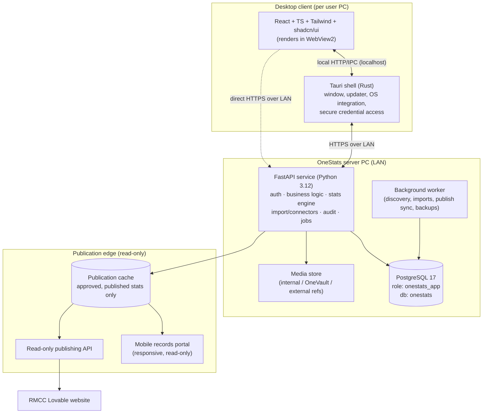

# 2. Technical Architecture

**Deliverable 2 of 38**

## 2.1 Goals and constraints

OneStats must be professional, reliable, secure, accurate, easy to use and scalable,
maintainable by a **small team working with Claude Code**, and must *not* introduce
unnecessary infrastructure. It runs primarily as a **Windows desktop application** with
a **central Windows server** that other desktop clients on a LAN can connect to, plus a
**read-only mobile/web portal** and **website publishing**. The database must never be
exposed to the public internet and the app must use the least-privilege `onestats_app`
role.

## 2.2 Layered architecture (recommended)

**Why a FastAPI service rather than all-in-Rust/Tauri?** The statistics engine,
importers, audit rules and NLP for Ask OneStats are Python-shaped and iterate fastest in
Python with Claude Code; a single service also makes the multi-client LAN topology
natural (clients share one authoritative brain and database). Tauri remains the
desktop shell (native window, auto-update, OS keychain access, packaging) and renders
the React UI. `[DECISION D1]` — see deliverable 37.

## 2.3 Component responsibilities

| Component | Responsibility | Does **not** do |
|---|---|---|
| **Tauri shell (Rust)** | Window/lifecycle, auto-update, OS keychain (DB creds, tokens), file dialogs, packaging/installer, sidecar lifecycle on a single-PC install | Business logic, SQL, stats |
| **React UI** | All screens (§4 six sections), scorecard grid, report rendering, theming | Authoritative calculation |
| **FastAPI service** | AuthN/Z, workspace scoping, CRUD, the **one** statistics engine, imports/connectors, audit engine, publishing, job orchestration | Direct DB admin as superuser |
| **Background worker** | Long jobs: online discovery + **web scraping/OCR** (deliverable 18), batch imports, publish sync, scheduled research tasks, scheduled backups, integrity sweeps | User-facing requests |
| **PostgreSQL 17** | System of record; constraints enforce integrity; row-level workspace scoping | Hold plaintext secrets |
| **Publication cache** | Serves approved published stats to portal/website independently of the server | Expose draft/disputed/private data |

## 2.4 Deployment topologies

1. **Single-PC install** — Tauri app + bundled FastAPI **sidecar** + local PostgreSQL on
   one machine. The Rust shell starts/stops the Python sidecar. Simplest; the RMCC
   starting point.
2. **Client/server (LAN)** — one server PC runs PostgreSQL + FastAPI + worker;
   additional desktop clients connect over HTTPS on the LAN. Matches §30 "Set up new
   system" / "Connect to existing system".
3. **Publication edge** — the publication cache + read-only API + portal can run on the
   server PC or be pushed to a small host so the public site survives server downtime
   (§28). See [29-website-publishing.md](29-website-publishing.md).

Packaging the FastAPI service: bundle via PyInstaller as a Tauri sidecar binary (no
system Python dependency for end users). `[DECISION D7]`.

## 2.5 Cross-cutting concerns

- **Workspace isolation** — every domain table carries `workspace_id`; every service
  query is scoped through a single data-access layer; PostgreSQL Row-Level Security as
  defence-in-depth. [06-workspace-isolation.md](06-workspace-isolation.md).
- **Permissions** — role + granular permission checks in the service layer on every
  mutating and sensitive read path. [07-permissions-matrix.md](07-permissions-matrix.md).
- **Audit** — append-only audit log for verified-record changes, imports, merges,
  branding, user admin, publishing. [33-security-and-privacy.md](33-security-and-privacy.md).
- **Provenance & integrity** — unknown ≠ zero (nullable + explicit "unknown"
  semantics), source references on records, no double counting in the engine.
  [22-statistics-engine.md](22-statistics-engine.md).
- **Secrets** — DB credentials and provider tokens stored via the OS credential store
  (Windows Credential Manager through Tauri/`keyring`), never in code, config or logs.
- **Observability** — structured logging, job progress, import/publish logs, health
  endpoint.

## 2.6 Data flow examples

- **Scorecard entry → stats**: UI grid → FastAPI validates → writes normalised innings/
  batting/bowling/fielding rows (workspace-scoped) → verification workflow → stats engine
  reads only verified data on demand (materialised/cached where needed).
- **Import**: connector/importer → staging tables → validation + identity matching →
  admin preview/approval → promotion into canonical records with source attribution.
- **Publish**: approved reports → publication cache (snapshot) → read-only API → website/
  portal; offline queue + retry if the edge is unreachable.

## 2.7 Technology choices (summary; full assessment in deliverable 3)

| Concern | Choice | Rationale |
|---|---|---|
| Desktop shell | **Tauri 2 (Rust)** | Small installer, native Windows integration, WebView2 present, secure sidecar + keychain |
| UI | **React + TypeScript + Tailwind + shadcn/ui** | Fast, accessible, consistent design system; good for data-dense grids |
| Backend | **Python 3.12 + FastAPI** | Best fit for stats/import/NLP; async; typed via Pydantic |
| DB | **PostgreSQL 17** | Already provisioned; constraints, RLS, JSONB for provenance, strong SQL for stats |
| ORM / migrations | **SQLAlchemy 2 + Alembic** | Mature; migrations are Phase 2+, not Phase 1 |
| Jobs | **In-process async + lightweight queue (APScheduler / DB-backed)** | No heavy broker; small-team friendly |
| Packaging | **Tauri bundler + PyInstaller sidecar** | Single installer, no user-managed Python |

No microservices, no Kubernetes, no external message broker, no cloud dependency are
introduced in the core product (cloud remains an optional future phase).
