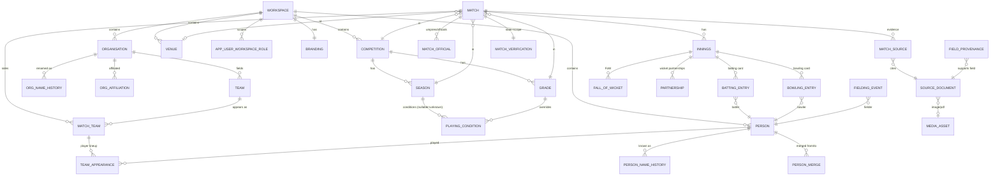

# 5. Database Entity-Relationship Design

**Deliverable 5 of 38** · PostgreSQL 17

Conceptual/logical design only. **No schema, DDL or migrations are created in Phase 1.**
This is the target model; column lists are indicative, not final DDL. All integrity
rules from §33 are baked into the design.

## 5.1 Design principles (enforced by the schema)

1. **Workspace isolation** — every domain table has a non-null `workspace_id`
   FK → `workspace(id)`; composite uniqueness is always scoped by workspace; RLS as
   defence-in-depth. See [06-workspace-isolation.md](06-workspace-isolation.md).
2. **Unknown ≠ zero** — numeric facts that may be historically unknown are
   **nullable**, with explicit "unknown" distinct from a recorded `0`. Partial scope is
   recorded, never zero-filled. Boolean "knownness" flags where ambiguity matters.
3. **Provenance preserved** — source references, original evidence links and
   field-level provenance are first-class, not afterthoughts.
4. **No destructive overwrite of verified data** — verification state + append-only
   audit + change history.
5. **No double counting** — normalised innings/performance rows; derived stats are
   computed, never stored as the source of truth.
6. **Surrogate keys** — UUID primary keys everywhere; natural keys become
   workspace-scoped unique constraints.
7. **Imported-source provenance** — every importable entity carries a `source_system` +
   `source_ref` (e.g. Cricket Statz `MatchID`/`PlayerID`/`TeamID`/`InningsID`), so imports
   are **idempotent** (re-import matches on `source_ref` → no duplicates) and every record
   traces to its origin. Confirmed necessary by the real Cricket Statz JSON (deliverable
   16a), whose IDs are internally consistent and worth preserving.

## 5.2 Domain map

## 5.3 Core entities (indicative columns)

### Workspace & access
- **workspace**: `id`, `name`, `short_name`, `type`(club|association|international|custom),
  `status`, `created_at`.
- **branding**: `workspace_id`, `primary/secondary/third/fourth_colour`, `accent_colour`,
  `logo_media_id`, `alt_logos`(jsonb), `theme_mode`, `presets`(jsonb), `tagline`.
- **app_user**: `id`, `username`, `display_name`, `status`, `auth_ref` (hash/credential
  reference — never plaintext).
- **role**, **permission**, **role_permission**, **app_user_workspace_role**
  (user × workspace × role; supports multiple roles per user + custom roles).
  See [07-permissions-matrix.md](07-permissions-matrix.md).

### Organisations & structure
- **organisation**: `id`, `workspace_id`, `name`, `short_name`, `kind`
  (club|association|intl_team|historical_club), `is_historical`.
- **org_name_history**: `organisation_id`, `name`, `valid_from`, `valid_to` (nullable=open/unknown).
- **org_affiliation**: historical affiliations between orgs, time-bounded.
- **team**: `id`, `workspace_id`, `organisation_id`, `program`
  (seniors|juniors|womens|girls|all_abilities|veterans|custom), `name`.
- **venue**, **competition**, **division**, **grade**, **season**.
- **playing_condition**: scoped by competition/season/grade with match overrides;
  `max_players` (default 15 for junior/girls, nullable where **unknown**),
  `overs_limit`(nullable), `conditions`(jsonb). **Null = unknown, not unlimited/zero.**

### People & identity
- **person**: `id`, `workspace_id`, `display_name`, `dob`(nullable, protected),
  `dob_precision`(exact|year|unknown), `is_junior_flag`, `notes`.
- **person_name_history**, **person_role** (player/captain/umpire/coach/official/
  committee/life_member/honorary — many per person), **person_affiliation**.
- **person_merge**: controlled, reversible merge events (`canonical_person_id`, merged
  `person_id`s, `actor`, `reason`, `at`, undo snapshot). **Never auto-merge uncertain
  identities.**
- **person_source_identity**: every original source identity → a person (`person_id`,
  `source_system`, `source_ref` e.g. CS `PlayerID`, `source_display_name`). A person holds
  **many**; all original IDs + scorecard display names **retained unchanged**; stats resolve
  a source record to its `person_id`. Drives idempotent re-import (multiple source IDs → one
  person) — deliverables 12 §12.3a, 16.
- **person_distinct_assertion**: "DEFINITELY DIFFERENT — DO NOT MERGE" between two
  `person_id`s (`actor`, `reason`, `at`); suppresses auto-suggestions, reviewable,
  revocable.

### Matches & scorecards (normalised — prevents double counting)
> Field set validated and extended against the real Cricket Statz UI + JSON (deliverables
> 16, 16a). **Match *type* (innings per side) is distinct from *classification*** and
> **statistical inclusion is distinct from verification** (both learned from CS evidence).
- **match**: `id`, `workspace_id`, `competition_id`, `season_id`, `grade_id`, `venue_id`(nullable),
  `match_date`(nullable precision), `match_type`(innings-per-side: 1|2|…, **distinct from
  classification**), `classification`(home_away|final|grand_final, nullable=unknown),
  `is_final`(bool, preserved separately), `is_grand_final`(bool, preserved separately),
  `result_type`(win|loss|draw|tie|abandoned|forfeit|no_result|unknown),
  `result_subtype`(nullable), `balls_per_over`(nullable), `is_multi_day`,
  `toss`(jsonb nullable: winner/unknown/uncontested), `dl`(jsonb nullable: revised target/
  overs/abandoned-by-DL), `include_in_statistics`(bool — **separate from verification**,
  mirrors CS "exclude from stats"), `requires_attention`(bool), `source_system`,
  `source_ref`.
- **match_team**: `match_id`, `team_id`, `home_away`, `is_winner`(nullable=unknown),
  `result_margin`(jsonb nullable: runs/wickets), `competition_points`(nullable),
  `captain_person_id`(nullable), `acting_captain_person_id`(nullable),
  `captain2_person_id`(nullable — **CS "Captain2"; role unresolved, not auto-credited**),
  `wicketkeeper_person_id`(nullable), `wicketkeeper2_person_id`(nullable — CS "Keeper2").
- **team_appearance**: `match_team_id`, `person_id`, `batting_order`(nullable),
  `played`(bool) — the canonical "who played" list (drives Most Matches, Played Together).
- **innings**: `match_id`, `batting_team_id`, `innings_seq`, `total_runs`(nullable,
  **derived**), `wickets`(nullable, derived), `overs`(nullable), `max_overs`(nullable),
  `byes`,`leg_byes`,`wides`,`no_balls`,`penalty_runs`(each nullable), `innings_result`
  (coded, nullable), `override_runs`(nullable), `override_wickets`(nullable),
  `declared`, `forfeited`, `is_complete`.
- **batting_entry**: `innings_id`, `person_id`, `position`(nullable), `runs`(nullable),
  `balls`(nullable=unknown), `dots`(nullable), `fours`(nullable), `sixes`(nullable),
  `minutes`(nullable), `how_out`(dnb|not_out|bowled|caught|caught_behind|caught_and_bowled|
  lbw|run_out|stumped|hit_wicket|obstructing|hit_twice|timed_out|retired_out|
  retired_not_out|retired_unspecified|unknown_out), `how_out_source_code`(int — **original
  CS code preserved**), `bowler_person_id`(nullable), `fielder_person_id`(nullable).
- **bowling_entry**: `innings_id`, `person_id`, `overs`(nullable, cricket-over notation),
  `maidens`(nullable), `dots`(nullable), `runs_conceded`(nullable), `wickets`(nullable),
  `wides`, `no_balls`, `dropped_catches`(nullable), `hat_tricks`(nullable) — a row with
  `overs=0, wickets=0` denotes a **fielder-only** appearance (CS combined bowler/fielder).
- **fall_of_wicket**: `innings_id`, `wicket_no`, `runs`, `person_out_id`, `over`(nullable),
  `is_list_incomplete`(bool). Reconstructable from CS `FOWPos`/`FOW`/`FOWBatID` (16a.10).
- **partnership**: `innings_id`, `wicket_no`, `person_a_id`, `person_b_id`,
  `runs`(nullable), `balls`(nullable), `unbroken`(bool) — stored for provenance where
  recorded; otherwise derived by the engine (see deliverable 25).
- **match_official**: `match_id`, `person_id`, `role`(umpire|scorer|referee).

### Verification, provenance, audit, media
- **match_verification**: `match_id`, `state`
  (draft|researching|ready_for_review|verified|verified_partial|disputed),
  `verified_scope`(jsonb — exact verified portion for *partial*), `verified_by`, `verified_at`.
- **source_document**: `id`, `workspace_id`, `kind`
  (newspaper|scorebook|website|import|oral|other), `title`, `publication_date`(nullable,
  **separate from match date**), `citation`, `copyright_info`, `media_asset_id`(nullable).
- **match_source** / **field_provenance**: link records (and individual fields) to the
  source(s) that support them; supports conflicting-evidence comparison.
- **media_asset**: `id`, `workspace_id`, `storage_provider`
  (internal|onevault|external_ref), `stable_media_id`, `mime`, `original_quality`,
  `copyright_info`, `significance`, `checksum`. **Originals never auto-deleted.**
- **audit_log**: append-only; `actor`, `action`, `entity`, `entity_id`, `before`/`after`
  (jsonb), `workspace_id`, `at`. Covers verified changes, imports, merges, branding,
  user admin, publishing.

### Import, discovery, publishing
- **import_batch**, **import_staging_record** (raw → mapped → validated → approved),
  **connector_config** (provider, token *reference* only), **discovery_job**
  (status, progress, resume cursor), **publication_snapshot**,
  **publish_log** (sync/retry/withdrawal).

### Research & discovery (scraping + timeline — deliverables 18, 19)
- **source_adapter_config**: a scrapeable source — `name`, `base_url`, access terms
  (`robots`/`licence`/`rate_limit`), supported search dimensions, `enabled`. No credentials
  for gated sources (those are not scraped).
- **research_project**: `workspace_id`, scope (club/player/competition/season/date-range +
  aliases), schedule, status, owner.
- **discovery_candidate**: an extracted item — `research_project_id`, `source_url`,
  `publication_details`, `retrieved_at`, raw snippet/image ref, extracted fields (jsonb),
  **`confidence`**, `ocr_text`(nullable) + `ocr_confidence`, `review_state`
  (awaiting|approved|rejected|deferred). Feeds `import_staging_record` on approval.
- **research_task**: `research_project_id`/gap ref, `priority`, `status`
  (open|in_progress|resolved), assignee, notes — auditable decision history.
- **season_coverage_assessment**: `workspace_id`, scope (competition/grade/team/season),
  `class`(comprehensive|partial|significant_gaps|unassessed|inactive), coverage inputs
  (jsonb: fixtures/scorecards/records/evidence counts), `method_version`, `assessed_at`.
  **Unassessed when evidence is insufficient** (never a fabricated %); `inactive` only with
  evidence (distinct from Unassessed). Recalculated after approved imports/corrections/
  findings; every change written to **audit_log**.

## 5.4 Integrity enforcement at the DB layer

| Rule | Mechanism |
|---|---|
| Workspace scoping | `workspace_id` NOT NULL + composite FKs + RLS policies |
| Unknown ≠ zero | nullable numerics + precision/knownness enums; no `DEFAULT 0` on historical facts |
| No duplicate batter/bowler in an innings | partial unique indexes (where names known) + audit rules (deliverable 15) |
| Verified not silently overwritten | state machine guard + audit triggers + change history |
| Valid enums/ranges | CHECK constraints (overs ≥ 0, wickets 0–10, result types) |
| Referential integrity | FKs with sensible ON DELETE (RESTRICT for referenced people/matches) |
| No double counting | derived stats computed by the engine, never persisted as source |

## 5.5 Indexing & performance (direction, not final)

- Composite indexes leading with `workspace_id`.
- Covering indexes for hot stat paths: `(workspace_id, person_id)` on batting/bowling
  entries; `(workspace_id, season_id, grade_id)` on matches.
- Materialised views for expensive aggregates (career totals, leaderboards), refreshed
  on verification events — measured before adopting (deliverable 22).

## 5.6 Reference / seed data (non-production)

Enum lookup tables (roles, programs, how_out, result_type, source kinds) and RMCC
competition/grade templates ship as reference seed in `packages/db-schema/` — **no real
player or match data in the repo**.
