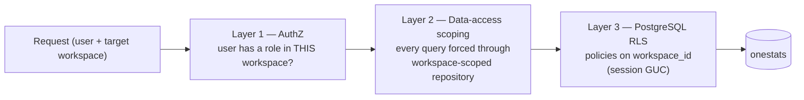

# 6. Workspace Isolation Architecture

**Deliverable 6 of 38**

Workspaces (RMCC, International Cricket, future) are **fully independent**: separate
organisations, competitions, people, matches, statistics, research, media, users/
permissions, branding, imports and publishing settings (§5). Isolation is enforced at
**both the server and the database access layers** (§5 hard requirement).

## 6.1 Chosen model — single database, row-scoped, defence-in-depth `[DECISION D2]`

| Option | Isolation | Ops cost | Cross-workspace (super admin) | Verdict |
|---|---|---|---|---|
| **A. Single DB, `workspace_id` on every row + RLS** | Strong (if enforced consistently) | Low | Easy | ✅ **Recommended** |
| B. Schema-per-workspace | Stronger physical | Medium (migrations × N) | Harder | ⚠️ fallback |
| C. Database-per-workspace | Strongest physical | High | Hardest | ❌ overkill for small team |

Recommendation **A**: lowest operational burden for a small team, simplest super-admin
management across workspaces, and strong enough when isolation is enforced in **three
layers** below. Fallback to B only if a workspace demands physical separation.

## 6.2 Three enforcement layers

1. **Authorization (service):** the request carries the authenticated user + the target
   `workspace_id`. The service rejects any user without an active role in that workspace
   before touching data. Super Administrator is the only cross-workspace role.
2. **Data-access scoping (service):** a single repository/session layer sets the current
   workspace and **injects `workspace_id` into every read and write**. No domain query
   bypasses it. Reviews/tests assert no raw cross-workspace query exists.
3. **Row-Level Security (database):** PostgreSQL RLS policies on every domain table key
   off a session setting (`SET onestats.workspace_id = ...`) that the connection layer
   sets per request. Even a coding mistake in layer 2 cannot leak rows. The super-admin
   path uses a dedicated, audited elevated mode.

The app always connects as **`onestats_app`** (non-superuser); RLS applies to it.
`BYPASSRLS` is never granted to the app role.

## 6.3 Super Administrator cross-workspace access

- Only the Super Administrator creates/onboards workspaces (§6) and may operate across
  them.
- Cross-workspace actions run through an explicit, **audited** elevated code path (not
  by relaxing RLS globally). Each cross-workspace read/write is logged with actor +
  reason.
- No ordinary role can target a workspace it has no membership in.

## 6.4 What is isolated

Per-workspace and never shared: organisations, teams, venues, competitions, seasons,
grades, people, matches, scorecards, statistics, research, source documents, media,
branding, import configs/history, discovery jobs, publishing settings, and
workspace-scoped users' roles. Global (shared) objects are limited to: the user
identity registry, role/permission definitions (custom roles are workspace-scoped), and
system reference enums.

## 6.5 Media & publishing isolation

- Media assets carry `workspace_id`; internal storage partitions by workspace; OneVault/
  external references are resolved per-workspace.
- Each workspace has independent publishing settings and its own publication snapshot;
  one workspace's data can never appear on another's published site.

## 6.6 Testing the boundary (ties to deliverable 34)

- Automated tests attempt cross-workspace reads/writes as each role and assert denial at
  layers 1–3.
- A "no unscoped query" lint/review gate in CI.
- RLS policy tests (e.g. pgTAP) verify rows are invisible without the correct session
  workspace.

## 6.7 RLS enforcement & role separation (user-approved plan — Phase 3) `[DECISION D2a]`

Refined per the Phase 2 review. Three parts:

### FORCE RLS where appropriate
Workspace-scoped domain tables use **`FORCE ROW LEVEL SECURITY`** so that **even a table
owner is subject to the policy** (owners bypass plain RLS). This closes the gap noted in the
Phase 2 foundation (the v1 scaffold enables RLS but not FORCE). Global/shared tables (user
registry, reference enums) are not force-scoped.

### Transaction-scoped workspace context
The current workspace is set with **`SET LOCAL onestats.workspace_id = ...` inside each
request's transaction** (not a session-wide `SET`), so the GUC cannot leak between pooled
connections or requests. The data-access layer opens a transaction, sets the workspace,
runs the work, and the setting is discarded at commit/rollback. A missing/empty GUC yields
**no rows** (the policy's `NULLIF(...)::uuid` comparison fails closed).

### Separate migration ownership from the runtime role `[DECISION D24]`
Investigated and adopted as the target model:

| Role | Owns tables? | Privileges | RLS |
|---|---|---|---|
| **`onestats_migrator`** (or the DB owner) | **Yes** | DDL (migrations) | runs migrations; not used at runtime |
| **`onestats_app`** (runtime) | **No** | granted DML only (SELECT/INSERT/UPDATE/DELETE), `USAGE` on schema | **always subject to RLS** (non-owners cannot bypass) |

Because the runtime `onestats_app` **does not own** the tables, RLS applies to it without
relying on FORCE, and it cannot `ALTER`/`DROP` protected tables or disable policies —
least privilege by construction. FORCE is still set so that administrative/owner access is
also policy-bound. Migrations are applied by the migrator/owner role; the app connects only
as the non-owner runtime role.

> **Phase 2 status:** the foundation currently has `onestats_app` owning the `onestats`
> database (it created the v1 tables), and RLS is enabled but not forced. Moving to the
> owner/runtime split and `FORCE` is a **Phase 3** task (it needs a superuser to create the
> migrator role and re-grant), done before any domain tables carry real data. Creating that
> role requires explicit user action (superuser) and is not performed automatically.
