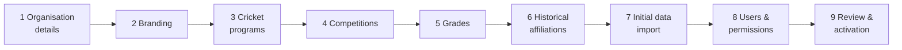

# 8. Workspace Onboarding Specification

**Deliverable 8 of 38**

Only the **Super Administrator** can create and onboard a workspace (§6). Onboarding is a
guided, resumable wizard with optional steps and templates (club / association /
international).

## 8.1 Wizard steps

| Step | Collects | Optional? | Template-prefilled |
|--:|---|:--:|:--:|
| 1 Organisation details | name, short name, type (club/assoc/intl/custom), tagline | no | yes |
| 2 Branding | colours, logos, theme (deliverable 9) | yes | yes |
| 3 Cricket programs | Seniors/Juniors/Women's/Girls'/All Abilities/Veterans/custom | no | yes |
| 4 Competitions | competitions/divisions the org plays in | yes | yes |
| 5 Grades | grades per competition; junior/girls default max 15 players | yes | yes |
| 6 Historical affiliations | prior names, affiliations, historical clubs | yes | — |
| 7 Initial data import | Cricket Statz / PlayHQ / manual (to staging, approved later) | yes | — |
| 8 Users & permissions | invite users, assign workspace roles | yes | — |
| 9 Review & activation | summary + activate workspace | no | — |

## 8.2 Save / resume

- Each wizard run is a persisted **onboarding draft** (state per step, jsonb). The admin
  can leave and resume; nothing is committed to canonical tables until activation.
- Optional steps can be skipped and completed later from Settings.

## 8.3 Templates

- **Club** (RMCC default): seniors + juniors programs, typical grade structure,
  home/away + finals + grand final classifications.
- **Association:** multiple member clubs, competitions/divisions, representative teams.
- **International Cricket:** national teams, formats (Test/ODI/T20), no club grades;
  different reporting defaults.

Templates prefill steps 1,3,4,5 and report/threshold defaults; everything remains
editable.

## 8.4 Historical correctness at onboarding

- Historical affiliations and prior names are captured as **time-bounded** records
  (deliverable 11), never flattening history into the current name.
- Unknown historical playing conditions remain **unknown** (null), not defaulted.
- Initial import lands in **staging** and follows the normal import approval path
  (deliverables 16–17); onboarding never bulk-promotes unverified data.

## 8.5 Activation

On step 9, the workspace is created with its org, programs, competitions, grades,
branding and user roles. Activation is audited. The workspace then appears for its
assigned users. Deactivation/archival of a workspace is a separate Super-Admin action
(data retained, access suspended).
