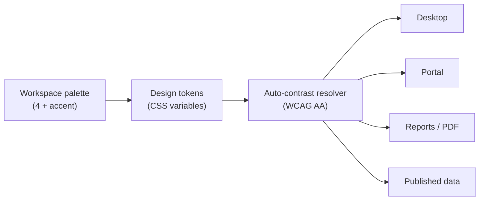

# 9. Branding and Theme Specification

**Deliverable 9 of 38**

Per-workspace branding (§7) applied consistently across the desktop app, mobile portal,
reports, PDF exports and website-publishing data. Only authorised users
(Super/Workspace Admin) may change it (deliverable 7).

## 9.1 Branding model

| Field | Notes |
|---|---|
| Primary / Secondary / Third / Fourth colour | Up to four official colours (HEX) |
| Accent colour | Separate, for calls-to-action/highlights |
| Theme mode | Light / Dark (both derived from the palette) |
| Background settings | Per-theme background |
| Logo + alternative logos | Upload; alt logos for dark bg, square/wordmark, favicon |
| Organisation name / short name / tagline | Tagline optional |
| Presets | Save/name theme presets; reset to default |

Stored in `branding` (deliverable 5), logos as `media_asset`s.

## 9.2 Colour input & assistance

- **HEX entry** and a **visual colour picker**.
- **Suggested colours extracted from the uploaded logo** (dominant-colour extraction) —
  offered, never forced.
- **Live theme preview** across sample screens (dashboard, scorecard, report).
- **Theme presets** and **reset to default**.

## 9.3 Automatic readable-text contrast (accessibility)

- Text/foreground colours are **computed** against their background to meet **WCAG 2.1
  AA** (≥ 4.5:1 body, ≥ 3:1 large text). The system picks light/dark foreground per
  surface automatically; admins cannot ship an unreadable combination (warned +
  auto-corrected).
- Implemented as design tokens (CSS custom properties) with a contrast function, so the
  same tokens drive desktop, portal, reports and PDFs.

## 9.4 Where branding applies

Desktop app chrome, mobile portal, generated reports, PDF/Excel exports (headers/logos/
colours), **player profiles** ([12a](12a-player-profile-and-badges.md) — profiles are
workspace-themed, never hardcoded to a club; the observed RMCC navy/gold is just one
workspace's theme), and the branding payload included in **published** website data (the
website renders it; OneStats supplies tokens + logos). Draft/disputed data is never
published (deliverable 29).

## 9.5 Theming engine notes

- Tailwind configured to read CSS variables so a workspace switch re-themes instantly.
- Dark mode is a token set, not a separate stylesheet.
- shadcn/ui components consume the tokens → consistent, accessible UI (§33).
