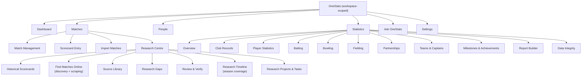

# 10. Application Navigation and Screen Map

**Deliverable 10 of 38**

Six primary sections (§4), clean and consistent, minimal menu depth.

## 10.1 Primary navigation

A persistent **workspace switcher** (and, for Super Admin, workspace management) sits in
the top bar with branding (logo + colours).

## 10.2 Section responsibilities

| Section | Key screens | Notes |
|---|---|---|
| **Dashboard** | KPIs, recent matches, verification queue, integrity alerts, milestones due | Entry point; respects permissions |
| **Matches** | Match Management (list/filter/CRUD), **Scorecard Entry** (spreadsheet grid), Import Matches, Research Centre | Scorecard grid is the flagship UX (deliverable 13) |
| **People** | People registry, **player profiles** (hero, stat cards, Service & Honours, Story, milestone badges — [12a](12a-player-profile-and-badges.md)); **Player Management → Find & Merge Duplicates** (compare, preview-merge, authorised merge, undo/split, "Definitely Different") | Junior/DOB protected; merge is permission-gated (deliverable 12 §12.3a); profiles workspace-branded |
| **Statistics** | Overview, Club Records, Player Statistics, Batting, Bowling, Fielding, Partnerships, Teams & Captains, Milestones & Achievements, Report Builder, Data Integrity | All from the one engine (deliverable 22) |
| **Ask OneStats** | NL query box, results with supporting records + qualifications | Deterministic answers only |
| **Settings** | Workspace, branding, programs/competitions/grades, playing conditions, users & permissions, publishing, media/storage, import connectors, backups | Permission-gated |

## 10.3 Navigation principles

- Max two levels of menu before a working screen; deep tasks use in-screen tabs, not
  more nav.
- Consistent layout: left/top nav + content + contextual right panel (sources,
  validation, audit) where useful.
- Keyboard-first on data-entry screens (deliverable 13): tab/enter/arrow navigation,
  autosave.
- State in the URL/route per section so deep links and "back" behave predictably.
- Permission-aware: disallowed sections/actions are hidden (enforcement is server-side).

## 10.4 Scorecard Entry screen (flagship) — outline

Spreadsheet-style grid: innings tabs; batting card rows (batter, how out, bowler/
fielder, R/B/4s/6s); bowling card rows; extras; fall of wickets; result/margin; match
metadata (captains, keeper, umpires, classification, conditions); source/evidence panel.
Create-player-inline (no separate Playing XI screen). Autosave to **draft**; validation
surfaces integrity warnings live (deliverable 15). Unknown values enter as explicit
unknown, never 0.

A separate **read-only scorecard / match-report view** presents the finished match
(header, result, toss, officials, per-batter dismissal lines with strike rate where known,
extras, innings totals, fall of wickets, bowling figures with economy, match summary). Its
information design is specified from the real Cricket Statz report in
[16a-cricket-statz-json-analysis.md](16a-cricket-statz-json-analysis.md) §16a.13 — OneStats'
visual design is its own, and all figures come from the one engine (deliverable 22).
