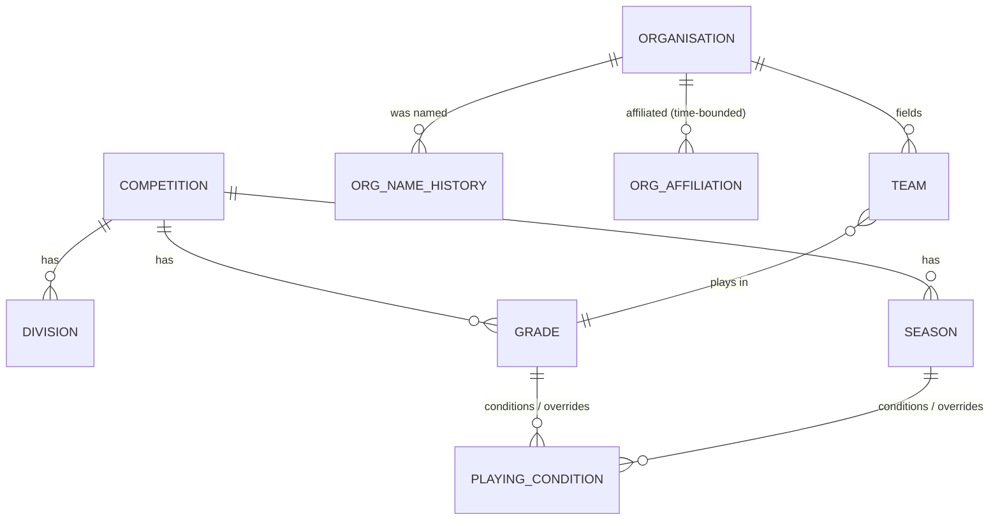

# 11. Cricket Organisation Data Model

**Deliverable 11 of 38**

Models clubs, associations, international teams, historical clubs/names/affiliations,
teams, venues, competitions, divisions, grades, seasons and playing conditions (§8). All
workspace-scoped (deliverable 6). Builds on the ERD (deliverable 5).

## 11.1 Entities

| Entity | Purpose | Key points |
|---|---|---|
| organisation | Club / association / international team / historical club | `kind`, `is_historical` |
| org_name_history | Prior names over time | time-bounded (`valid_from`/`valid_to` nullable=unknown) |
| org_affiliation | Historical affiliations between orgs | time-bounded; many-to-many |
| team | A side an org fields | `program`, belongs to one organisation |
| venue | Grounds | reusable across matches |
| competition | A competition/league | may belong to an association |
| division | Division within a competition | optional |
| grade | Grade within competition (e.g. A Grade, U14) | junior/girls default max 15 players |
| season | A season of a competition | date range; many per competition |
| playing_condition | Rules for competition/season/grade | overs limit, max players, format; **null = unknown** |

## 11.2 Relationships

## 11.3 Programs

Seniors, Juniors, Women's, Girls', All Abilities, Veterans/Masters, and **custom**
programs per workspace. A team is tagged with one program; reports can filter by program.

## 11.4 Playing conditions (unknown-aware)

- Configurable by **competition, season and grade**, with **match-specific overrides**
  (deliverable 13).
- Resolution order for a match: match override → grade → season → competition default.
- **Junior and Girls' grades default to max 15 players**, subject to the actual
  competition rules (editable).
- **Unknown historical playing conditions remain unknown** — stored as null, surfaced in
  the UI as "unknown", and the audit engine does not flag absence of a limit as an
  error when the condition is explicitly unknown (deliverable 15).
- **Rules are not hard-coded to "today".** Playing conditions and competition rules are
  stored **per competition/season/grade (with match overrides)**, so a rule that changed
  over the decades is resolved for each match by its own era's record — never by applying
  current rules retroactively across all seasons. Where a historical rule is unknown, it
  is recorded as unknown, and OneStats does **not invent** RMCC competition rules.

## 11.5 Historical correctness

- An organisation's name at the time of a match is resolved from `org_name_history`, so
  historical scorecards and records show the period-correct name while the canonical
  organisation stays single.
- Affiliations (e.g. a club that merged/renamed) are modelled as relationships over
  time, never by overwriting the organisation.
- Historical/defunct clubs are first-class organisations (`is_historical = true`),
  allowing matches and records against teams that no longer exist.
