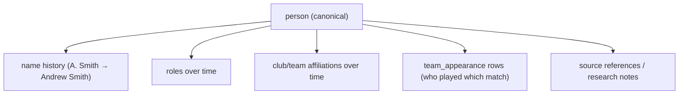

# 12. People and Identity Model

**Deliverable 12 of 38**

A canonical **People registry per workspace** (§9) with historical names, affiliations,
multi-role history, media, research notes and source references, plus **controlled**
identity merging that never auto-merges uncertain historical identities.

## 12.1 Core model

| Entity | Purpose |
|---|---|
| person | Canonical person in a workspace |
| person_name_history | Names a person was known by, time-bounded |
| person_role | Roles held (player, captain, umpire, coach, official, committee, Life Member, Honorary) — many per person, time-bounded |
| person_affiliation | Club/team affiliations over time |
| person_merge | Audited, reversible merge record (surviving ↔ merged) |
| field_provenance | Source references on biographical fields |

`person` holds `dob` (nullable), `dob_precision` (exact|year|unknown) and an
`is_junior` flag — both **protected** (deliverables 24, 33). A person may simultaneously
be player, captain and committee member.

## 12.2 Identity, names and history

- Playing/captaincy/umpiring history is **derived** from `team_appearance`,
  `match_team` (captain/keeper) and `match_official` rows — not duplicated on the person
  (no double counting).
- Historical names let a scorecard show the period name while statistics attribute to
  the canonical person.

## 12.3 Controlled identity merging (§9 hard rule)

- Merges are **proposed** (Researcher/People Manager/Reviewer) and **approved/executed**
  only by Reviewer/Admin with explicit identity-merge permission (deliverable 7).
- A merge records `surviving_id`, `merged_id`, actor, reason, timestamp and the moved
  references; it is **reversible** and fully audited.
- **Never auto-merge uncertain identities.** Automated matching may only *suggest*
  candidates with a confidence score and the evidence; a human decides.
- Split/unmerge is supported to correct a wrong merge without losing provenance.

## 12.3a Player Identity Management — Find & Merge Duplicates `[CONFIRMED REQUIREMENT]`

A first-class feature (not optional), located at **People → Player Management → Find &
Merge Duplicates**. Designed into the schema **before Phase 2** so identities can be
corrected safely for the life of OneStats. Confirmed by two real Cricket Statz examples:

| Example (same club) | Source records | Confirmed truth |
|---|---|---|
| **"Bonner A"** (Swifts/Great Western) | `3555610` "A Bonner", `3569462` "Ashton Bonner" | **Different people — keep separate** (mark *Definitely Different*) |
| **"Walker D"** (Rhymney/Moyston) | `361787` "Daniel Walker" (236 appearances), `362652` "D Walker" (4 appearances) | **Same person — eligible to merge** |

**Principle:** matching names/initials **alone can never determine identity** — they only
*suggest*; evidence decides; nothing merges automatically.

### Model (schema, deliverable 5)

- **person** — the canonical OneStats identity (one `person_id`).
- **person_source_identity** — every original source identity mapped to a person:
  `person_id`, `source_system`, `source_ref` (e.g. CS `PlayerID`), `source_display_name`.
  A person may hold **many** source identities; **all original IDs and scorecard display
  names are retained unchanged**. Statistics always resolve a source record → its
  `person_id`.
- **person_merge** — audited, reversible merge event: `canonical_person_id`, the set of
  merged `person_id`s + their source identities, actor, reason, timestamp, snapshot for
  undo.
- **person_distinct_assertion** — "DEFINITELY DIFFERENT — DO NOT MERGE" between two
  `person_id`s: actor, reason, timestamp; suppresses future auto-suggestions; reviewable;
  revocable when new evidence emerges.

### 1. Find possible duplicates (suggest, never auto-merge)

Candidate suggestions scored from a **combination** of: names/initials, club & team
history, seasons/playing dates, historical affiliations, existing Cricket Statz IDs, and
supporting source evidence. A name match alone yields a low-confidence suggestion only.
Pairs marked *Definitely Different* are excluded from suggestions.

### 2. Compare player records (side by side)

Names & aliases · original Cricket Statz IDs · club/team history · seasons/grades · match
appearances · batting/bowling/fielding performances · conflicting information · supporting
evidence.

### 3. Preview merge (recalculated, not summed)

Shows the proposed canonical profile, the source identities being combined, **career
statistics recalculated from the underlying match records** (never by adding previously
calculated career totals — avoids double counting, deliverable 22), overlapping
appearances/conflicts, records needing manual resolution, and the potential effect on
existing reports.

### 4. Authorised merge

Only users with **identity-merge permission** (deliverable 7) may confirm, after
confirming the intended records. Preserves **every** original CS player ID, original and
scorecard display names, historical affiliations, source references, original performance
records, and a **complete merge audit history**. The merged profile uses **one canonical
`person_id`** while retaining all source identities.

### 5. Conflict handling (same-match safety)

If two source records appear in the **same match**, performances are **not** auto-combined.
The system determines whether they are separate appearances, duplicate imported data, or an
unresolved conflict, and **blocks finalisation** where a merge would create impossible or
contradictory match participation (e.g. one person batting in two positions in one
innings). An authorised reviewer resolves with evidence. (The two "Bonner A" in one innings
are a case that must **not** be merged.)

### 6. Reversibility

An authorised **Undo Merge / Split Player** restores the original identity assignments
**without losing** match performances, source IDs or audit history (the merge snapshot
enables exact reversal).

### 7. Definitely Different

Users may mark two records **DEFINITELY DIFFERENT — DO NOT MERGE** (the "Bonner A" case).
Saved, audited, suppresses repeated auto-suggestions, remains reviewable by admins, and
**never blocks a legitimate correction** if new evidence later emerges.

### 8. Statistics after merge

All calculations use **canonical `person_id`s**. After a confirmed merge: recalculate
affected career statistics **from match records**, recalculate rankings/records, update
captaincy/partnerships/fielding combinations, refresh published data through the normal
approval process (deliverable 29), and **prevent duplicate match appearances from inflating
totals** (a person counted once per match even if two source IDs appeared).

### 9. Import integration

The Cricket Statz importer supports **multiple source player IDs → one OneStats person**.
On later imports, **previously confirmed identity mappings and Definitely-Different
assertions are reused** — resolved duplicates are never recreated (deliverable 16).

## 12.4 Identity matching during import

Importers (deliverables 16–17) match incoming names to existing people using name +
alias + context (team/season), producing ranked suggestions. High-confidence matches are
still presented for approval in import preview; low-confidence creates a new person or is
left for manual resolution. No silent merge.

### Realities from the real Cricket Statz export (deliverable 16a)

- **Preserve `source_ref`** (Cricket Statz `PlayerID`) on each person so re-import is
  idempotent and merges can be traced.
- **Unknown DOB sentinel** `1700-01-01` (3,576 of 3,595 players) → `dob = null`,
  `dob_precision = unknown`; **never** treated as a real birth date (deliverable 24). Only
  **19 players have a real DOB** (mostly current/active) — so age & longevity reports apply
  to a small minority and must be unknown-aware for everyone else.
- **Abbreviated historical names** (single-initial firstnames: "A", "B Webb", "D McCann")
  are high-ambiguity → flagged for human review, never auto-merged.
- **Duplicate `(firstname,lastname)`** pairs exist (e.g. "Matthew Dean" ×2) → imported as
  **distinct** people, never merged on name alone.
- **A shared display name or initials is NEVER, by itself, evidence of the same person**
  (user-confirmed). The real data has **two different players both shown "Bonner A"** in one
  innings (`PlayerID 3555610` and `3569462`). OneStats: preserves each unique source ID;
  keeps original display names; supports same-named players in the same match; keys **all
  batting/bowling/fielding/career statistics on `person_id`, never names**; flags a
  potential duplicate **only** with additional supporting evidence; and **never
  auto-merges** (deliverable 15).
- **Officials share the player ID space** (batter/bowler/official IDs resolve against
  players ∪ officials) → one import must reconcile both registries into the People model.
- The 3,595 players include **opposition players** (`MyClub` distinguishes RMCC `26267`);
  import must not assume club membership. 14 registry-only players (no appearances) are
  retained, not dropped.

## 12.5 Privacy

- Date of birth and junior information are hidden by default and shown only to permitted
  roles (deliverable 7 `[DECISION D3]`).
- Age-based rankings are **never** computed from uncertain birth dates (deliverable 24).
- Published/portal data excludes protected junior/private fields (deliverables 29–30).
