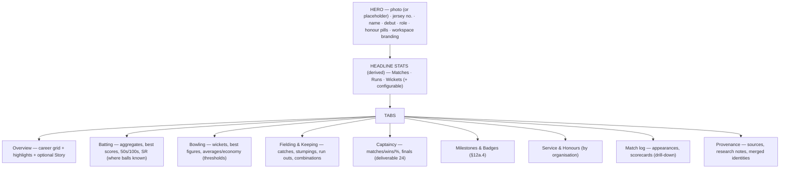

# 12a. Player Profile Design & Milestone Badge Catalogue

**Companion to deliverables 12 (people), 26 (milestones), 29 (publishing), 30 (mobile).**
Design input from the **real RMCC player-profile page** (inspected 2026-10-21):
`rhymneymoystoncc.com/players/39f68820-…` (Scotney Hayter). The page was accessed and
examined directly (layout, colours, typography, stat cards, honours, narrative, milestone
badges). OneStats reproduces the **information design and functionality**, not the RMCC
visual identity — it is **workspace-branded** (deliverable 9).

## 12a.1 Analysis of the existing RMCC profile

### Structure observed

| Zone | Content |
|---|---|
| Site chrome (nav) | Home · Media Centre · Player Profiles · Fixtures & Results · Life Members · Honorary Members · More · Availability · Login |
| Hero | Circular player photo (gold ring) · jersey number "5" · "PLAYER PROFILE" eyebrow · large name (serif) · **Club Debut: 2004** · **Role: Opening Batsman – Wicketkeeper** · pill badges (Life Member, Treasurer) |
| Headline stats | 3 cards: **188 Matches · 3,721 Runs · 46 Wickets** (gold numerals) |
| Sponsor | "PROUDLY SPONSORED BY — OpticOne Business Solutions" |
| Service & Honours | Grouped by organisation — **RMCC** (Life Member; Secretary 2007-08…; Treasurer 2010–2027; Vice Captain; Team of the Decade 2000-2009; Leading Run Scorer 2017-18; Premiership Player 2005-06 & 2007-08); **GCA** (President, VP, Secretary, Treasurer, Committee); **HCA** (Treasurer) |
| Career Statistics | 6-stat grid: Matches 188 · Runs 3,721 · Wickets 46 · Catches 88 · Stumpings 27 · Run Outs 18 |
| The Story | Narrative bio in themed sections: The Story · With the Ball · With the Bat · Behind the Stumps · Team Man · Leadership & Club Loyalty · Around the Club · The Verdict |
| Career Recognition | **Milestone Badges**, grouped (see §12a.4) |

### Visual design (for reference only — not to be copied)

- **Palette:** deep navy (~`#0f1f3d`) header/hero; **gold/amber** (~`#b8863b`) accents for
  numerals, headings and badge icons; cream/off-white content panels with a faint club-crest
  watermark.
- **Typography:** serif display for the player name and section headings; sans-serif for
  labels and body.
- **Badges:** circular navy discs with a gold emblem, a label and (where relevant) a year;
  grouped under category headers.

### Data-integrity note (important)

The live page shows **internal discrepancies**: headline "46 Wickets" vs narrative "43
wickets at 20.42"; "88 Catches" vs "around 90"; "3,721 Runs" vs "over 3,600 at 21.50".
This is exactly why OneStats derives every figure from **verified match records** via the
one engine (deliverable 22), shows a single reconciled number, flags conflicts
(deliverable 15), and uses **known-minimum** where data is incomplete — rather than
hand-keyed profile totals that drift.

## 12a.2 Retain vs exclude

| Existing element | OneStats decision |
|---|---|
| Hero (photo, number, name, debut, role, honour pills) | **Retain** — workspace-branded |
| Headline stat cards | **Retain** — but **derived from verified records** |
| Career Statistics grid | **Retain** — engine-derived; extend (batting/bowling/fielding/captaincy) |
| Service & Honours grouped by org | **Retain** — maps to `person_role`/honours (deliverables 9, 12) |
| Narrative "Story" | **Retain as optional** — a curated, authored bio field (clearly separate from computed stats; never a source of statistics) |
| Milestone Badges | **Retain + formalise** (§12a.4) — awarded from verified records |
| **Sponsor block ("OpticOne…")** | **Exclude from core**; make an **optional workspace-configurable** sponsor slot (publishing only) |
| **RMCC site chrome/nav, colours, crest, domain** | **Exclude** — replaced by OneStats nav + **workspace branding** (deliverable 9) |
| Hardcoded "RMCC/GCA/HCA" labels | **Exclude hardcoding** — organisations/affiliations are data (deliverable 11) |

## 12a.3 Proposed OneStats player-profile layout

**Analytical breakdowns & charts** (validated against the Cricket Statz stats viewer,
[16a §16a.14](16a-cricket-statz-json-analysis.md)): each statistics tab supports grouping a
player's record by **Division/grade · Season · Team · Opponent · Ground · Batting Position ·
Match Type (1Inn/2Inn/T20) · Played-With · Dismissed-By · Partnership partner**, plus curated
lists (**Best Batting**, **Best Bowling**, **Top Partnerships**, **Bowling/Fielding
Victims**, **Finals**) and charts (run-scores and wickets timelines with a cumulative-average
line; "How Out" and "Victim Batting Position" breakdowns). All are the same engine metrics
with a group-by (no duplicated logic; deliverables 22, 27), workspace-branded and
unknown-aware (SR/econ shown only where balls/overs are known).

Design principles:
- **Workspace-branded** (deliverable 9): colours, logo, fonts come from the workspace
  theme with auto-contrast; **no hardcoded RMCC identity**.
- **Every figure is engine-derived** from verified records and honours **merged player
  identities** correctly (one canonical `person_id`; deliverable 12 §12.3a) — a profile
  reflects all of a merged person's source records, counted once per match.
- **Current and historical players both supported**, including those **without a photo or
  complete stats** — missing photo → branded placeholder; unknown values shown as unknown /
  known-minimum, never zero.
- **Responsive**: desktop app, website-published, and mobile portal (deliverable 30) share
  the same profile data; layout reflows (tabs → accordions on mobile).
- **Permissions/privacy**: protected junior/DOB data hidden by default (deliverables 7,
  24, 33); public/published profiles exclude it.

## 12a.4 Proposed milestone badge catalogue

Badges are **awarded automatically from verified match records** (deliverable 26), never
hand-assigned. Each badge has: category, name, criterion, optional detail (year/opponent),
and a **state** (achieved-confirmed / achieved-known-minimum / upcoming / indeterminate —
deliverable 26). Thresholds are **workspace-configurable** (RMCC defaults below, from the
observed page). Honours (Life Member, Premiership, etc.) come from recorded roles/awards,
not computed totals.

| Category | Badges (RMCC default tiers) | Source |
|---|---|---|
| **Club Honours** | Life Member · Premiership Player (per season) · Team of the Decade · Leading Run Scorer (per season) · Leading Wicket Taker · Club Champion | roles/awards (deliverable 25 §25 honours) |
| **Batting — runs** | 100 · 500 · 1,000 · 2,000 · 3,000 · 5,000 Club Runs | verified career runs |
| **Appearances** | First Match · 50 · 100 · 150 · 200 · 250 Club Matches | verified appearances |
| **Bowling** | First Club Wicket · 25 · 50 · 100 · 200 Club Wickets · 5-Wicket Innings | verified wickets |
| **Fielding & keeping** | 10 · 50 · 100 Catches · 10 · 20 · 50 Stumpings · 5 · 10 · 15 Run Outs | verified dismissals |
| **Special achievements** | First Club Century · Century · First Match as Captain · First Club Wicket · Debut season · Grand Final appearance/win | computed from records |
| **Milestones (over time)** | timeline of when each was reached | engine history (deliverable 26) |

Badge display: **earned** badges prominent; **upcoming** (within a configurable window)
optionally shown with progress; **indeterminate** (unknown data) shown as such — never a
fabricated "achieved". Confirmed vs known-minimum is distinguished (deliverable 26). Each
badge drills to the supporting match(es).

## 12a.5 Existing vs proposed feature comparison

| Feature | RMCC page today | OneStats proposed |
|---|---|---|
| Stat source | Hand-entered (shows discrepancies) | **Verified match records**, reconciled, conflict-flagged |
| Branding | Hardcoded RMCC navy/gold | **Workspace theme** (deliverable 9) |
| Identity | Single page per player | **Canonical person** with merged source identities (deliverable 12 §12.3a) |
| Narrative bio | Free text | Optional authored bio, kept separate from stats, provenance-aware |
| Badges | Displayed, award logic opaque | **Rule-based from verified records**, states + thresholds configurable |
| Honours | By organisation | Same, **modelled as roles/affiliations** (deliverable 11) |
| Batting SR / bowling econ | Shown | Shown **only where balls/overs known** (16a) |
| Historical/no-photo players | Limited | **First-class**, placeholder + unknown-aware |
| Privacy | — | Junior/DOB protected; published view excludes it |
| Sponsor | Hardcoded | Optional workspace sponsor slot |
| Platforms | Website only | Desktop app · website publish · mobile portal (responsive) |
| Drill-down | None | Every figure/badge → supporting scorecards |

## 12a.6 Publishing profiles to club websites

Profiles publish through the **decoupled publication edge** (deliverable 29): OneStats
builds **approved, verified** profile snapshots (+ branding tokens + optional sponsor) and
pushes them to the read-only publication cache; the club website (RMCC's Lovable site, or
any workspace's site) renders them, staying up even when the OneStats server is offline.

- **Only approved, verified** profile data is published; draft/disputed/private/junior data
  is never exposed (deliverables 14, 29, 33).
- OneStats supplies **data + branding**, not presentation — the site keeps its own design
  (deliverable 29, `[DECISION D17]` integration method TBD after inspecting the real site).
- Corrections/withdrawals are first-class; a profile re-publishes through the normal
  approval flow after a stat change or an identity merge (deliverable 22, 12 §12.3a).
- The mobile portal (deliverable 30) reads the same snapshot — one profile, three surfaces.

## 12a.7 Open items

- `[DECISION D17]` the publishing method to the RMCC Lovable site (JSON feed / embeddable /
  pre-rendered) — decide after inspecting the site's capability.
- Confirm RMCC's **badge thresholds** and honour definitions (above are proposed defaults).
- Confirm whether the **authored narrative bio** is in scope for the initial release or a
  later enhancement (it is content, not statistics).
