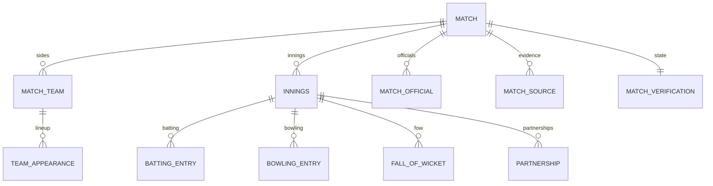

# 13. Scorecard Data Model

**Deliverable 13 of 38**

The normalised match/innings/performance model that supports fast spreadsheet-style
entry (§10), every match shape, partial and unknown data, and the statistics engine —
without double counting. Builds on the ERD (deliverable 5).

## 13.1 Match shapes supported

Multiple innings, multi-day matches, home & away, finals, grand finals, forfeits, draws,
ties, abandoned matches, historical playing conditions, **partial scorecards**, **unknown
values**, match-only and season-only historical records, match captains, acting
captains, wicketkeepers, umpires, source documents and research notes (§10).

## 13.2 Structure

| Level | Records | Unknown handling |
|---|---|---|
| Match | classification (home_away/final/grand_final), result_type, date (precision), toss, conditions override | date precision; nullable result |
| Match team | home/away, captain, acting captain, wicketkeeper, winner, margin | nullable winner/margin = unknown |
| Team appearance | the canonical "who played" list, batting order | `played` explicit; order nullable |
| Innings | seq, total, wickets, overs, declared/forfeited, complete | nullable totals; `is_complete` flag |
| Batting entry | position, runs, balls, 4s, 6s, how_out, bowler, fielder | each nullable; `how_out=unknown` |
| Bowling entry | overs, maidens, runs, wickets, wides, no-balls | each nullable |
| Fall of wicket | wicket no, runs, player out, over | optional |
| Partnership | wicket no, pair, runs, balls, unbroken | stored if recorded, else derived |

## 13.3 Unknown ≠ zero (critical)

- Historical facts are **nullable**; a blank card is *unknown*, not 0.
- `how_out = unknown` is distinct from `not_out`.
- A **partial scorecard** records exactly what is known; the verification scope
  (deliverable 14) captures which parts are verified.
- **Match-only** and **season-only** historical records are supported: a match may exist
  with only a result and lineup (no ball-by-ball), or a season aggregate may exist
  without individual matches. The engine treats these appropriately and never
  back-fills zeros.

## 13.4 Fast entry UX (requirements the model must support)

- **Spreadsheet-style grid** with keyboard navigation (tab/enter/arrows), paste,
  autosave to **draft**, inline validation.
- **Create players inline** during entry (no separate Playing XI screen) — a new
  `person` + `team_appearance` created on the fly, workspace-scoped.
- Live validation hooks into the audit rules (deliverable 15): duplicate batter, bowler
  missing from batting card, FoW inconsistency, totals mismatch, overs exceeding limit,
  etc. — surfaced as warnings, not blockers, so historical oddities can still be
  recorded (then classified as accepted exceptions).
- Attach source documents/images and per-field provenance during entry.

## 13.5 Derived vs stored

- Totals, averages, strike rates, partnerships (where not explicitly recorded) and all
  leaderboards are **derived by the statistics engine** (deliverable 22) — never stored
  as the authoritative value, preventing double counting and drift.
- Where a historical source gives only an aggregate (e.g. a season total), it is stored
  as a provenance-tagged aggregate record, clearly distinguished from match-derived
  totals.

## 13.6 Validation against the real Cricket Statz export (deliverable 16a)

The real RMCC export confirms the model fits and sharpens several rules:

- **Innings totals are derived, not stored** — Cricket Statz innings rows carry only
  extras (byes/legbyes/noballs/wides), batting/bowling teams and an innings-result code;
  the total and wickets are computed from batting scores + extras + dismissals. OneStats'
  derived-stat design (§13.5) already matches this.
- **Balls faced are almost never recorded** (`Balls=0` in 98.7% of 30,832 entries) →
  stored as **unknown**, not 0; strike-rate reports will be largely known-minimum for
  historical seasons.
- **Fall-of-wicket is present** (`FOW`,`FOWPos`,`FOWOvers`,`FOWBatID`) → batting
  partnerships are derivable (deliverable 25).
- **No ball-by-ball** (empty `cricket_overs`) → the model needs no delivery-level store
  for this data; confirms the participation-based bowling-partnership method (deliverable
  25).
- **`0`/sentinel = not recorded** for captain, keeper, fielder, bowler and result fields
  → mapped to **unknown** (deliverable 16 §16.3), never a real person or a real zero.
- Supports a **second wicketkeeper** per side (`homekeeper2`/`awaykeeper2`) and separate
  **scorers/officials** — the model's `match_official` + keeper fields cover these.

## 13.7 Match type vs classification; dismissal taxonomy (from CS evidence)

- **Match *type* (innings per side)** and **match *classification* (Home&Away / Final /
  Grand Final)** are **different axes** stored separately (`match.match_type` vs
  `classification` + `is_final`/`is_grand_final`). Cricket Statz holds explicit Final/
  Grand-final flags; OneStats preserves them separately and never infers classification
  from round labels alone (deliverables 16 §16.4, 16a.9).
- **Dismissal taxonomy** — `how_out` distinguishes the axes the engine needs (deliverable
  22), with the **original CS code preserved** (`how_out_source_code`):
  - **Participation:** `dnb` / `absent` (no innings) vs batted.
  - **Dismissal status:** `not_out` vs out vs `unknown_out` vs `retired_*`.
  - **Batting-average treatment:** out counts in the denominator; `not_out`/`dnb`/
    `retired_not_out` do not.
  - **Bowler credit:** bowled/caught/caught_behind/caught_and_bowled/lbw/stumped/hit_wicket
    credit a bowler; run_out/obstructing/hit_twice/timed_out/retired/unknown do **not**.
  - **Fielding credit:** caught→fielder; caught_behind/stumped→keeper;
    caught_and_bowled→bowler (no double count); run_out→fielder.
  Full code→semantics table: deliverable 16 §16.8.
- **Overs** are stored in **cricket-over notation** (e.g. `5.3` = 5 overs 3 balls); balls
  are derived with `balls_per_over`, never by multiplying the decimal (16a.10).
- **Extras** modelled separately incl. **penalty runs**; `max_overs`, innings override
  (`override_runs`/`override_wickets`) and the "FOW incomplete" flag are preserved where
  known (absent from the current JSON export — re-captured, deliverable 16 §16.9).
- **Statistical inclusion** (`match.include_in_statistics`) is **separate from verification
  state** — a match may be verified yet excluded from stats (CS "Yes but exclude from
  stats"), or vice versa.
- **Three distinct layers kept separate** (never conflated): **source values** (as
  imported, with `source_ref`), **calculated totals** (engine-derived: innings total,
  strike rate, economy, partnerships), and **official overrides** (e.g. CS innings
  override runs/wkts). Strike rate and economy are shown **only where the underlying balls/
  overs are known** (balls are unrecorded in ~99% of historical innings → often blank, not
  zero).
- **Scorecard / match-report presentation** is specified from the real completed report
  (deliverable 16a.13): dismissal descriptions, SR-where-known, extras breakdown, FOW list,
  bowling economy from converted overs, and duck/captain/keeper markers — all values from
  the one engine (deliverable 22). OneStats' visual design is its own.
