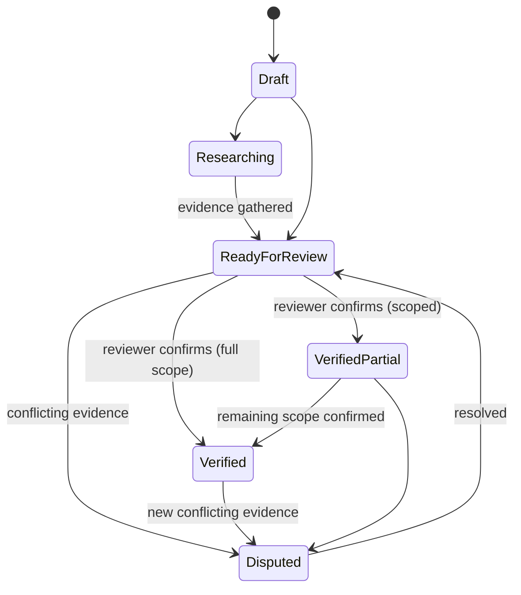

# 14. Match Verification Workflow

**Deliverable 14 of 38**

Record states and the rules that protect verified data (§11). Verified Partial must
preserve the **exact verified scope**; missing historical data is never treated as zero;
provenance, evidence, verification history and user changes are preserved; verified
records are never silently overwritten.

## 14.1 States

| State | Meaning |
|---|---|
| Draft | Being entered; not authoritative |
| Researching | Under active historical research |
| Ready for Review | Submitted for verification |
| Verified | Fully verified against evidence |
| **Verified Partial** | Only a defined scope is verified; the rest remains unverified/unknown |
| Disputed | Conflicting evidence; shown with the conflict, excluded from authoritative stats until resolved |

## 14.2 Verified Partial scope

- `match_verification.verified_scope` (jsonb) records **exactly** what is verified — e.g.
  "result + team totals verified; individual bowling figures unverified; batter X runs
  verified, balls unknown".
- The statistics engine consumes only the verified scope; unverified fields stay unknown
  and are **excluded**, not zeroed, from calculations and leaderboards.
- Reports and Ask OneStats surface the qualification ("based on verified data; N matches
  partially verified") (deliverables 22, 26, 28).

## 14.3 Protection rules

- **No silent overwrite:** editing a Verified/Verified Partial record requires the right
  permission (Reviewer/Admin, deliverable 7), is audited, and keeps change history
  (before/after). An edit can move the record to Disputed/Ready for Review rather than
  mutating verified truth invisibly.
- **Evidence preserved:** original source documents/images and citations remain attached;
  verification records who verified what, when, and against which source.
- **Conflicting evidence:** multiple sources can disagree; the Research Centre
  (deliverable 19) compares them; the match keeps one canonical record plus the
  conflicting sources.
- **Unknown ≠ zero** throughout (deliverable 13).

## 14.4 Review queue

- Reviewers work a queue of Ready-for-Review and Disputed records (Dashboard + Research
  Centre → Review & Verify).
- Verification actions are permission-gated and audited; bulk verification is explicit
  and scoped.

## 14.5 Interaction with imports & publishing

- Imported records arrive as Draft/Researching and must pass verification before being
  authoritative or published.
- Only Verified / Verified Partial (within scope) data is eligible for website publishing
  and the mobile portal; Draft/Disputed/private records are never exposed (deliverables
  29–30).
- **Bulk Cricket Statz imports (≈940 RMCC matches, deliverable 16a)** arrive as Draft with
  `source_ref` provenance. They are **not** auto-verified; the large historical backlog is
  worked through the review queue (and the audit centre, deliverable 15). Because much is
  unknown-not-zero (balls, captains, some results), many will end as **Verified Partial**
  with an explicit scope — never zero-filled to force a "complete" state.
- **Incomplete or internally inconsistent historical records are preserved, not rejected.**
  The importer ingests partial scorecards, unknown balls, incomplete fall-of-wicket
  sequences, unresolved dismissal codes and conflicting figures into Draft for later
  research (deliverable 19), surfacing issues via the audit centre rather than discarding
  the match. Nothing is thrown away for being imperfect; the source values, the engine's
  calculated totals and any official overrides are kept distinct (deliverable 13).
