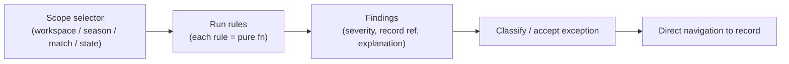

# 15. Data Integrity Audit Rules

**Deliverable 15 of 38**

The **Scorecard Audit Centre** (§12, Statistics → Data Integrity) runs a rules engine
over scorecards, classifies findings, links directly to the affected record, and
**never automatically alters verified information**.

## 15.1 Severity classification

| Severity | Meaning | Default action |
|---|---|---|
| **Critical** | Breaks correctness/integrity (e.g. impossible totals, duplicate match) | Must resolve or accept-as-exception before Verified |
| **Warning** | Likely error but historically possible | Review; may accept |
| **Informational** | Worth noting, not an error | Visible, no block |
| **Accepted historical exception** | Human-confirmed oddity that is genuinely correct | Suppressed from future alerts, audited |

## 15.2 Rule catalogue (§12)

| # | Rule | Severity (default) | Unknown-aware note |
|--:|---|---|---|
| 1 | Incomplete retirements (retired, no resolution) | Warning | skip if how_out unknown |
| 2 | Duplicate batters in an innings | Critical | needs known names |
| 3 | Bowler/fielder missing from batting card | Warning | only flag if batting card is complete |
| 4 | Duplicate bowlers/fielders | Warning | — |
| 5 | Players with no recorded participation | Informational | — |
| 6 | Missing captain(s) | Warning | not flagged if historically unknown |
| 7 | Missing wicketkeeper | Informational | — |
| 8 | Incorrect caught-and-bowled entries (c&b where bowler≠fielder) | Warning | — |
| 9 | Fall-of-wicket inconsistencies (order/runs) | Critical | needs FoW present |
| 10 | Winning-margin inconsistencies (margin vs scores) | Warning | skip if scores unknown |
| 11 | Missing maximum overs | Informational | **not** flagged when conditions are explicitly unknown |
| 12 | Overs exceeding limit | Critical | only when limit is known |
| 13 | Missing batting/bowling scorecards | Informational | expected for match-only records |
| 14 | Blank batter/bowler names | Warning | distinct from "unknown player" |
| 15 | Potentially inconsistent bowler/fielder combinations | Informational | — |
| 16 | Incomplete abandoned matches | Informational | abandoned ⇒ partial is expected |
| 17 | Incorrect innings totals (sum of batters + extras ≠ total) | Critical | skip if any component unknown; compute a *known-minimum* instead |
| 18 | Duplicate matches | Critical | fuzzy match on date/teams/competition |
| 19 | Conflicting historical evidence | Warning | links to Research Centre comparison |

**Key principle:** rules must distinguish **unknown from wrong**. A null/unknown value
never produces a Critical "mismatch"; it is handled as unknown (Informational at most),
honouring unknown ≠ zero (deliverable 13).

## 15.3 Engine design

- Each rule is a **pure, individually tested function** (deliverable 34) returning
  findings with a record reference and plain-language explanation.
- Rules run on demand, on save (live validation in scorecard entry, deliverable 13), and
  as scheduled background sweeps (deliverable jobs).
- Findings are stored so accepted exceptions persist and re-runs don't re-raise them.

## 15.4 Guardrails

- The audit engine **only reports**; it never edits data and never changes verification
  state automatically (§12).
- "Accepted historical exception" is a human decision, permission-gated and audited.
- Direct navigation links each finding to the exact record/field for fixing.

## 15.5 Sentinel awareness for imported Cricket Statz data (deliverable 16a)

The real export encodes "not recorded" as sentinels; the audit rules must read these as
**unknown**, not as errors or zeros, or they will raise thousands of false positives:

- `Howout = 0` (10,312 batting entries) = not-out / did-not-bat / unknown → **not** a
  dismissal; rule 14 (blank names) and duck detection (deliverable 23) must require a
  genuine dismissal code, not `Howout=0`.
- `Balls = 0` (98.7%) = balls unknown → strike-rate/overs rules skip rather than flag.
- `Bowler = 0` / `Fielder = 0` on a dismissal = not recorded (often a run-out) → rules 3,
  8 and 15 treat as unknown, not "missing bowler" errors.
- `captain/keeper/official = 0`, `Result = 0`, venue `"?"`, `DOB = 1700-01-01` → unknown;
  rules 6, 7, 10 do not fire on these.

Post-import, the audit centre runs over the Draft backlog to surface **genuine** issues
(e.g. innings-total mismatches, duplicate matches) for the verification queue (deliverable
14), with sentinel-derived unknowns suppressed.

### Dismissal-aware refinements (confirmed CS legend, deliverable 16 §16.8)

- **Caught & bowled** is an explicit dismissal type (`how_out = caught_and_bowled`, CS code
  4, with `Fielder = 0`): the fielder **is** the bowler by definition, so **rule 8** must
  **not** flag it as an "incorrect c&b" — it only flags a `caught` (code 3) whose fielder
  equals the bowler (a likely mis-entry of a c&b).
- **Run-outs and other non-bowler dismissals** legitimately have no bowler — the audit must
  not flag a missing bowler on these, and the stats engine must not credit a bowler
  (deliverable 22).
- **Innings total reconciliation** mirrors Cricket Statz's own "Batting Runs vs Bowling
  Runs" check: flag a Critical only when all components are known and Σ(batting Score) +
  extras ≠ recorded/override total; if any component is unknown, compute a **known-minimum**
  instead (rule 17, unknown-aware).
- **Unresolved `how_out` codes** (CS 22/23/24, `unknown_out`) are Informational, not
  errors — the batter is out of unknown manner, pending confirmation of the legend.
  (`20` is confirmed = Retired-Not-Out.)
- **Duplicate display name, distinct IDs — NOT a finding** (rule 2 refinement). The real
  data has **two different players** both shown as "Bonner A" in one innings
  (`PlayerID 3555610` "A Bonner" and `PlayerID 3569462` "Ashton Bonner") — **user-confirmed
  as two distinct people**, not an error. A shared name or initials **alone is never
  evidence of the same identity** and **must not** raise a duplicate or merge finding. Rule
  2 (duplicate batter) fires **only** when the **same `person_id`** appears twice in a
  batting card. A potential-duplicate *identity* is surfaced only when there is
  **additional supporting evidence** beyond the name, and even then it is a suggestion for a
  human — **never an auto-merge** (deliverable 12). All batting/bowling/fielding/career
  stats key on **`person_id`, never on names**, so same-named players are never combined.
- **Wicket reconciliation is retirement-aware:** total wickets = genuine dismissals only;
  a Retired-Not-Out (20) is not a wicket (confirmed: 8 dismissals + 1 retirement = 162/8).
