# 16. Cricket Statz Import Architecture

**Deliverable 16 of 38** · §14

Imports Cricket Statz data **safely** — staging, validation, identity matching and
approval — preserving existing verified records and all source identifiers. A **real RMCC
Cricket Statz JSON export has now been inspected** (deliverable 16a); **direct Cricket
Statz JSON import is therefore the core planned format**, built against that sample. Other
formats (MXP/CSV/Excel) remain candidates whose schemas are **not** assumed until real
examples are examined.

## 16.1 Formats

| Format | Status | Design stance |
|---|---|---|
| **Cricket Statz JSON** | **CORE — real RMCC sample inspected** (deliverable 16a): 940 matches, 3,595 players, 1919–2026, clean internal references | Build the JSON importer first, against the real structure in 16a; confirm coded-enum legends before import |
| **MXP** (`.mxp`) | `[UNVERIFIED]` legacy match export (old Cricket Statz PC / Total Cricket Scorer); no public schema | Parse only from a real sample; tolerant parser |
| **CSV** | `[UNVERIFIED]` historical-summary import ("no header row", specified columns) | Obtain real spec + sample first |
| **Excel / other** | `[UNVERIFIED]` | Build only when a real sample + doc exist |

> **Do not assume MXP, CSV or Excel schemas are known until actual examples are examined.**
> The JSON path is privileged precisely because a real sample exists.

## 16.2 Pipeline (unchanged shape; JSON is the first connector)

```mermaid
flowchart LR
  F["Cricket Statz JSON (real sample)"] --> Parse["JSON reader<br/>(structure per 16a)"]
  Parse --> Raw["Raw staging<br/>(verbatim + source IDs preserved)"]
  Raw --> Map["Field mapping<br/>(§16.3, sentinel-aware)"]
  Map --> Val["Validation<br/>(audit rules, unknown-aware)"]
  Val --> Match["Identity & entity matching<br/>(players/teams/venues/grades + aliases)"]
  Match --> Preview["Import preview / review screen<br/>(diff vs existing, duplicate check)"]
  Preview --> Approve["Admin/Reviewer approval"]
  Approve --> Promote["Promote → canonical (Draft/Researching)<br/>+ source attribution"]
```

**Mandatory behaviours** (§3 of the user's instruction): preserve source identifiers,
stage all data before import, provide a review screen, prevent duplicate matches, protect
verified records, and **leave the original JSON unchanged**.

## 16.3 Field-mapping specification (Cricket Statz JSON → OneStats)

Maps the verified structure (deliverable 16a) to the OneStats model (deliverables 5, 11,
12, 13). **Every `0`/sentinel maps to unknown, never zero** (16a.4).

| Source (Cricket Statz) | OneStats target | Transform / rule |
|---|---|---|
| `clubs[].ClubID/Name` | `organisation` (kind=club) | keep `ClubID` as `source_ref`; RMCC club = 26267 |
| `teams[].TeamID/Name/ClubID` | `team` + `organisation` link | keep `TeamID` as `source_ref` |
| `venues[].GroundID/Name` | `venue` | `Name="?"` → venue with `name=unknown` |
| `divisions[].GradeID/Name` | `grade` (+ competition) | names incl. "Grand Final"/"Semi Final" — see classification (16.4) |
| `players[].PlayerID` | `person` + `source_ref` | preserve ID for re-import idempotency |
| `players[].Firstname/Lastname` | `person.display_name` + name history | abbreviated names flagged for identity review |
| `players[].DOB` | `person.dob` + `dob_precision` | `"1700-01-01"` → **null, precision=unknown** |
| `players[].MyClub` | `person_affiliation` | `0` → unknown affiliation |
| `players[].Battingtype/Bowlingtype` | person attributes (coded) | needs legend (16a.6); `0`→unknown |
| `officials[]` | `person` (role=umpire/scorer) | same ID space; link via `match_official` |
| `matches[].MatchID` | `match` + `source_ref` | duplicate detection key within source |
| `matches[].HomeTeam/AwayTeam` | `match_team` (home/away) | → team `source_ref` |
| `matches[].DatePlayed` | `match.match_date` (precision=exact) | ISO parse |
| `matches[].Ground/Grade` | `match.venue_id`/`grade_id` | resolve via source_ref |
| `matches[].Result` | `match.result_type` | via **confirmed** Result legend (16a.6); `0`→unknown |
| `matches[].round` | finals classification + round label | "GF"→grand_final; "SF"/"Semi"→final; numeric→home_away |
| `matches[].matchtype` | match format attribute | via confirmed legend |
| `matches[].home/awaycaptain1` | `match_team.captain_person_id` | `0` → **unknown captain** (not "player 0") |
| `matches[].home/awaykeeper1/2` | `match_team.wicketkeeper_person_id` (+2nd keeper) | `0` → unknown |
| `matches[].official1..3` | `match_official` | `0` → none |
| `matches[].scorer1..3` | `match_official` (scorer) | `0` → none |
| `matches[].tosswonby` | `match.toss` | 0→unknown |
| `matches[].home/awaybpoints` | competition points (metadata) | retained, not a core stat |
| `innings[].cricket_Innings[]` | `innings` (InnsNumber, batting/bowling team) | keep `InningsID` as source_ref |
| `innings[].Byes/Legbyes/Noballs/Wides` | innings extras | — |
| *(innings total/wickets/overs)* | **derived** | compute from batting scores + extras / dismissals — not present in source |
| `batting[].cricket_batting[]` | `batting_entry` | per fields below |
| `Batpos` | `batting_entry.position` | — |
| `BatsmanID` | `batting_entry.person_id` | resolve source_ref |
| `Howout` | `batting_entry.how_out` | via **confirmed** Howout legend; **`0` → not-out/DNB/unknown, NOT a dismissal** |
| `Fielder`/`Bowler` | `batting_entry.fielder_person_id`/`bowler_person_id` | `0` → none/unknown |
| `Score` | `batting_entry.runs` | — |
| `Balls` | `batting_entry.balls` | **`0` → unknown** (98.7% unrecorded) |
| `mins`,`sixes`,`fours` | mins / sixes / fours | `0` mins → unknown; sixes/fours `0` → genuine 0 if card complete |
| `FOW`,`FOWPos`,`FOWOvers`,`FOWBatID` | `fall_of_wicket` | supports partnerships (deliverable 25) |
| `bowling[].cricket_bowling[]` | `bowling_entry` | per fields below |
| `bowlerID` | `bowling_entry.person_id` | resolve |
| `Overs` | `bowling_entry.overs` | float overs (e.g. 7.0) |
| `Maidens`,`Wickets`,`RunsA`,`wides`,`noballs` | maidens / wickets / runs_conceded / wides / no_balls | — |
| `ballByBall[].cricket_overs[]` | — | **empty in sample; nothing to import** |
| `retirements[].cricket_retirements[]` | retirement detail on batting entry | corroborate with Howout retired codes |
| `awards`,`history` | — | null in sample; nothing to import |

**Cannot yet be mapped confidently** (blocking items): the coded-enum **legends**
(`Result`, `matchtype`, `Howout`, `iresult`, `Battingtype`, `Bowlingtype`) — see 16a.6 —
and the **finals/grand-final classification** rules (16a.7). These must be confirmed with
the user / Cricket Statz before promotion.

## 16.4 Classification derivation `[provisional — low confidence]`

**Match *type* (innings per side) and match *classification* (Home&Away / Final / Grand
Final) are different axes** and are stored separately (deliverable 13). `matchtype`
(confirmed: `1` = 1 innings per side) is the type, **not** the classification.

The Cricket Statz UI holds **explicit `Final` and `Grand-final` boolean flags**, but these
are **not in the JSON export** (16a.9). The export gives only `round` + `Grade` as finals
signals, so the importer can only *provisionally* derive classification: `round="GF"` →
grand_final (candidate); `round in {"SF","Semi"}` or a finals division → final (candidate);
numeric/empty round → home_away. **Per the user's instruction, classification is NOT
inferred from `round`/`SF`/`GF` labels alone as authoritative** — every derived Final/GF is
flagged **low-confidence** in preview and must be confirmed by the user or by a richer
source (Cricket Statz DB, a fuller export preserving the flags, or per-match evidence). The
"SF"/"Semi" inconsistency is normalised during mapping. The original `round`/`Grade`/`Final`
intent is preserved for audit.

## 16.5 Safety rules

- **Preserve source identifiers** (`source_ref`) on every imported entity → idempotent
  re-import and provenance.
- **Staging-first:** nothing touches canonical tables until validated and approved.
- **Preserve verified records:** imports never overwrite Verified/Verified Partial data;
  conflicts surface for human resolution (deliverable 14). Imported records enter as
  Draft/Researching.
- **Duplicate matches prevented:** keyed on `MatchID` within-source, plus fuzzy
  date/teams/grade across sources (deliverable 15 rule 18).
- **Identity matching:** ranked suggestions with evidence; **no auto-merge** (deliverable
  12); abbreviated/duplicate names flagged. Each CS `PlayerID` becomes a
  `person_source_identity`; **multiple source IDs may map to one OneStats person**, and
  **previously confirmed merges and "Definitely Different" assertions are reused on
  re-import** — resolved duplicates (e.g. the two "Walker D" → one person) are never
  recreated, and confirmed-distinct records (two "Bonner A") are never re-suggested
  (deliverable 12 §12.3a).
- **Unknown ≠ zero:** all sentinels (16a.4) map to unknown.
- **Reversible:** each `import_batch` rolls back with audit.
- **Original file untouched;** real RMCC data stays out of source control and test fixtures.

## 16.6 Sample import test cases (from the real data)

| # | Scenario (real example) | Expected outcome |
|--:|---|---|
| T1 | Player DOB `1700-01-01` (3,576 players) | `dob=null, precision=unknown`; excluded from age reports |
| T2 | `homecaptain1 = 0` (500 matches) | captain = **unknown**; no "player 0" created; not credited to anyone |
| T3 | Batting `Balls = 0` with `Score = 38` | runs=38, balls=**unknown**; strike rate = known-minimum/blank, not ∞/0 |
| T4 | `Howout = 0` with `Score = 0` | **not** a duck; recorded as not-out/DNB/unknown per confirmed legend |
| T5 | Genuine dismissal `Howout=caught, Score=0` | counts as a duck (deliverable 23) |
| T6 | `round = "GF"` | classification = grand_final |
| T7 | `round = "SF"` and `round = "Semi"` | both → final (normalised) |
| T8 | Venue `"?"` | venue mapped as unknown, not dropped |
| T9 | Duplicate name "Matthew Dean" ×2 | two distinct people; flagged for identity review, **not** merged |
| T10 | Re-import same file | `source_ref` matching ⇒ no duplicate matches/people created |
| T11 | Innings with no total column | total **derived** from batting + extras; wickets from dismissals |
| T12 | `ballByBall` empty | nothing imported; no error |
| T13 | Match already Verified in OneStats | import does not overwrite; conflict queued |
| T14 | Bowler `0` on a run-out dismissal | no bowler credited; run-out handled (not a bowler wicket) |
| T15 | `Howout = 4` (C&B), `Fielder = 0`, `Bowler` set | one bowler wicket (no double count); fielding credit = the bowler (c&b); batting dismissal |
| T16 | Bowling `Overs = 5.3` with balls/over = 6 | deliveries = 5×6 + 3 = 33 (cricket-over conversion), **not** 5.3×6 |
| T17 | Bowling row `Overs = 0, Wickets = 0` for a catcher | treated as a **fielder**, not a bowler who bowled |
| T18 | FOW with fewer entries than wickets (or UI "incomplete") | partnerships marked incomplete/known-minimum; not fabricated |
| T19 | `Final` / `Grand-final` / margin / sub-result / D/L / "exclude from stats" | **not in JSON** → imported as unknown; classification provisional; flagged for re-capture |
| T20 | `Keeper2` present / `Captain2` absent | keeper2 preserved; captain2 not in JSON — not invented, role unresolved |
| T21 | Innings override fields (UI) | absent from JSON → derived totals used; override unknown |

These become golden importer fixtures (deliverable 34). Fixtures are **synthetic
reproductions** of these shapes — the real RMCC file is never committed.

## 16.8 Dismissal (Howout) mapping table

Cricket Statz `Howout` codes → labels → semantics. The **original numeric code is always
preserved** alongside the mapped dismissal type. Confidence: **✅ confirmed** (direct
UI↔JSON cross-reference, 16a.10/16a.11); **~ inferred** (dropdown index-position, order
matches the confirmed codes); **❔ unconfirmed** (needs evidence — do not rely on in stats).

| JSON code | CS label | Meaning | Bowler wicket? | Batting dismissal? (avg) | Fielder/keeper credit | Evidence / confidence |
|--:|---|---|:--:|:--:|---|---|
| 0 | dnb | Did not bat | No | **No** (no innings; excluded) | — | ✅ (Ralph Lucas) |
| 1 | Not Out | Batted, not dismissed | No | **No** (not-out; not in avg denom.) | — | ✅ (Slorach, Cosgriff) |
| 2 | Bowled | Bowled | **Yes** | Yes | — | ✅ (Hayter) |
| 3 | Caught | Caught by fielder | **Yes** | Yes | Fielder (catch) | ✅ (Padley, Riddell, N.Quick) |
| 4 | C&B | Caught & bowled | **Yes (once)** | Yes | Bowler as fielder (no double count) | ✅ (Walker) |
| 5 | Ct Behind | Caught by keeper | **Yes** | Yes | **Keeper** (catch) | ~ inferred |
| 6 | LBW | LBW | **Yes** | Yes | — | ✅ (Taylor, T.Quick, Lennie) |
| 7 | Run Out | Run out | **No** | Yes | Fielder (run-out) | ~ inferred (code 7 ×909 fits) |
| 8 | Stumped | Stumped | **Yes** | Yes | **Keeper** (stumping) | ~ inferred |
| 9 | Retired | Retired (out/not-out unclear) | No | **Depends** — retired-out = out; retired-not-out = not out → **unresolved** | — | ❔ investigate |
| 10 | UnknownOut | Dismissed, manner unknown | No | **Yes** (was out) | unknown (none) | ❔ investigate |
| **20** | Retired (Not Out) | Retired, did not resume | No | **No** (not out; not in avg denom.) | — | **✅ confirmed** (Kettle R retired 53; innings 162/**8** ⇒ not a wicket, 16a.10) |
| 22,23,24 (seen) | rare: Obstr Fld / HitTwice / CaughtFld / Absent / Hit Wkt / Timed Out / Retd Out | rare dismissals | varies* | varies* | varies* | ❔ **unconfirmed** — codes do not follow a 20-base index; needs evidence |

\* When confirmed, the rare set resolves as: **Hit Wkt** (bowler yes, out); **Stumped/Ct
Behind/CaughtFld** (fielding/keeper credit); **Obstr Fld / HitTwice / Timed Out / Retd
Out** (out, **no bowler wicket**); **Absent** (no innings); **CaughtFld / Retired /
UnknownOut** need explicit confirmation (user task). Until confirmed, an unresolved code
counts as a **dismissal of unknown manner** (batter out, **no** bowler/fielder credit) and
is flagged — never guessed.

**Hard rules from this table** (enforced in the engine, deliverable 22):
- **C&B credits exactly one bowler wicket** and one fielding credit (the bowler) — no
  double counting.
- **Run-outs and other non-bowler dismissals (7, Obstr Fld, HitTwice, Timed Out, Retd Out,
  Retired, UnknownOut) credit NO bowler wicket** — they must not inflate bowling figures.
- **Not Out (1), Retired-Not-Out (20) and dnb (0)** are excluded from the batting-average
  denominator (dnb/absent have no innings at all); only genuine dismissals count as "out".
  Confirmed by reconciliation: an innings with 8 genuine dismissals + 1 retirement is
  **8/8**, not 9 wickets.
- **Keeper catches are usually coded `3` (Caught) with the keeper as `Fielder`** (not the
  separate code 5 "Ct Behind"), as the real data shows. So the keeper-vs-fielding catch
  split (deliverable 23, D13) must key on **"fielder is the recorded wicketkeeper"**, not on
  a dismissal code.
- Ducks (deliverable 23) require `Score = 0` **and** a genuine dismissal code — never
  `Howout = 0` (dnb), `1` (not out) or `20` (retired not out).

## 16.9 Lossy export — fields requiring re-capture

The JSON export omits authoritative fields the Cricket Statz UI holds (16a.9, 16a.10).
These cannot be imported and are set **unknown**, flagged for human re-capture during
verification (deliverable 14), unless a richer export/DB is supplied:

- **Match level:** explicit Final / Grand-final flags, winning margin, sub-result,
  Duckworth/Lewis metadata, balls-per-over, Captain2, per-team Message, **Match-Approved /
  "exclude from stats"** state, Requires-Attention, Warnings.
- **Innings level:** batting Dots; bowling Dots/MVP/Dropped catches/Hat-tricks;
  Runouts-Unassigned count; Penalty runs; Total/Max overs; Innings override (runs/wkts);
  "FOW List Incomplete" flag.

**Statistical inclusion is modelled separately from verification** (deliverable 22): the
Cricket Statz "Yes (but exclude from stats)" state has no JSON field, so OneStats provides
its own `include_in_statistics` flag on each match, independent of its verification state,
re-captured by a reviewer.

## 16.7 Phasing

Built in **Phase 8**. First tasks: confirm the coded-enum legends + classification rules
with the user, implement the JSON reader against 16a, then staging/validation/identity/
preview/approval. MXP/CSV/Excel follow only when real samples are supplied.
