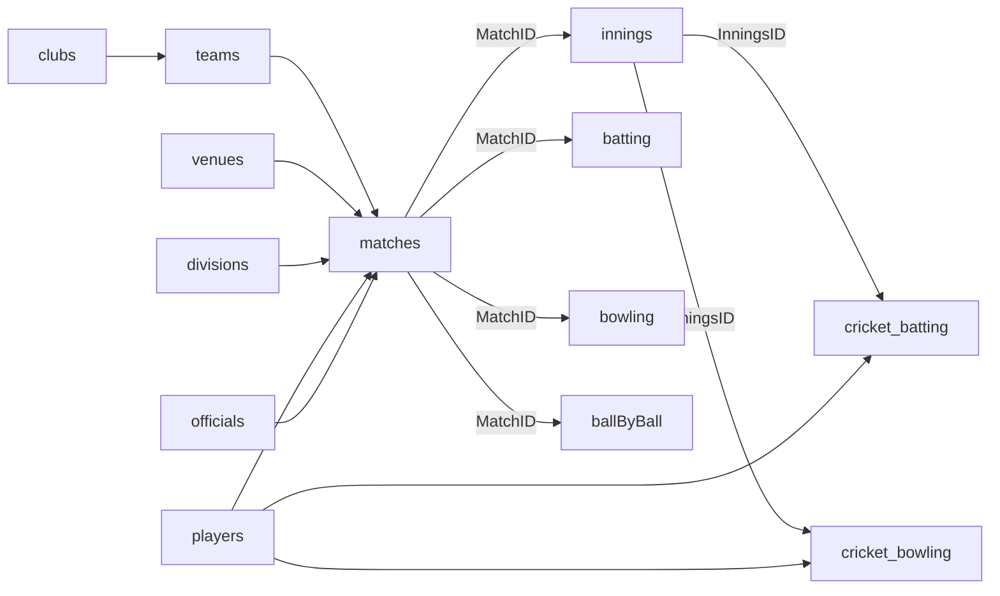

# 16a. Cricket Statz JSON Export — Real Structure Analysis

**Companion to deliverable 16.** Evidence record from inspecting the **actual** RMCC
Cricket Statz JSON export (read-only; the original file was not modified and is **not**
copied into the repo). Source file analysed: `CS26266_1br2is1nqhk.json` (~8.1 MB), held
outside version control in the user's Downloads. Analysis date: 2026-10-21.

> This is the real sample §14/deliverable 16 required. Direct **Cricket Statz JSON import
> is now a core planned format**, supported by this sample. Coded enum legends (Result,
> Howout, matchtype, etc.) are **not** in the file and must be confirmed before import —
> see §16a.6.

## 16a.1 Top-level shape

A single JSON **object** keyed by collection. Confirmed counts:

| Collection | Shape | Count | Notes |
|---|---|--:|---|
| `matches` | list of match headers | **940** | one row per match |
| `innings` | list keyed by MatchID → `cricket_Innings[]` | 940 → **2,248 innings** | extras live here |
| `batting` | nested → `cricket_batting[]` | 940 → **30,832 entries** | per-batter lines + FOW |
| `bowling` | nested → `cricket_bowling[]` | 940 → **15,588 entries** | per-bowler figures |
| `ballByBall` | nested → `cricket_overs[]` | 940 → 2,249 over objects | **all empty `{}` — no data** |
| `retirements` | nested → `cricket_retirements[]` | **3** | explicit retirements only |
| `players` | registry | **3,595** | includes opposition players |
| `officials` | registry (same ID space) | **13** | umpires/scorers |
| `venues` | lookup | **43** | `Name="?"` = unknown |
| `divisions` | lookup (grade/round-ish) | **7** | e.g. "B Grade", "Grand Final" |
| `teams` | lookup | **56** | TeamID, Name, ClubID |
| `clubs` | lookup | **46** | ClubID, Name |
| `awards` | — | **null** | not exported |
| `history` | — | **null** | not exported |

**Date range:** `1919-11-01` → `2026-03-07`. **Every one of the 940 matches involves an
RMCC team** (Rhymney/Moyston `19766`, Moyston `19781`, Rhymney `19782`; RMCC club
`ClubID 26267`). This is a single-club, 107-year export.

All preliminary figures (≈940 matches, 3,595 players, 56 teams, 46 clubs, 43 venues, 7
divisions, 1919–2026) are **confirmed** against the file.

## 16a.2 Collection fields (verified)

### matches
`MatchID` · `HomeTeam`→teams · `AwayTeam`→teams · `DatePlayed` (ISO) · `Ground`→venues ·
`Grade`→divisions · `Result` (coded int) · `pool` (empty in all 940) · `round` (str:
"1".."16","GF","SF","Semi", empty in 431) · `comment` (free text; e.g. "Match abandon due
to...") · `matchtype` (1/2/3) · `homebpoints`/`awaybpoints` (bonus points, float) ·
`homecaptain1` · `homekeeper1`/`homekeeper2` · `awaycaptain1` · `awaykeeper1`/`awaykeeper2`
· `tosswonby` (0/1/2) · `official1..3`→officials · `scorer1..3`→players.
**`0` = not recorded** throughout the person fields (e.g. `homecaptain1=0` in 500/940).
Note: only `*captain1` and `*keeper1/2` exist — no second captain field beyond keeper2.

### innings (`cricket_Innings[]`)
`InningsID` · `InnsNumber` · `battingteam`→teams · `bowlingteam`→teams · `iresult` (coded)
· `Byes` · `Legbyes` · `Noballs` · `Wides`. **No innings total/wickets/overs columns** —
the innings total must be **derived** from batting scores + extras (and wickets from
dismissals). 2,248 innings across 940 matches.

### batting (`cricket_batting[]`, 30,832 entries)
`Batpos` · `BatsmanID`→players · `Howout` (coded) · `Fielder`→players (0=none) ·
`Bowler`→players (0=none) · `Score` · `Balls` · `mins` · `sixes` · `fours` · `mvp` ·
`FOW` · `FOWPos` · `FOWOvers` · `FOWBatID`→players. FOW data present → supports
partnership derivation (deliverable 25).

### bowling (`cricket_bowling[]`, 15,588 entries)
`bowlerID`→players · `Maidens` · `Overs` (float, e.g. 7.0) · `Wickets` · `RunsA` (runs
conceded) · `wides` · `noballs`.

### retirements (`cricket_retirements[]`, 3)
`RetiringBatsmanID` · `RetiredAtFOW` · `RetiredAtRuns` · `ReturnedAtFOW` · `ReturnedAtRuns`.

### players / officials
`PlayerID` · `Firstname` · `Lastname` · `DOB` · `ExternalID` (empty in all) · `MyClub`→clubs
· `Battingtype` (coded) · `Bowlingtype` (coded, players only) · `isActive`. Officials share
the same ID space and are referenced by `matches.official*`. Batter/bowler IDs resolve
against **players ∪ officials**.

### venues / divisions / teams / clubs
`venues`: `GroundID`,`Name` (`"?"`=unknown). `divisions`: `GradeID`,`Name`. `teams`:
`TeamID`,`Name`,`ClubID`→clubs. `clubs`: `ClubID`,`Name`.

## 16a.3 Relationships

Join keys: `MatchID` links matches↔innings↔batting↔bowling↔ballByBall; `InningsID` links
innings rows to their batting/bowling cards; person IDs (`PlayerID`) join everywhere.

## 16a.4 Null / empty / zero / sentinel treatment (CRITICAL — unknown ≠ zero)

| Signal | Meaning | Count/evidence | Import rule |
|---|---|---|---|
| `DOB = "1700-01-01"` | **Unknown DOB** sentinel | 3,576 / 3,595 players | Map to **unknown** (null + precision=unknown); never compute age |
| Venue `Name = "?"` | Unknown venue | 1 venue row | Map to unknown venue |
| person field `= 0` | Not recorded (no captain/keeper/fielder/bowler/official/scorer) | captain 500/940; Fielder 22,794; Bowler 14,835 | Map `0` → **unknown/none**, never a real person |
| `Balls = 0` | Balls faced **not recorded** | 30,431 / 30,832 (98.7%) | Treat as **unknown**, not 0 balls (affects strike rate) |
| `mins = 0`, `FOWOvers = 0.0` | Usually not recorded | widespread | Treat as unknown unless corroborated |
| `Result = 0`, `iresult = 0`/`null` | Unknown/none result | Result 30; iresult 32+1 null | Map to unknown result, not a draw/loss |
| empty string `pool`/`round`/`comment` | Not recorded | pool all empty | Leave unknown |

**The pervasive use of `0` and `1700-01-01` as "not recorded" is the single biggest import
hazard.** A naive import would fabricate zero-ball innings, zero-year-old players and
phantom "player 0". Every mapping below honours unknown ≠ zero.

## 16a.5 Completeness & quality

- **Clean internal references:** 0 matches with an unknown team/ground/grade ref; 0 orphan
  batter/bowler IDs. IDs are internally consistent → low referential-integrity risk.
- **Batting cards well populated** (30,832 entries); **balls faced almost never recorded**
  (98.7% zero) → strike-rate reports will be heavily known-minimum for historical seasons.
- **No ball-by-ball** (`cricket_overs` all empty) → no delivery-level analysis possible;
  confirms the participation-based bowling-partnership method (deliverable 25) is the only
  viable one.
- **FOW present** → batting partnerships derivable (deliverable 25).
- **Retirements** mostly encoded via `Howout` codes rather than the 3-row `retirements`
  collection.

## 16a.6 Coded enums — partly confirmed by cross-reference, rest MUST be confirmed

Status after cross-referencing the screenshots (16a.9–16a.11): some values are now
**confirmed**; the rest stay **inferred/unconfirmed** and must not be hard-coded as a
guessed legend.

| Field | Observed values (count) | Status |
|---|---|---|
| `matches.Result` | 1(468) 2(416) 0(30) 4(18) 9(5) 3(2) 8(1) | **1 = Home Win ✅** (16a.9); 2 = Away Win (likely); 0=unknown; 3/4/8/9 (tie/draw/abandoned/no-result?) **unconfirmed** |
| `matches.matchtype` | 1(506) 2(419) 3(15) | **1 = 1 innings/side ✅, 2 = 2 innings/side ✅, 3 = T20 ✅** (16a.14: the stats viewer's Type tab shows 1Inn/2Inn/T20, and the player's `3`-count matches his "T20" count). **Match *type*, not classification.** |
| `innings.iresult` | 1(1146) 2(879) 3(180) 4(11) 0(32) null(1) | `2` observed = "Closed" (one data point, 16a.10); full legend **unconfirmed** |
| `batting.Howout` | 0(10312) 3(7645) 2(6166) 1(3089) 6(1335) 7(909) 4(594) 8(494) 22(178) 20(63) 5(26) 9(17) 10(1) 23(1) 24(1) | **CONFIRMED: 0=dnb, 1=Not Out, 2=Bowled, 3=Caught, 4=C&B, 6=LBW, 20=Retired-Not-Out** (16a.11). Inferred (index): 5=Ct Behind?, 7=Run Out?, 8=Stumped?, 9=Retired?, 10=UnknownOut?. **22/23/24 unconfirmed**. NB keeper catches are coded 3 (not 5). Full table: [16-cricket-statz-import.md](16-cricket-statz-import.md) §16.8 |
| `players.Battingtype` | 0/1/2 | **1 = Right Handed ✅** (Scotney, 16a.14); 2 = Left (likely); 0 = unknown. Others unconfirmed |
| `players.Bowlingtype` | 0/1/2/3 | **1 = Right Arm Pace ✅** (Scotney, 16a.14); 2/3 = spin/left-arm (likely); 0 = unknown. Unconfirmed |
| `matches.round` | "1".."16","GF","SF","Semi","" | finals markers mixed with numeric rounds; **"SF" vs "Semi" inconsistency**. NOT authoritative for classification (16a.9) |

**`Howout = 0` = did-not-bat** (confirmed): the largest group, and must never be imported
as a dismissal. A duck requires `Score=0` **and** a genuine dismissal code — not `0` (dnb)
or `1` (not out).

## 16a.7 Classification mapping challenge

Match classification (Home & Away vs Finals excl. GF vs Grand Finals — deliverables 22/23)
is **not a single field**. Signals: `round` ("GF"→grand final; "SF"/"Semi"→final), the
`divisions` lookup (contains "Grand Final"/"Semi Final" as grade names), and possibly
`matchtype`. **The Cricket Statz UI holds explicit `Final`/`Grand-final` boolean flags,
but these are NOT in the JSON export (16a.9)** — so the importer must derive classification
provisionally, flag ambiguity, and **ask the user to confirm the finals/grand-final
mapping** (deliverable 37 §37.3). **Do not infer classification from `round`/`SF`/`GF`
labels alone.**

## 16a.8 Identity-matching risk

- 5 duplicate `(firstname,lastname)` groups (10 players), e.g. "Matthew Dean" ×2 — real
  collision risk requiring controlled merge (deliverable 12).
- Many **abbreviated historical names** (single-initial firstnames: "A", "B Webb",
  "D McCann") → ambiguous identity; must not auto-merge (deliverable 12).
- 3,595 players for one club over 107 years ⇒ mostly opposition players; import must not
  assume all are RMCC members (`MyClub` distinguishes).
- 14 defined players never appear in batting/bowling (registry-only) — retain, don't drop.

## 16a.9 UI ↔ JSON field reconciliation (screenshot evidence, 2026-10-21)

The user supplied screenshots of the Cricket Statz **Edit Match Fixture** and **Edit Match
Results** screens for a real RMCC match. Cross-referencing them against the actual JSON
confirmed the exact match row (`MatchID 3177394`: Home `19769` Swifts/Great Western, Away
`19766` Rhymney/Moyston, `2026-03-07T13:00`, round "SF", `matchtype 1`, `Result 1`,
`tosswonby 1`). **This match is the authoritative worked reconciliation below.**

Two enum values are now **confirmed by cross-reference** (no longer inferred):

- **`matchtype = 1` ⇔ "1 Innings per side"** — Match Type encodes **innings per side**, a
  different axis from match **classification** (Home&Away/Final/Grand Final).
- **`Result = 1` ⇔ Home Win** (UI "Swifts/Great Western Win"; Swifts = home `19769`).
  By symmetry `2` is very likely Away Win (still to confirm).

### Field-by-field classification

Legend: **✅ Confirmed in JSON** (path) · **≈ Represented differently** (mapping) ·
**🟥 In UI, NOT in JSON** (absent from export) · **❔ Unresolved** (needs more evidence).

| UI field (screen) | Status | JSON path / note |
|---|:--:|---|
| Home / Away Team | ✅ | `matches.HomeTeam` / `AwayTeam` → teams |
| Match Type ("1 Innings per side") | ✅/≈ | `matches.matchtype` (1=1-innings/side **confirmed**; 2,3 need legend) |
| **Final flag** | 🟥 | **No field in JSON.** Only `round="SF"` present — the explicit boolean is lost on export |
| **Grand-final flag** | 🟥 | **No field in JSON.** Only `round`/`Grade` hint — explicit boolean lost |
| Round ("SF") | ✅ | `matches.round` |
| Pool | ✅ | `matches.pool` (empty in all) |
| **Balls/over (6)** | 🟥 | No field in JSON |
| Venue | ✅ | `matches.Ground` → venues |
| Start Date & Time | ✅ | `matches.DatePlayed` (ISO incl. time) |
| Division ("C Grade") | ✅ | `matches.Grade` → divisions (`9774`) |
| Umpires | ✅ | `matches.official1..3` → officials |
| Scorers | ✅ | `matches.scorer1..3` |
| Innings / batting teams | ✅ | `innings.cricket_Innings[].battingteam/bowlingteam` |
| Innings total "160/8" | ≈ | **Derived** (sum of batting Score + extras; wickets from dismissals) — no total column in JSON |
| Toss (won by Home / Away / unknown / uncontested) | ≈/❔ | `matches.tosswonby` (0/1/2). **Here `1` = away (Rhymney) won toss** ⇒ coding is NOT 1=home; "unknown" vs "uncontested" both likely collapse to `0`. **Unresolved** |
| Match Result ("… Win") | ✅/≈ | `matches.Result` (**1=home win confirmed**; full legend to confirm) |
| **Sub-Result** | 🟥 | No field in JSON |
| **Winning margin ("2 wickets")** | 🟥 | No field in JSON (would need re-derivation or re-entry) |
| Match comments | ✅ | `matches.comment` |
| Captain (per team) | ≈ | `matches.homecaptain1` / `awaycaptain1` (`0`=unknown) |
| **Captain2 (per team)** | 🟥/❔ | **No `captain2` field in JSON** (only `*captain1`). Meaning unresolved — do not assign a role or credit |
| Keeper (per team) | ✅ | `matches.homekeeper1` / `awaykeeper1` |
| Keeper2 (per team) | ✅/❔ | `matches.homekeeper2` / `awaykeeper2` present (0=none). Role (sub/keeper-change?) unresolved |
| **Message (per team)** | 🟥 | No per-team field in JSON (match-level `comment` only) |
| **Duckworth/Lewis (revised target, overs, abandoned-by-D/L)** | 🟥 | No field in JSON |
| Competition Points (per team) | ✅ | `matches.homebpoints` / `awaybpoints` |
| **Match Approved (No / Yes / Yes-exclude-from-stats)** | 🟥 | **No field in JSON** — statistical-inclusion state lost on export |
| **Requires attention / Warnings / Audit log** | 🟥 | No field in JSON |

### Consequence: the JSON export is LOSSY

The export omits several **authoritative** fields the Cricket Statz UI holds — most
critically the **explicit Final / Grand-final flags**, the **winning margin**, **sub-
result**, **D/L metadata**, and the **"exclude from stats" approval state**. Therefore:

- **Classification must NOT be inferred from `round` labels alone** (the user's explicit
  instruction) — yet the JSON provides *only* `round` + `Grade` for finals status. The
  importer treats any round/Grade-derived Final/GF as **provisional, low-confidence**, to
  be confirmed by the user or by a richer source (the Cricket Statz DB, a fuller export,
  or a screenshot/report per match).
- The **"exclude from stats"** flag cannot be honoured from this JSON because it is not in
  it — statistical-inclusion state must be **re-captured** in OneStats, not assumed.
- Winning margin / sub-result / D/L either re-derive from scores (margin may be
  computable) or must be re-entered; they are recorded as **unknown** until then.

**Recommendation:** ask the user whether a **richer Cricket Statz export or direct
database access** is available that preserves these fields; otherwise plan for
human re-capture of the lost authoritative fields during verification.

## 16a.10 Innings-screen reconciliation (Edit Innings evidence, 2026-10-21)

Screenshots of the Cricket Statz **Edit Innings** screen were cross-referenced against the
real JSON for **MatchID 3177394, innings 1** (Rhymney/Moyston 160/8). The batting card
matched the JSON exactly, confirming structure and several codes.

### Confirmed by direct UI↔JSON cross-reference

- **`Overs` is cricket-over notation**, not a decimal quantity: bowling overs
  `6,6,4,6,6,6,6,0,0` sum to **40** = the innings `TotOvers` (40.0), with balls/over = 6.
  Convert to deliveries as `floor(overs)*balls_per_over + (fractional ball digits)`, **not**
  `overs × balls_per_over` on the raw decimal. Preserve the original value; convert only
  when confirmed.
- **Fielders appear in `cricket_bowling` with `Overs=0`** (e.g. Sandeep Raju, R Kettle took
  catches but did not bowl) — a bowling row with 0 overs/0 wickets is a **fielder**, not a
  bowler who bowled.
- **FOW is fully reconstructable from `cricket_batting`** (`FOWPos`,`FOW`,`FOWBatID`): the
  JSON reproduces the UI fall-of-wicket list exactly (31→Padley, 36→Taylor, 40→Walker, 63,
  70, 94, 108, 160) ⇒ **partnerships are derivable** (deliverable 25) when FOW is complete.
- **Innings totals are computed/reconciled, not stored**: CS displays "Batting Runs 160,
  Bowling Runs 160"; the JSON innings header carries **only** extras + `iresult`, so OneStats
  derives totals (Σ Score + extras) and wickets (count of dismissals), honouring unknowns.

### UI innings fields NOT in the JSON export (🟥 — confirmed absent)

Batting **Dots**; bowling **Dots, MVP Pts, Dropped Catches, Hat-tricks**, and the
**Runouts/Unassigned Wickets** box; extras **PenRuns (penalty), TotOvers, MaxOvers**;
**Innings Override (runs / wickets)**; the **"FOW List Incomplete"** flag. (Concept
searches for `dot/pen/totover/maxover/override/drop/hat/runout/unassign` returned nothing
in any nested collection.) The JSON innings header is only `InningsID, InnsNumber,
battingteam, bowlingteam, iresult, Byes, Legbyes, Noballs, Wides`; JSON batting adds `mins`
(not shown in this UI); JSON bowling is only `bowlerID, Maidens, Overs, Wickets, RunsA,
wides, noballs`.

- `iresult = 2` for this innings corresponds to UI **"Closed"** (single data point; full
  `iresult` legend unconfirmed).
- **Run-outs/unassigned wickets** are not separable in the export — they must be inferred
  from `Howout` codes on the batting card, not from a bowling column.

## 16a.11 Dismissal (Howout) legend — confirmed + full label list

The full Cricket Statz **Howout** dropdown (user screenshot) has **17 selectable values**
plus a "rare" category heading (not selectable). Listed order:

`dnb, Not Out, Bowled, Caught, C&B, Ct Behind, LBW, Run Out, Stumped, Retired, UnknownOut`
— then **rare:** `Hit Wkt, Obstr Fld, HitTwice, CaughtFld, Absent, Retd Out, Timed Out`.

The first 11 labels correspond **index-for-index** to JSON codes 0–10, and **six are
directly confirmed** by the innings cross-reference (0,1,2,3,4,6). The authoritative
mapping table (code → label → semantics → bowler/batting/fielding credit → evidence) is in
the importer spec: **[16-cricket-statz-import.md](16-cricket-statz-import.md) §16.8**. The
"rare" codes observed in the JSON (`20, 22, 23, 24`) do **not** follow a simple 20-based
index (e.g. `22` occurs 178× — implausibly many for "HitTwice") and are left **unconfirmed
— require evidence**. The original numeric code is always preserved alongside the mapped
label. **Code `20` is confirmed = Retired (Not Out)** (16a.13), so the rare codes are not a
clean 20-base index and must not be guessed.

## 16a.12 Further Cricket Statz evidence needed (to resolve ambiguities)

Concise list of screenshots / exports that would close the remaining unknowns:

1. **Full `Result` dropdown** (Edit Match Results) — to map Result codes 2, 3, 4, 8, 9.
2. **Full `Match Type` dropdown** — to map `matchtype` 2 and 3 (2 innings/side? other?).
3. **`Innings Result` dropdown** (Edit Innings) — to map `iresult` 1/2/3/4/0.
4. **`Sub-Result` dropdown** values.
5. An innings containing a **run-out, stumping, caught-behind and retired** dismissal,
   **with its MatchID**, so codes 5, 7, 8, 9, 10 can be confirmed against the JSON (and the
   remaining **rare** codes 22/23/24 tied to Hit Wkt / CaughtFld / Absent / etc.; code 20 is
   already confirmed = Retired-Not-Out).
6. A match with **Captain2 and Keeper2 populated** (plus any field help text) — to learn
   their meaning before assigning roles/credit.
7. A match set to **"Yes (but exclude from stats)"** and its JSON — to confirm the export
   carries no inclusion flag (as currently found) vs a hidden field.
8. A **Grand Final** match showing `round`, the **Final** and **Grand-final** toggles, and
   `Division` together — to validate classification derivation.
9. The **Player edit screen** dropdowns for **Battingtype** and **Bowlingtype**.
10. A match where **toss is "uncontested"** vs **"unknown"** — to disambiguate `tosswonby`
    (and confirm the home/away coding, since `1` was the *away* side here).
11. The **Cricket Statz export/download options screen** — to confirm whether a **richer
    export** (preserving Final/GF flags, margin, sub-result, D/L, approval/exclude-from-
    stats, Captain2) or **direct database access** is available.

## 16a.13 Completed match-report evidence (rendered scorecard, 2026-10-21)

Screenshots of the **finished Cricket Statz scorecard** for the same match (3177394) were
cross-referenced with the JSON. New confirmed findings:

- **`Howout = 20` = Retired (Not Out)** — Kettle R "retired" on 53; the innings is
  **162/8** (8 genuine dismissals), so the retirement is **not** a wicket and the batter is
  **not out** (excluded from the batting-average denominator). Corrects the earlier guess
  that 20 might be "Hit Wkt".
- **Two different players both shown "Bonner A" — a CONFIRMED identity distinction** (user,
  2026-10-21). `PlayerID 3555610` "A Bonner" (22) and `PlayerID 3569462` "Ashton Bonner" (0),
  both club 26273, both render "Bonner A" in the report. These are **two different people**,
  **not** a duplicate error. Rule: a shared name/initials **alone is never evidence of the
  same identity**; OneStats preserves each unique Cricket Statz ID, keeps the original
  display names, supports same-named players in the same match, and keys **all statistics on
  `person_id` (never names)** so their records are never combined. A potential duplicate is
  flagged **only** with additional supporting evidence, and never auto-merged (deliverables
  12, 15). This is the canonical real-world test case (34).
- **Keeper catches render as "c Padley D" with code `3` (Caught)**, confirming keeper
  catches are **not** separately coded — the keeper/fielding split must use *fielder =
  wicketkeeper* (16.8, D13).
- **Cricket overs → deliveries confirmed:** Swifts 162/8 off **33.2** overs = 33×6+2 = 200
  deliveries; Hayter S **4.2** overs, 22 runs → economy 5.08 = 22 ÷ (26/6). Never treat
  `33.2`/`4.2` as decimals.
- **Strike rate shown only where balls are known** — innings 1 shows R/B/SR; innings 2
  shows no balls column (balls unrecorded) and no SR. Matches the JSON (`Balls=0`).
- **Reconciliation holds:** innings 1 = Σ runs 144 + extras 16 = 160/8; innings 2 = Σ runs
  152 + extras 10 = 162/8. Source batting runs + extras = official total; dismissals =
  wickets. OneStats keeps **source values, calculated totals and (if present) official
  overrides** distinct (deliverable 13).
- **Report markers:** captain (crown) and wicketkeeper (gloves) icons; a **duck** marker on
  a batter out for 0 — presentation cues OneStats can mirror functionally.

### Scorecard / match-report presentation reference (design input, not a visual copy)

The completed report demonstrates the information a OneStats scorecard view should present
(design is OneStats' own — **do not copy Cricket Statz's visual design**): match header +
result; competition/grade/round/venue; date/time; toss; officials; per-batter line
(name + dismissal description "c Fielder b Bowler" / "lbw Bowler" / "c&b Bowler" /
"not out" / "retired" / "dnb", runs, balls, **strike rate where balls known**, 4s, 6s,
duck/captain/keeper markers); extras breakdown (b/lb/w/nb/pen) and innings total "160/8
(40.0 ov)"; fall-of-wickets list "1-31 … 8-160"; bowling figures (O/M/R/W/wd/nb) with
**economy** from converted overs; and a match-summary line. Every derived value (totals,
SR, economy, partnerships) comes from the **one engine** (deliverable 22); unknowns are
shown as unknown, never zero-filled.

## 16a.14 Cricket Statz statistics-viewer evidence (analytical drill-down, 2026-10-21)

Screenshots of the **Cricket Statz player statistics viewer** (the analytical drill-down,
distinct from the Lovable website profile) were reviewed as a reference for OneStats'
statistics engine coverage and the Player Statistics screen. This is a **functional**
reference (OneStats' own design), and it **validates and enriches** deliverables 22, 23,
25, 27.

### New confirmations (cross-referenced to the JSON)

- **`matchtype 3 = T20`** ✅ — the viewer's **Type** tab shows `1Inn / 2Inn / T20`, and the
  player's `matchtype=3` match count (7) equals his "T20" count. So `matchtype` = {1: 1
  innings/side, 2: 2 innings/side, 3: T20}.
- **`Battingtype 1` = Right Handed; `Bowlingtype 1` = Right Arm Pace** ✅ (the Home tab shows
  "Batting: Right Handed / Bowling: Right Arm Pace" for a player whose JSON values are
  `Battingtype=1, Bowlingtype=1`). Other handedness/style codes still to confirm.
- **Catches are split keeper vs field** — the Home tab shows **CtKeeper 64 / CtField 24**
  (= 88 total). Confirms the keeper-vs-fielding catch split (deliverable 23, D13) is real
  data; OneStats derives it via *fielder is the recorded wicketkeeper* (16.8).
- **Dismissal set confirmed by the charts** — the "How Out" pies legend lists *not out,
  bowled, caught, c&b, ct behind, run out, retired* (two retired variants) for batting, and
  *bowled, caught, c&b, ct behind, lbw* for bowling (the **bowler-credited** set). Confirms
  `ct behind` (5) is used and that there are two retired variants (codes 9 / 20).
- **Real DOBs are rare** — only **19 / 3,595** players have a non-sentinel DOB; age/longevity
  reports (deliverable 24) apply to very few players; the rest stay unknown.
- **Strike rate only where balls known** — Division/Season tabs show `SR = "-"` for grades/
  seasons with no recorded balls (balls faced are a recent addition), matching the JSON.

### Statistical dimensionality OneStats must support (validates deliverable 22 filters + 27)

The viewer offers these breakdowns of one player's record — OneStats' engine/Report Builder
should cover all of them: **Division/grade · Season · Team · Opponent · Ground · Batting
Position · Match Type (1Inn/2Inn/T20) · Played-With (teammates) · Dismissed-By (which
bowlers dismissed the player) · Partnerships (by partner)**, plus curated lists **Best
Batting** (top scores with date/opp/ground/pos), **Best Bowling** (best figures), **Bowling
Victims / Fielding Victims** (whom the player dismissed), and **Finals**. Matchup analytics
(batter-vs-bowler "Dismissed By", bowler's "Victim Batting Position") are a notable
addition beyond the core RMCC catalogue (deliverable 23) — candidate OneStats features.

### Charts (presentation reference)

Batting: run-scores timeline (bars, with a cumulative-average line and highlighted 50s/100s)
and "How Out" pies (incl. a low-scores variant). Bowling: wickets-per-season timeline with a
cumulative-average line, "How Out" pie, and "Victim Batting Position" (Top Order 1-4 /
Middle 5-7 / Tail 8+). OneStats can offer equivalent charts, workspace-branded, all fed by
the one engine from verified records (deliverables 12a, 22).

### Additional drill-down views confirmed (per-match & victim lists)

- **Match Stats by Player** (per-match log): Runs/HS/4s/6s · Overs/Maids/Runs/Wkts/BBI ·
  **CtsFld · CtsKeep · Stumps · Runouts** — the **fielding split is tracked per match**
  (field catch vs keeper catch vs stumping vs run-out), confirming the granular fielding
  model (deliverables 5, 23 D13). Overs in cricket-over notation (e.g. `0.1` = 1 ball).
- **Score by Score** (innings list): per-innings Batter/BatPos/Howout/Fielder/Bowler/Score/
  4s/6s/Balls — confirms dismissal labels (incl. "Retired" shown as `53*`, i.e. not-out ⇒
  code 20) and that **Balls are populated only for recent seasons** (2024-26), `0` earlier.
- **Bowling Victims / Fielding Victims** (whom the player dismissed, as bowler or fielder/
  keeper) — the matchup views noted in deliverable 22.
- **"finals only" filter** — a standard view, confirming **Finals classification filtering**
  is pervasive (deliverable 23 §23.10 splits), not just a single report.
