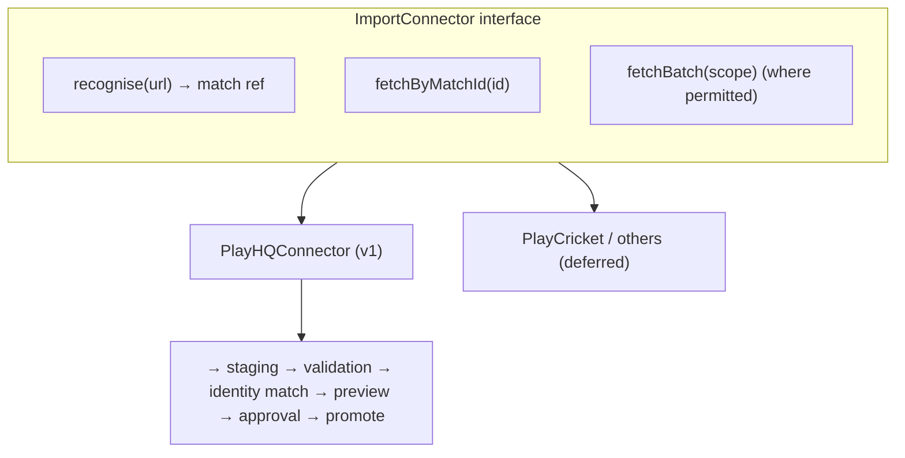

# 17. Third-Party Provider Feasibility Matrix

**Deliverable 17 of 38** · §13

Feasibility of the candidate match-import providers, from real investigation
(2026-10-21). **None is assumed to be a working API.** Several providers gate their
developer docs behind authentication/agreements (returned HTTP 403 to anonymous fetch),
so gated specifics are marked `[UNVERIFIED]` and must be confirmed with the provider's
own docs **and a signed agreement/API key** before any connector is relied upon. Full
notes: shared session-notes `provider-research-findings.md`.

Legend — **Feasibility:** 🟢 realistic self-serve path · 🟡 possible but gated/negotiated
· 🔴 no supported data API found. **Priority** reflects RMCC need.

## 17.1 Matrix

| Provider | Region / relevance | Data API? | Auth | Formats | Licensing / restrictions | Feasibility | Priority |
|---|---|---|---|---|---|:--:|:--:|
| **PlayHQ** | AU/NZ/Scotland — **RMCC's platform** | **Yes.** Public API (visible data only) + Private API (approved partners). Cricket scorecard depth `[UNVERIFIED]` | Public: `x-api-key` + `x-phq-tenant`; Private: + bearer JWT | JSON, cursor pagination (`metadata.nextCursor`) | Key requested from PlayHQ; public returns only admin-visible data; ToS review needed | 🟢 | **1** |
| **Play-Cricket (ECB)** | England & Wales | Yes, for clubs/leagues on-platform | Signed agreement + API key from help desk; per-club tokens | XML/JSON | **Not real-time**; **not onboarding start-up/experimental/educational products**; club-scoped | 🟡 | 4 (not RMCC) |
| **Play.Cricket Australia** | AU (legacy term) | Treat as **PlayHQ** (AU cricket consolidated on PlayHQ) `[UNVERIFIED]` | — | — | Confirm whether distinct from PlayHQ | 🟡 | 3 |
| **PlayHQ New Zealand** | NZ | Same platform as PlayHQ AU (regional tenant) | as PlayHQ | JSON | as PlayHQ | 🟢 | 5 |
| **PlayHQ Scotland** | Scotland | Same platform as PlayHQ (regional tenant) | as PlayHQ | JSON | as PlayHQ | 🟢 | 6 |
| **Cricket Archive** | Global historical | **No public API found.** Subscription site (~£4.99/mo); group memberships; "client services" | Subscription login | HTML (site); licensed data via client services `[UNVERIFIED]` | Paywalled; redistribution/commercial reuse rights unknown — **negotiate a data licence** | 🔴 (as API) | 7 (manual research source) |
| **NVPlay** | Global high-performance/broadcast | Bespoke only; "live data export" via sales | Negotiated | Custom/live feed | Enterprise; integrations are custom, not self-serve | 🔴 (self-serve) | 8 |
| **CricClubs** | Global clubs | Only a **Graphics Overlay API** found (broadcast graphics), no documented data-export API | — | — | Confirm with vendor whether a data API exists | 🔴 (data) | 9 |
| **CricHeroes** | Global clubs | **No official public API.** Only unofficial scrapers | — (scrapers use Selenium) | — | ToS likely **disallows automated access** → treat as manual/partnership, **not** scraped (the core scraping capability, deliverable 18 §18.2a, covers *publicly accessible* sources only) | 🔴 | 10 |

## 17.2 Recommendation

- **v1 connector = PlayHQ public** (RMCC's platform). It is the only candidate with a
  realistic self-serve path. Even so: request an API key, confirm the **cricket
  scorecard** payload depth against the gated `docs.playhq.com/tech`, and review ToS
  (public API returns only admin-visible data; a private-partner path may be needed for
  full scorecards). `[DECISION D5]`.
- **Defer** all others. Play-Cricket is not RMCC-relevant and bars start-up onboarding.
  Cricket Archive, NVPlay, CricClubs and CricHeroes have no supported self-serve data API
  — treat them as **manual research sources** or future negotiated integrations, never as
  assumed APIs, and **never bypass access controls** (§13).

## 17.3 Modular connector architecture (§13)

Every connector implements the same interface and feeds the **same staging/validation/
approval pipeline** as Cricket Statz (deliverable 16), providing: match-URL recognition,
match-ID entry, single-match import, batch import **where permitted**, import preview,
player/team matching, duplicate detection, conflict resolution, administrator approval,
source attribution and import history.

## 17.4 Compliance rules (non-negotiable, §13/§15/§33)

- Respect each provider's **copyright, terms and access controls**; store provider tokens
  via the OS credential store (never in code/logs).
- **Do not bypass access controls** or scrape where prohibited. Historical **web scraping of
  publicly accessible sources** is a core capability (deliverable 18 §18.2a) under strict
  guardrails (robots.txt, licensing, privacy, rate limits); authentication-gated/paywalled
  providers (above) remain manual-research or negotiated-API only, never scraped.
- Record source attribution on every imported record; keep import history.
- Rate-limit and back off per provider terms; batch import only where explicitly
  permitted.
