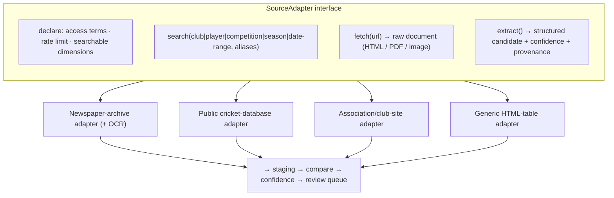
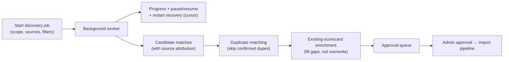

# 18. Online Match Discovery Architecture

**Deliverable 18 of 38** · §15

Background discovery of historical/online matches, with administrator approval, resumable
jobs and strict respect for copyright, access restrictions and provider terms.

## 18.1 Defaults (§15)

| Setting | Default |
|---|---|
| Scope | Search Entire Workspace |
| History range | All Available History (**no arbitrary 150-year limit**) |
| Partial records | Include Partial Records |
| Duplicates | Skip Confirmed Duplicates |
| Approval | **Administrator Approval Required** |

## 18.2 What it searches

Historical club aliases, historical competitions, newspaper archives, cricket databases
and **publicly accessible** online sources. Sources are pluggable; each source declares its
access terms and whether automated querying is allowed. Disallowed/paywalled/
authentication-gated sources (e.g. Cricket Archive) are **manual-research links**, not
crawled.

## 18.2a Historical web scraping — a CORE capability `[CONFIRMED REQUIREMENT · DECISION D20]`

The user explicitly authorises **web scraping of publicly accessible historical cricket
sources** to discover and recover historical records. It is a **core** OneStats capability,
built primarily in **Phase 9 (Auto Discovery)** and **Phase 10 (Research Centre)**, within
the compliance guardrails of §18.4 (publicly accessible only; never bypass access controls,
paywalls or authentication; respect robots.txt, licensing, privacy and reasonable request
limits).

### Source-specific scraper adapters

A modular **`SourceAdapter`** interface (mirroring the import connectors, deliverable 17),
one adapter per source, each declaring: base URL(s), access terms (robots/licence/rate
limit), the search dimensions it supports, and its extraction logic.

### Extraction

Extract structured information from **historical scorecards, match reports, competition
records and digitised newspaper articles**: match metadata (teams, date, venue,
competition/grade, result), innings/batting/bowling lines where present, and partial
information. Extraction is tolerant of incomplete/ambiguous source text and **preserves
uncertainty** — never fabricating missing values (unknown ≠ zero).

- **HTML/structured** → parse to candidate records (HTML tables, semantic markup).
- **PDF / digitised documents** → text/table extraction.
- **Scanned newspaper images → OCR** (deliverable 36 tech): OCR output carries a
  **per-field confidence**, and **unclear scanned text is preserved as uncertain** (shown
  with the OCR'd text + the source image), never silently "cleaned" into a definite value.

### Research dimensions & identity

- Search by **club, player, competition, season and date range** (and combinations).
- Recognise **historical club names, aliases and team identities** (deliverable 11) so a
  club's former names are searched and matched.
- **Compare** discoveries with existing OneStats records; identify **missing matches,
  missing performances and conflicting information** (feeds the Research Centre, deliverable
  19).
- **No automatic player merges on matching names alone** (deliverable 12 §12.3a) —
  discoveries only *suggest* identity links with evidence; a human decides.

### Confidence, provenance & evidence

Every extracted item carries a **confidence level** and full provenance: **source URL,
publication details, retrieval date**, the raw snippet/image, and the extraction method.
Low-confidence or conflicting items are flagged for closer review, never auto-accepted.

### Scheduling & resumability

Research runs as **scheduled tasks** (e.g. periodic sweeps) and **resumable searches**
(persisted cursor + restart recovery, §18.3) — important for sources that must be queried
slowly within rate limits over >100 years of records.

### Targeted discovery from the Historical Research Timeline

Discovery can be **launched targeted** at a specific gap identified by the **Historical
Research Timeline** (deliverable 19 §19.6): a season/grade/team/date-range (with club
aliases) is passed as the job scope, so scraping focuses where coverage is Partial /
Significant Gaps / Unassessed. Approved findings feed back and **recalculate** that season's
coverage.

## 18.3 Job model

- Jobs are **pausable/resumable** with progress tracking and **restart recovery** (a
  persisted cursor so a crash/restart continues, not restarts).
- Candidates carry **source attribution** and land in the same staging/approval pipeline
  as imports (deliverables 16–17).
- **Enrichment** fills gaps in existing records without overwriting verified data
  (unknown → known only via approval).

## 18.4 Compliance (§15/§33) — non-negotiable guardrails on scraping

- **Publicly accessible sources only.** Respect `robots.txt`, rate limits, source terms,
  **licensing and privacy**, and reasonable request limits (polite crawling, backoff,
  caching). **Never bypass** paywalls, authentication or any access control.
- Each `SourceAdapter` declares its access terms; a source that disallows automated access,
  or requires login/subscription, is a **manual-research link**, not scraped.
- Respect **copyright** of source text/images: store provenance and copyright metadata;
  published outputs honour it (deliverables 19–20, 29). Scraped material supports research
  and verification; it is not redistributed in breach of a source's licence.
- **Privacy:** do not harvest personal/private data beyond the cricket record; protect
  junior/DOB data (deliverables 24, 33); nothing personal goes to an external service.
- Publication dates are kept **separate** from match dates (deliverable 19).
- Everything requires **administrator approval** before becoming canonical; nothing is
  auto-verified, and nothing with unresolved low confidence is promoted.
- **Review the decision:** making scraping a core capability is `[DECISION D20]` —
  presented for approval with these guardrails (deliverable 37).

## 18.5 Phasing

Specified now; built in **Phase 9**, after the import pipeline (Phase 8) and before/with
the Research Centre (Phase 10). High legal/technical risk — see deliverable 37.
