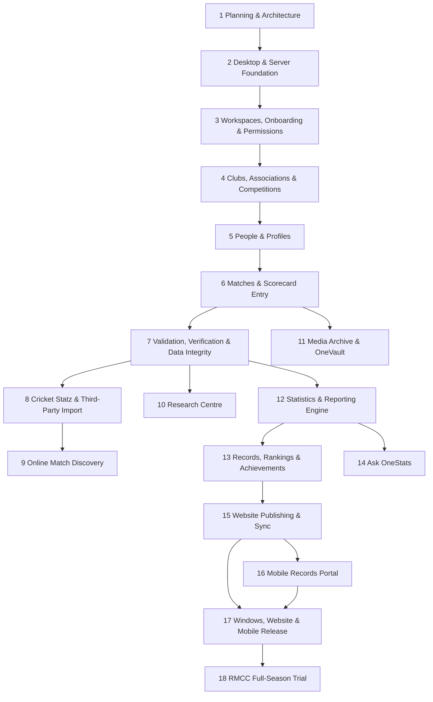

# 18-Phase Development Roadmap

**Supporting document** (§31) · referenced by deliverables 1, 35, 37

The 18 phases with purpose, dependencies, key risks and sensible overlap. Phase 1 is this
documentation set. **No phase after 1 starts without user approval.**

## Dependency overview

## Phases

| # | Phase | Purpose | Depends on | Key risks |
|--:|---|---|---|---|
| 1 | Planning & Architecture | This doc set | — | Scope creep; unverified external facts |
| 2 | Desktop & Server Foundation | Tauri+React shell, FastAPI sidecar, PG schema v1, auth, migrations, CI, installer | 1 | Sidecar packaging (D7); TLS on LAN (D18) |
| 3 | Workspaces, Onboarding & Permissions | Workspace isolation, onboarding wizard, roles/permissions, audit | 2 | Isolation correctness (D2); RLS complexity |
| 4 | Clubs, Associations & Competitions | Org model, competitions/grades/seasons, playing conditions | 3 | Historical modelling edge cases |
| 5 | People & Profiles | People registry, roles/history, controlled merge | 4 | Identity merge safety; privacy (D3) |
| 6 | Matches & Scorecard Entry | Scorecard model + fast grid UX, unknown-aware entry | 5 | Grid UX is the hardest piece |
| 7 | Validation, Verification & Data Integrity | Verification state machine, audit rules engine | 6 | Unknown-vs-wrong rule correctness |
| 8 | Cricket Statz & Third-Party Import | Staging pipeline, MXP/CSV parsers, PlayHQ connector | 7 | **Needs real samples + PlayHQ key**; format unknowns |
| 9 | Online Match Discovery | Background discovery jobs, approval queue | 8 | **Legal/ToS** (copyright, access) |
| 10 | Research Centre | Reconstruction, source library, conflicts, verify queue | 7 (parallel w/ 8–9) | Field-level provenance complexity |
| 11 | Media Archive & OneVault | Media storage abstraction, originals, heritage | 6 | OneVault API unknown (D6) |
| 12 | Statistics & Reporting Engine | The one engine + Report Builder + exports | 7 | Correctness; performance |
| 13 | Records, Rankings & Achievements | RMCC catalogue, milestones, captaincy, partnerships | 12 | Counting decisions (D4,D9–D13) |
| 14 | Ask OneStats | NL → deterministic query | 12 | NL approach (D16); no fabrication |
| 15 | Website Publishing & Sync | Publication edge, read-only API, RMCC site | 13 | Lovable site API unknown (D17) |
| 16 | Mobile Records Portal | Responsive read-only portal | 15 | Privacy scoping |
| 17 | Windows, Website & Mobile Release | Harden, package, docs, backups, remote access | 15,16 | Release hardening |
| 18 | RMCC Full-Season Trial | Real-world trial with RMCC | 17 | Real-data surprises; feedback loop |

Optional future: **Cloud Hosting & Wider Commercial Deployment** (architecture already
supports it as a config change).

## Overlap guidance

- Phases 8/9/10 (import, discovery, research) share the staging/approval pipeline and can
  overlap once Phase 7 exists.
- Phase 11 (media) can begin after Phase 6.
- Phases 13 and 14 both build on Phase 12 and can overlap.
- Phases 15/16 share the publishing edge.

## Critical external dependencies (gate certain phases)

- **Phase 8:** real Cricket Statz sample files + PlayHQ API access for RMCC.
- **Phase 9:** legal review of discovery sources.
- **Phase 15:** confirmation of the RMCC Lovable site's integration capability.
