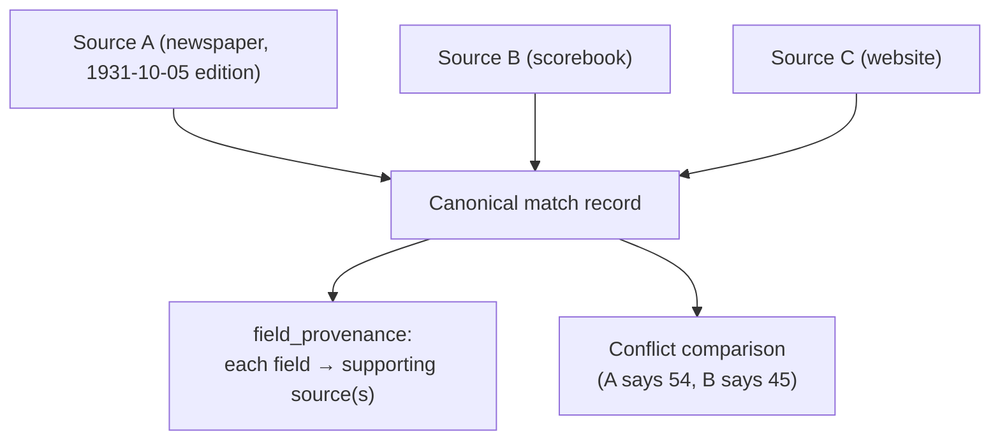
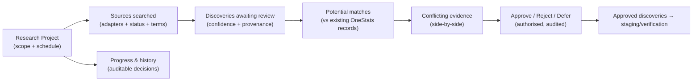
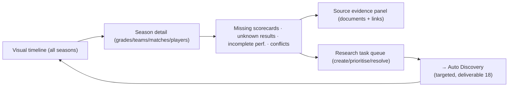

# 19. Research Centre Architecture

**Deliverable 19 of 38** · §16

Location: **Matches → Research Centre.** Supports historical reconstruction from multiple
sources while maintaining **one canonical match record** and field-level provenance.

## 19.1 Five areas (§16)

| Area | Purpose |
|---|---|
| 1. Historical Scorecards | Reconstruct scorecards from sources; partial information; research notes; save/resume |
| 2. Find Matches Online | Launch/monitor discovery jobs (deliverable 18) |
| 3. Source Library | Manage source documents/editions, citations, copyright, media |
| 4. Research Gaps | Surface missing matches/fields/seasons to target research |
| 5. Review & Verify | Verification queue (deliverable 14), conflict comparison |

## 19.2 Canonical record + provenance

- **One canonical match record** per real match; multiple sources link to it.
- **Field-level provenance:** each field records which source(s) support it, so a
  scorecard can be assembled from several partial sources with full traceability.
- **Conflict comparison:** when sources disagree, both values are retained and compared;
  the record can be marked Disputed (deliverable 14) until resolved.
- **Multiple newspaper editions** of the same report are distinct sources; **publication
  date is stored separately from the match date** (§16).

## 19.3 Reconstruction workflow

1. Create/attach source documents (Source Library) with citation + copyright + optional
   media image.
2. Build/extend the scorecard from a source, tagging each entered field with its source.
3. Save/resume partial reconstructions (nothing forced to complete).
4. Compare conflicting sources; record research notes.
5. Submit to Review & Verify; reviewer sets Verified / Verified Partial / Disputed.

## 19.4 Research Gaps

Derived views highlighting: seasons with no matches, matches with missing scorecards,
fields commonly unknown, people with sparse histories — to direct research effort.
Unknown-aware (a known-incomplete record is a gap; it is never silently zero-filled).

## 19.5 Research Projects & discovery review interface (scraping-driven)

With historical web scraping now a core capability (deliverable 18 §18.2a,
`[DECISION D20]`), the Research Centre is organised around **Research Projects** that drive
and review scraped discoveries. A project scopes a line of research (e.g. "RMCC seasons
1891–1950", "find Pomonal away matches 1920s") by **club, player, competition, season and
date range**, including historical aliases.

The interface surfaces:

| Panel | Shows |
|---|---|
| **Research projects** | Active/paused projects, scope, schedule, owner |
| **Sources searched** | Which `SourceAdapter`s ran, access terms honoured, last run, rate-limit status |
| **Discoveries awaiting review** | Extracted candidates with **confidence**, source URL, publication details, retrieval date, raw snippet/image |
| **Potential matches** | Each discovery compared to existing records (new match? enrichment of a known match? duplicate?) |
| **Conflicting evidence** | Side-by-side source disagreements (deliverable 14 Disputed) |
| **Approved discoveries** | Promoted to staging/verification, with the approver + decision |
| **Research progress & history** | Per-project progress and an **auditable history of every research decision** (approve/reject/defer, by whom, when, why) |

Decision controls: an authorised user may **Approve, Reject or Defer** each discovery;
nothing enters verified statistics without review. **No player merges on matching names
alone** (deliverable 12 §12.3a). Scheduled and resumable (deliverable 18), designed to work
across **more than 100 years** of records (no arbitrary date limit; unknown-aware).

## 19.6 Historical Research Timeline `[CONFIRMED REQUIREMENT · DECISION D21]`

A core Research Centre feature: a **coverage timeline** across a workspace's full available
history, so researchers can see what is covered, what is missing, and where to focus — with
a **transparent, configurable** methodology that shows **Unassessed** rather than inventing
a completeness percentage.

### Season coverage classification

Each season (per the filters below) is classified:

| Class | Meaning |
|---|---|
| **Comprehensive** | Coverage evidence indicates the season's matches are substantially present |
| **Partial** | Some matches/records present, known gaps remain |
| **Significant Gaps** | Large portions missing |
| **Unassessed** | **Insufficient evidence to judge coverage** — shown as Unassessed, never a fabricated % |

### Coverage methodology (transparent & configurable)

- Coverage is **calculated** from available **fixture lists, scorecards, season records and
  supporting evidence** — not from a guess. The weighting/thresholds that map evidence to a
  class are **configurable per workspace** and **documented** (shown to the user).
- **Completeness ≠ verification** (distinct axes): a season can be comprehensively *recorded*
  yet unverified, or verified-but-incomplete. The timeline shows both.
- **Never assume a season is complete** merely because all *currently known* matches have
  records — absence of a fixture list is **Unassessed/Partial**, not Comprehensive.
- **Confirmed inactivity vs missing evidence** are distinct: a season the club demonstrably
  did not play (evidenced) is marked inactive, **not** the same as a season with no surviving
  evidence (Unassessed). Unknown ≠ zero (deliverable 22).

### Capabilities

- **Drill-down:** season → grades → teams → matches → players, each showing coverage.
- **Identify:** missing scorecards, unknown results, incomplete performances, conflicting
  records (links to deliverables 14, 15).
- **Source links:** every assessment links to its **source documents and supporting
  evidence** (Source Library, §19.1).
- **Auto Discovery integration:** a gap can **launch a targeted discovery/scrape**
  (deliverable 18) scoped to that season/grade/team/date range and club aliases.
- **Research tasks:** authorised users **create, prioritise and resolve** research tasks
  against gaps; the timeline shows **research progress and newly verified discoveries**.
- **Historical identity:** supports **historical club identity changes and predecessor
  teams** (deliverable 11) so coverage follows a club through its former names.
- **Recalculation:** season coverage is **recalculated after approved imports, corrections
  and research findings** (and after identity merges, deliverable 12 §12.3a).
- **Audit trail:** every coverage assessment and change is **audited** (what changed, when,
  by whom / by which import or finding).

### Interface

A **visual timeline**, a **season detail view**, a **research task queue**, and a **source
evidence panel**. Filters: **organisation, competition, grade, team and date range**.
Designed for **>100 years** of history (no arbitrary date limit; Unassessed-aware).

## 19.7 Integrity

- Research never overwrites Verified data without going through verification (deliverable
  14); scraped discoveries enter as Draft/Researching and must pass review.
- All source material, OCR text, confidence and notes are preserved (provenance, §33);
  **uncertainty from unclear scans is preserved**, never fabricated.
- Copyright/licensing info on each source is mandatory where applicable; scraping respects
  access controls and published outputs respect copyright (deliverables 18 §18.4, 20, 29).
