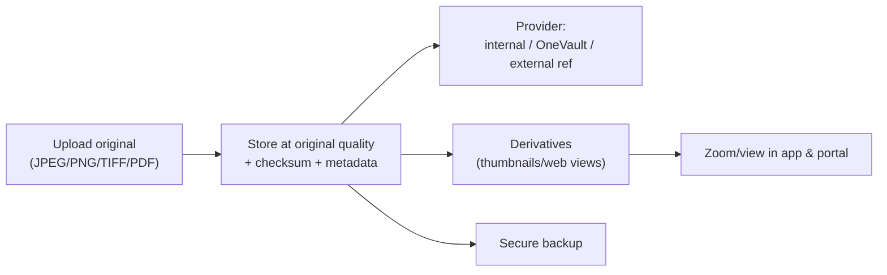

# 20. Media Archive Architecture

**Deliverable 20 of 38** · §17

Preserves original scorecard images and historical documents at original quality, with
source metadata, copyright information and secure backup. Includes an optional **Club
Heritage Collection**.

## 20.1 Capabilities (§17)

- Original scorecard images and documents: **JPEG, PNG, TIFF, PDF**.
- Multiple documents per match; original-quality preservation (no lossy
  re-encoding of originals).
- Zoom/viewing; source metadata; copyright information; **historical significance
  markers**.
- Secure backup (deliverable 32) and export.
- Optional **Club Heritage Collection** — a curated set suitable for optional website
  publication (deliverable 29), permission-gated.

## 20.2 Model

`media_asset` (deliverable 5): `storage_provider` (internal|onevault|external_ref),
`stable_media_id`, `mime`, `original_quality`, `checksum`, `copyright_info`,
`significance`, `workspace_id`. Linked from `source_document`, `person` (photos),
`branding` (logos), matches (evidence).

- **Originals are never modified or auto-deleted** (§18). Derivatives
  (thumbnails/optimised web views) are generated separately for display/publishing; the
  original is the preservation master.
- **Stable media identifiers** (deliverable 18/21) so references survive provider
  migration.
- **Checksums** detect corruption; verified on backup/restore.

## 20.3 Storage providers

Three options per asset (deliverable 21): OneStats Internal Storage (default), Optional
OneVault Integration, External File References. Migration between providers is supported
without breaking references (stable IDs). Internal storage partitions by workspace
(isolation, deliverable 6).

## 20.4 Copyright & privacy

- Copyright/source metadata is mandatory where applicable; publication (deliverable 29)
  only exposes assets cleared for publishing and respects copyright.
- Junior/private imagery is protected (deliverables 24, 33) and excluded from public
  portal/website unless explicitly cleared.

## 20.5 Mobile uploads

Media can be uploaded **directly from a mobile phone** (camera, photo library, PDFs) via a
QR-paired, time-limited secure session — full design in
[20a-mobile-upload-architecture.md](20a-mobile-upload-architecture.md) (`[DECISION D22]`).
Originals + metadata are preserved, previews/thumbnails generated, uploads associated with
players/matches/seasons/orgs/research or sent to a review queue, and any extracted
statistics require human verification before entering official records.

## 20.6 Phasing

Core media management built in **Phase 11** (Media Archive & Optional OneVault Integration);
the **mobile upload interface is coordinated with Phase 16** (mobile portal). Foundational
hooks are accommodated in Phase 2 (20a §20a.8) without building later-phase functionality.
