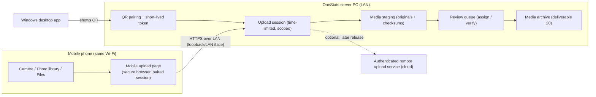
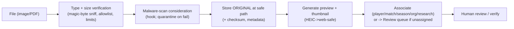

# 20a. Mobile Image & Document Upload Architecture

**Companion to deliverables 20 (media archive), 30 (mobile portal), 21 (OneVault), 33
(security).** `[CONFIRMED REQUIREMENT · DECISION D22]` Lets **authorised users upload media
and historical cricket records directly from a mobile phone** — camera capture, photo-
library selection and PDFs — **without a desktop**, paired securely from the Windows app.

Phase allocation: **core media management → Phase 11**; **mobile upload UI → coordinated
with Phase 16** (mobile portal); **foundational hooks → Phase 2** (see §20a.8). Do not build
later-phase functionality early.

## 20a.1 Capabilities (confirmed)

Mobile-friendly secure-browser upload · **camera capture** · multi-select from the photo
library · **PDF + supported documents** · **QR pairing** from the Windows app · **secure,
time-limited upload sessions** · progress/retry/failure recovery · **preserve originals +
metadata** · generated previews/thumbnails · JPEG/PNG/**HEIC**/other appropriate formats ·
associate uploads with **players, matches, seasons, organisations, research projects** ·
**review queue** for unidentified/unassigned media · optional image analysis / historical
scorecard extraction · **human verification before any extracted statistics enter official
records** · protect **junior photos & private info** by permission · **upload attribution +
audit** · optional **future OneVault** storage (never a dependency).

## 20a.2 Topology — local-first, optional remote later



- **Local-network uploads** (primary): the phone reaches the OneStats server over the LAN.
  The server binds the upload endpoint to the LAN interface **only when a pairing session is
  active**; the **dev FastAPI server is never exposed to the public internet** (§20a.7).
- **Optional remote uploads** (later release): through an **authenticated** service, not the
  dev server. Designed for, not built now.

## 20a.3 QR pairing & time-limited sessions (security-critical)

```mermaid
sequenceDiagram
  participant D as Desktop (authed user)
  participant S as Backend
  participant P as Phone
  D->>S: request upload session (user, scope, ttl)
  S-->>D: session id + short-lived token + LAN URL (encoded in QR)
  D->>D: render QR
  P->>S: open paired URL (token)
  S-->>P: scoped upload page (no long-lived credential stored)
  P->>S: upload files (token per request)
  S-->>P: progress / resumable upload ids
  Note over S: token expires (short TTL); session is revocable; audited
```

- The QR encodes a **single-use/short-lived token** and the LAN URL — **not** the user's
  real credentials. Tokens are **short-TTL, scoped** (to the pairing user, permissions and
  optionally a target association/match/project), **revocable**, and **audited**.
- Sessions are **time-limited**; expiry/idle closes them. No long-lived secret lands on the
  phone. Pairing requires an **already-authenticated desktop user** with upload permission.

## 20a.4 Upload pipeline



- **Preserve originals + metadata** (deliverable 20): the uploaded file is the preservation
  master (never re-encoded); EXIF/source metadata retained (with privacy stripping options
  for public use). **Checksums** detect corruption.
- **Previews/thumbnails** are derivatives; **HEIC** is transcoded to a web-safe preview for
  display while the HEIC original is preserved.
- **Resumable/chunked** uploads with progress, retry and failure recovery (important on
  mobile networks).
- **Associations**: attach to players, matches, seasons, organisations or research projects
  (deliverable 19); unassigned media goes to the **review queue**.
- **Image analysis / scorecard extraction** is optional and **advisory** — any extracted
  statistics require **human verification before entering official records** (deliverables
  14, 15, 18 §18.2a OCR-uncertainty rules apply).

## 20a.5 Storage, privacy, audit

- Media uses the **storage-provider abstraction** (deliverable 21): internal storage by
  default; **optional OneVault** later; OneVault is never a dependency. Stable media IDs so
  references survive provider migration.
- **Safe storage paths**: generated, non-guessable paths under the media root; filenames
  sanitised; no path traversal; per-workspace partitioning (isolation, deliverable 6).
- **Privacy**: junior photos and private info are permission-protected (deliverables 24,
  33); not exposed publicly (deliverables 29–30) unless explicitly cleared.
- **Attribution + audit**: who uploaded what, when, from which paired session; append-only
  audit (deliverable 33).

## 20a.6 Permissions

Uploading requires an authenticated user with **media-upload permission**; pairing is
initiated by such a user from the desktop. Reviewing/assigning and verifying extracted data
are separately permissioned (deliverable 7). Viewing protected media follows the junior/
private rules (deliverable 33).

## 20a.7 Security requirements (non-negotiable)

- **Never expose the local dev FastAPI server to the public internet.** LAN upload binding
  is active only during a pairing session and restricted to the local network.
- **QR pairing uses secure authentication + short-lived credentials** (§20a.3); tokens are
  scoped, revocable and audited; transport is TLS on the LAN (deliverable 31, `[DECISION
  D18]`).
- **File-type verification** by content (magic bytes) against an allowlist, not just
  extension; **upload size limits**; **malware-protection consideration** (scan hook +
  quarantine); **safe storage paths**.
- Secrets/tokens are never logged; the phone stores no long-lived credential.

## 20a.8 Phase 2 foundational requirements (accommodate now, build later)

So later phases are not blocked, Phase 2's foundation should keep room for:

- **Auth/session token foundation** capable of issuing **short-lived, scoped tokens** (the
  pairing tokens are a specialised case) — Phase 2 deliberately ships no auth yet, but the
  config/architecture must not preclude it.
- **Media storage abstraction + stable IDs** reserved in the data model (deliverables 5, 21)
  — no media tables are created in Phase 2, but the pattern is planned.
- **Config for upload size limits, allowed types and the media root path** (extend the
  settings model later; keep settings env-driven).
- **Loopback-only dev binding** today (the backend binds `127.0.0.1` in dev) — LAN binding
  is an explicit, session-gated opt-in added with the feature, never a default.
- No Phase 11/16 code is written in Phase 2.

## 20a.9 Open items (for review)

- `[DECISION D22]` approve the mobile-upload architecture and its security model.
- Confirm remote-upload (cloud) is explicitly a **later release**, not in the initial build.
- Confirm the malware-scanning approach (local scanner vs. defer with quarantine) for the
  LAN-only initial scope.
