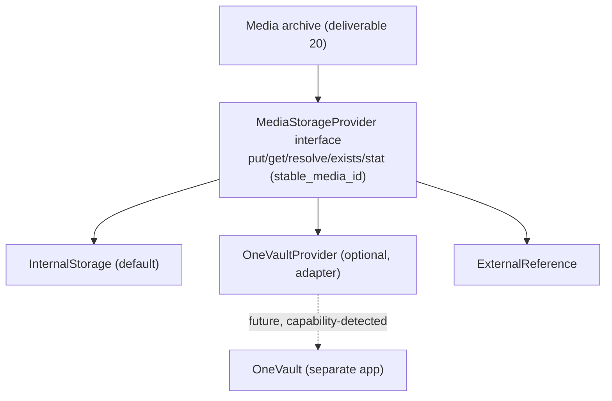

# 21. OneVault Integration Contract

**Deliverable 21 of 38** · §18

OneStats must work **fully without OneVault**. Integration is optional and designed
against an **abstraction**, because OneVault is **not assumed to have a working API**.
OneVault (`C:\OneVault`) is a separate project OneStats never modifies.

## 21.1 Media storage abstraction

A single `MediaStorageProvider` interface with three implementations (§18):

| Provider | Description | Default |
|---|---|---|
| **InternalStorage** | OneStats-managed files on the server | ✅ default |
| **OneVaultProvider** | Delegates to OneVault (optional) | opt-in |
| **ExternalReference** | Points at files OneStats does not own | opt-in |

## 21.2 Contract rules (§18)

- **Optional:** every media feature works with InternalStorage alone; OneVault is never a
  hard dependency.
- **Stable media identifiers:** OneStats stores its own `stable_media_id`; provider-
  specific locators are resolved behind the interface, so switching providers doesn't
  break references.
- **Respect permissions:** OneStats honours OneVault's access permissions; it never
  escalates or bypasses them.
- **No auto-delete of originals:** OneStats never deletes originals in OneVault or
  external stores.
- **Optional migration:** assets can be migrated between providers (internal ↔ OneVault ↔
  external) with audit, preserving stable IDs and checksums.
- **Capability detection:** the OneVault adapter **detects** whether an API exists at
  runtime; if not, OneVault options are disabled gracefully. No assumptions about
  OneVault's interface are baked in.

## 21.3 Future One-family compatibility

The same abstraction pattern (stable IDs + adapter + capability detection) is the
template for future One-software integrations (§18/§33). OneStats exposes stable record
and media identifiers so sibling apps can reference OneStats data later without coupling.

## 21.4 Status & phasing

- `[UNVERIFIED]` OneVault's API is unknown; the adapter is **stubbed** until a real
  OneVault interface is confirmed. `[DECISION D6]` — confirm whether OneVault integration
  is in scope for the initial release or deferred.
- Built in **Phase 11** alongside the media archive; InternalStorage first, OneVault
  adapter only if/when an API is available.
