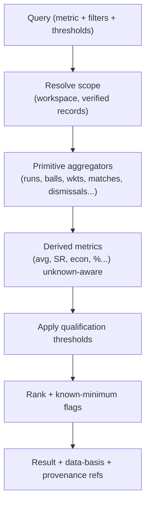

# 22. Statistics Calculation Architecture

**Deliverable 22 of 38** · §19

**One deterministic statistics engine** is the single source of all calculations
(batting, bowling, fielding, wicketkeeping, captaincy, participation, team performance,
partnerships, records, milestones, awards). No calculation logic is duplicated in the UI,
reports, Report Builder or Ask OneStats — they all call this engine.

## 22.1 Core principles (referenced across all stats docs)

1. **Deterministic** — same inputs → same outputs; no randomness, no estimation.
2. **Verified data only** — the engine reads Verified / Verified Partial (within scope)
   records (deliverable 14); Draft/Disputed excluded.
3. **Unknown ≠ zero** — unknown values are **excluded** from calculations, never treated
   as 0. Where a total is affected, the engine reports a **known-minimum** and flags it.
4. **Never invent statistics** — if data is insufficient, the engine returns "unknown" /
   "insufficient data", not a guess.
5. **No double counting** — each performance contributes once; derived stats are computed
   from normalised rows, never from pre-aggregated duplicates.
6. **Document limitations** — every result can report its data basis and qualifications
   (matches counted, partial/unknown caveats, thresholds applied).
7. **Provenance-aware** — results can drill to the underlying records.

## 22.2 Known-minimum semantics (important)

When some contributing values are unknown, aggregates are reported as a **known-minimum**
with an explicit flag, e.g. *"≥ 1,240 runs (3 innings unknown)"*. Rankings distinguish
confirmed totals from known-minimums so a player is never unfairly ranked on incomplete
data, and reports can show or hide known-minimum entries. Averages/rates are computed
only over the known contributing values and labelled accordingly.

## 22.3 Filtering dimensions (§19)

Workspace, club/organisation, competition, grade, season, historical period, match
classification, player, team. Plus the mandatory separations:

- **Home & Away** vs **Finals (excluding Grand Finals)** vs **Grand Finals** — kept
  separate where required; `match.classification` drives this.
- Match records are available separately for Home & Away, Finals and Grand Finals
  (deliverable 23).

### Full per-player breakdown dimensions (validated against the Cricket Statz stats viewer, 16a.14)

The engine must support breaking a player's record down by: **Division/grade · Season ·
Team · Opponent · Ground/Venue · Batting Position · Match Type (1Inn/2Inn/T20) ·
Played-With (teammate) · Dismissed-By (bowler) · Partnership partner**. These are the same
engine metrics with an extra group-by, so no logic is duplicated (they feed the player
profile tabs, deliverable 12a, and the Report Builder, deliverable 27).

### Matchup analytics (candidate features beyond the core catalogue)

The viewer also provides batter-vs-bowler matchups — **Dismissed-By** (which bowlers most
dismissed a batter), **Bowling/Fielding Victims** (whom a player dismissed), and **Victim
Batting Position** (where in the order a bowler takes wickets). These are deterministic,
engine-derived, and proposed as OneStats features (user to confirm priority).

## 22.4 Engine structure

- **Primitive aggregators** are small, individually tested pure functions over
  normalised rows (batting/bowling/fielding/appearances).
- **Derived metrics** compose primitives; each has a documented formula (deliverables
  23–25) and unknown-handling.
- Thresholds (deliverable 21/23) are parameters, not hard-coded, and workspace-configurable.

## 22.5 Calculation definitions (canonical)

| Metric | Formula | Unknown handling |
|---|---|---|
| Batting average | runs ÷ (innings − not-outs) | exclude innings with unknown runs; if dismissals unknown, label |
| Batting strike rate | (runs ÷ balls) × 100 | only over innings with known balls |
| Bowling average | runs conceded ÷ wickets | exclude spells with unknown figures |
| Economy rate | runs conceded ÷ overs | known overs only |
| Bowling strike rate | balls bowled ÷ wickets | known balls only |
| Matches played | count of `team_appearance.played = true` | `played` is explicit |
| Not out | `how_out = not_out` | distinct from unknown |
| Catch/stumping/run-out | fielding events by role | — |

Full report-level definitions and thresholds: deliverable 23. Captaincy: deliverable 24.
Partnerships: deliverable 25.

### Dismissal semantics (from the confirmed Cricket Statz legend, deliverable 16 §16.8)

The engine reads `how_out` (with original code preserved) to credit correctly and avoid
inflation:

- **Bowler wickets** are credited **only** for bowled, caught, caught_behind,
  caught_and_bowled, lbw, stumped, hit_wicket. **Run-outs and other non-bowler dismissals
  never credit a bowler** (no bowling-figure inflation).
- **Caught & bowled credits exactly one bowler wicket** and one fielding credit (the
  bowler) — no double counting.
- **Batting dismissals** (denominator of average) = genuine outs; `not_out`, `dnb`,
  `retired_not_out` are excluded; `dnb`/`absent` are not innings at all.
- **Fielding/keeper credit:** caught→fielder; caught_behind/stumped→keeper;
  caught_and_bowled→bowler; run_out→fielder. Unknown fielder/keeper ⇒ no credit (not
  guessed).
- **Unresolved `how_out` codes** (e.g. CS 22/23/24, or `unknown_out`/`retired_unspecified`)
  count the batter as **out of unknown manner** (in the average denominator) with **no**
  bowler/fielder credit, and are flagged — never guessed into a specific type. (`20` is
  confirmed Retired-Not-Out: **not** out, excluded from the denominator.)
- **Keeper catches** are identified by *the fielder being the recorded wicketkeeper* (the
  real data codes them as `caught`, not a separate "caught behind" code), so the keeper-vs-
  fielding catch split (deliverable 23, D13) keys on that, not on a dismissal code.
- **All statistics key on `person_id`, never on display names** — two different players with
  the same displayed name (e.g. the two "Bonner A", deliverable 16a.13) are never combined.
- **After an identity merge** (deliverable 12 §12.3a), affected career stats, rankings,
  records, captaincy, partnerships and fielding combinations are **recalculated from the
  underlying match records**, never by summing previously-calculated career totals (avoids
  double counting). A person is counted **once per match** even if two merged source IDs
  both appeared, and published data is refreshed through the normal approval process
  (deliverable 29). A **split/undo** merge recalculates back the same way.

### Statistical inclusion vs verification

`match.include_in_statistics` is **independent of verification state**. The engine excludes
a match flagged `include_in_statistics = false` (CS "exclude from stats") **even if
Verified**, and may include a Verified-Partial match within its verified scope. Both axes
are reported in a result's data-basis.

### Overs conversion

`overs` is cricket-over notation; deliveries = `floor(overs) × balls_per_over +
ball_digits`. Economy/strike-rate use correctly converted balls, never the raw decimal
(deliverable 16a.10).

## 22.6 Performance

- Hot leaderboards backed by **materialised views** refreshed on verification events;
  measured before optimising (deliverable 3).
- All materialised results are reproducible from the engine (they are a cache, never the
  source of truth).

## 22.7 Testing (ties to deliverable 34)

Every primitive and every report has fixture-based tests with hand-computed expected
values, including **unknown/partial** fixtures and **classification-split** fixtures.
Statistical correctness is a release gate.
