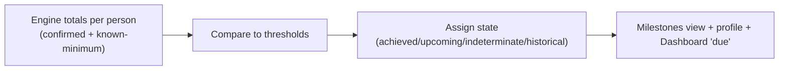

# 26. Milestones and Achievements Specification

**Deliverable 26 of 38** · §23

Workspace-configurable milestones and achievements, distinguishing **confirmed**
milestones from **known-minimum** totals (unknown ≠ zero), from the one engine.

## 26.1 Milestone categories (§23)

Matches played, runs, wickets, catches, run outs, stumpings, captaincy (matches/wins),
Grand Final appearances, Grand Final wins, years of service, seasons represented.

## 26.2 Milestone states

| State | Meaning |
|---|---|
| **Achieved (confirmed)** | The confirmed total has reached the threshold using verified data with no relevant unknowns. |
| **Achieved (known-minimum)** | Known-minimum total already meets the threshold (i.e. meets it even ignoring unknowns). Displayed as achieved, flagged. |
| **Upcoming** | Confirmed total is within a configurable window below the threshold (e.g. 5 matches away). |
| **Indeterminate** | Unknown data means the system cannot confirm whether the threshold is met — shown as such, **never** assumed achieved or not. |
| **Historical** | A milestone reached in the past (with the match/season it occurred). |

## 26.3 Configuration

- Thresholds per milestone type are **workspace-specific** (e.g. 100/150/200 matches;
  1,000/2,500/5,000 runs; 50/100/200 wickets). RMCC defaults proposed in Phase 13,
  pending user confirmation.
- "Upcoming" window configurable (e.g. show when within N of the next threshold).
- Milestones over time: a timeline of when each milestone was reached.

## 26.4 Methodology

- Totals come from the engine (deliverable 22); confirmed vs known-minimum is preserved.
- A milestone is **confirmed achieved** only when the *confirmed* total meets it;
  otherwise it is known-minimum/indeterminate — the system **distinguishes confirmed
  milestones from known minimum totals** (§23).
- Grand Final appearances/wins use `classification = grand_final`.
- Years of service / seasons represented use appearance spans (not DOB).

## 26.5 Achievements / awards link

Career achievements, awards and honour boards (spec §25 — configurable MVP/player points,
club/season awards, Life/Honorary Members, premiership teams/captains; designed for
optional RMCC-website publication) consume the same engine totals.

Milestones surface on the **player profile as badges** — see the badge catalogue and
profile design (from the real RMCC profile page) in
[12a-player-profile-and-badges.md](12a-player-profile-and-badges.md) §12a.4. Badges are
awarded automatically from verified records, honour the merged-identity rules (one
canonical person; deliverable 12 §12.3a), and carry the same states (achieved-confirmed /
known-minimum / upcoming / indeterminate).
Nothing is invented; an achievement with unknown underlying data is flagged, not asserted.
