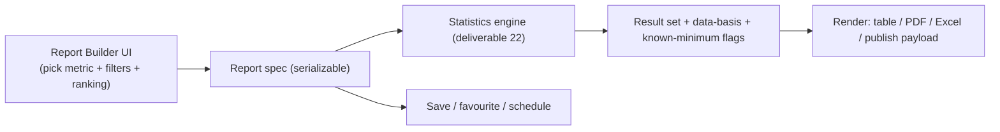

# 27. Report Builder Specification

**Deliverable 27 of 38** · §22

A flexible report tool that composes outputs from the **one engine** (deliverable 22) —
**no duplicate calculation logic**. Location: Statistics → Report Builder.

## 27.1 Capabilities (§22)

- **Standard reports** (the full RMCC catalogue, deliverable 23) and **advanced reports**
  (custom metric + filter combinations).
- **Saved reports** and **favourite reports** (per user/workspace).
- **Custom filters & group-bys:** workspace, club, competition, grade, season, historical
  period, classification (Home&Away / Finals / Grand Finals), player, team, thresholds, plus
  the breakdown dimensions validated against the Cricket Statz stats viewer (16a.14):
  **Division/grade, Opponent, Ground, Batting Position, Match Type (1Inn/2Inn/T20),
  Played-With, Dismissed-By, Partnership partner** — all the same engine metrics with a
  group-by, so no calculation logic is duplicated.
- **Multiple report selections** in one view (compose a page of reports).
- **Sorting**, **Top 10** and **extended rankings** (Top N / all).
- **PDF export** and **Excel export** (branded, deliverable 9).
- **Approved website publishing** (deliverable 29) and **mobile-friendly display**
  (deliverable 30).

## 27.2 Architecture

- A **report spec** is a declarative object (metric id + filters + thresholds + ranking +
  classification). It is the only thing saved; results are always recomputed by the
  engine (so saved reports never drift from truth).
- The same spec drives on-screen, PDF, Excel and publish outputs → one calculation path.

## 27.3 Export & publishing

- **PDF:** server-side rendering with workspace branding (logo, colours, contrast-safe);
  includes data-basis footnotes (matches counted, partial/known-minimum caveats,
  thresholds applied) — **never hides limitations**.
- **Excel:** openpyxl; raw rows + a summary sheet; same caveats as metadata.
- **Publish:** approved reports become a publication snapshot (deliverable 29); only
  Verified/approved data, never draft/disputed/private.

## 27.4 Integrity

- Qualification thresholds applied only where defined (deliverable 23 §11).
- Known-minimum and partial-verification caveats carried into every export and
  publication.
- Report specs are workspace-scoped; sharing a saved report never crosses workspaces.
