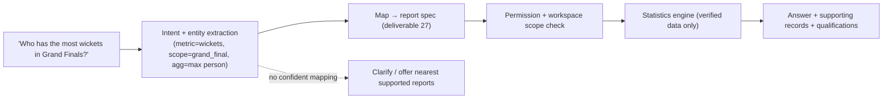

# 28. Ask OneStats Architecture

**Deliverable 28 of 38** · §26

A natural-language statistics assistant whose answers are **always** produced by the
deterministic engine (deliverable 22). It **never invents statistics**, respects
permissions, and shows supporting records with qualifications.

## 28.1 Principle — language in, deterministic query out

The NL layer only **maps a question to a report spec** (metric + filters). The numbers
come exclusively from the engine. The assistant is a *translator and presenter*, not a
calculator. If a question can't be mapped to a supported deterministic query, it says so
and offers the closest supported reports — it does not guess a number.

## 28.2 Example mappings (§26)

| Question | Mapped spec |
|---|---|
| "Who has scored the most runs for RMCC?" | metric=run_aggregate, scope=workspace, rank=top person |
| "Which captain has the highest winning percentage?" | metric=captain_win_pct, threshold=min eligible (D4), rank=top |
| "Who has the most wickets in Grand Finals?" | metric=wickets, classification=grand_final, rank=top |
| "What is the highest fourth-wicket partnership?" | metric=partnership_by_wicket, wicket=4, rank=max |

## 28.3 NL implementation `[DECISION D16]`

Two viable approaches; both keep calculation deterministic:

1. **Rule/grammar + synonym mapping** (no LLM) — parse intent to a fixed catalogue of
   metrics/filters. Fully offline, fully deterministic, predictable; limited phrasing
   flexibility.
2. **LLM for intent→spec only** — an LLM converts the question into a **validated report
   spec** (a constrained schema); the engine computes. The LLM never sees/produces the
   numbers. More flexible phrasing; needs a model (local or API) and strict output
   validation + guardrails.

**Recommendation:** start with (1) for the known RMCC question set (reliable, offline),
and optionally add (2) behind a validation boundary later. Either way, the **answer
numbers are always the engine's**. User to confirm whether an LLM is acceptable
(privacy/offline considerations, deliverable 33).

## 28.4 Guardrails

- **Permissions & workspace scope** enforced before the engine runs (deliverables 6–7);
  Viewers get only permitted, non-private data.
- **Qualifications shown** (thresholds applied, matches counted, partial/known-minimum
  caveats) with every answer, plus drill-down to supporting records.
- **No fabrication:** insufficient data ⇒ "insufficient/unknown data", never a guess.
- Answers are reproducible (same question → same engine spec → same result).
