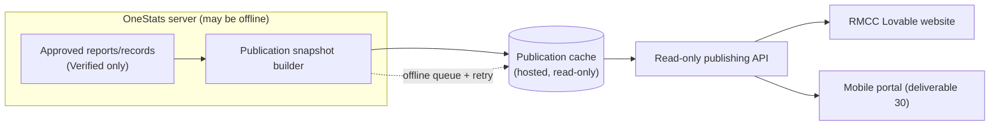

# 29. Website Publishing Architecture

**Deliverable 29 of 38** · §28

Automatic statistics publishing to a workspace's website — initial target: RMCC's
existing **Lovable-built** site. The public site must keep working **even when the
OneStats Windows server is offline**, and must never expose draft, disputed, private or
restricted records.

## 29.1 Decoupled publication edge

- OneStats builds **publication snapshots** of approved content and pushes them to a
  **hosted publication cache** that serves a **read-only API**. The website reads the
  cache, so it is independent of the OneStats server's uptime (§28).
- **Offline queue + retry:** if the cache is unreachable, publishes queue and retry; the
  previously published snapshot stays live meanwhile.

## 29.2 What may be published

- **Only Verified / Verified Partial (within scope) and explicitly approved** statistics,
  records, honour boards and heritage items.
- **Never:** draft, disputed, private or restricted records; protected junior/DOB data
  (deliverables 24, 33).
- Publishing is **permission-gated** (approve/withdraw = Admin/Reviewer, deliverable 7)
  and **audited**; corrections and withdrawals are first-class (a withdrawal republishes a
  snapshot without the item).

## 29.3 RMCC Lovable website integration `[UNVERIFIED]`

- **Do not assume** the existing website has a compatible API (§28). Phase 15 begins by
  **confirming** what the Lovable site can consume (static JSON feed, embedded widget,
  REST). `[DECISION D17]`.
- **Preserve the existing website design** where practical — OneStats supplies **data +
  branding tokens**, the site owns presentation. Options: (a) published JSON the site
  fetches; (b) embeddable read-only widgets; (c) pre-rendered pages. Decide against the
  real site.

## 29.4 Sync & logging

- **Automatic and manual** synchronisation; publication logs record what was published,
  when, by whom, and the snapshot version.
- Each workspace has independent publishing settings and its own snapshot (isolation,
  deliverable 6).
- The read-only API is **read-only** and exposes only approved data; it never proxies the
  administrative database (§29/§33).

## 29.4a Player profiles

Approved, verified **player profiles** (+ branding and optional sponsor) publish through the
same snapshot/cache as statistics — design in
[12a-player-profile-and-badges.md](12a-player-profile-and-badges.md) §12a.6. Junior/DOB and
unverified data are excluded; a profile re-publishes through the normal approval flow after
a stat change or an identity merge (deliverable 12 §12.3a).

## 29.6 Individual report publishing (Phase 15 — MANDATORY, added 2026-10-26)

Every **eligible** report in the Report Catalogue (deliverable 23 / the Phase 12 catalogue) must be able
to receive a **permanent public URL** that carries its **saved report filters**, so it can be linked from,
or embedded in, the existing RMCC website. Requirements:

- **Permanent, stable URLs per published report.** A publish action mints a durable, unguessable public
  URL (slug or token) bound to a report **id + saved filter set** (season/grade/competition/team/date/
  split/qualification). The URL does not change when the data updates. The RMCC website's category
  **External URL** field must accept these URLs directly.
- **Read-only JSON/API feed per report.** The same published report is available as read-only JSON
  (`.../r/<token>.json`) for embedding and third-party consumption — approved data only, never the admin DB.
- **Embeddable HTML** (an `<iframe>`-able, branded, read-only rendering) for sites that embed rather than
  link.
- **Automatic updates.** When approved statistics change (recompute / re-approval / merge), the published
  snapshot refreshes through the normal publication edge (§29.1/§29.4) — no manual re-export.
- **Club branding** on every public report (logo, colours, club name) via the workspace branding.
- **Public player profiles** publishable the same way (§29.4a), DOB/junior/unverified excluded.
- **Publish / unpublish / revoke** controls, per report, permission-gated; a revoked token stops resolving.
- **Privacy protections**: only publication-eligible, approved, non-private data; junior/DOB excluded;
  unverified/known-minimum clearly marked.
- **Secure hosting**: the public edge serves cached snapshots only; it **never** exposes the local
  PostgreSQL database or the desktop backend (§33). No admin surface is reachable from a public URL.

**Acceptance (Phase 15):** publish a report → the URL renders the correct, filtered, branded report; paste
it into the RMCC site's External URL field → it works; the JSON feed returns the same figures; a stats
change refreshes the public copy; unpublish/revoke makes the URL stop resolving; no admin/DB surface is
reachable. These tests join the deferred acceptance register (deliverable 62).

## 29.5 Phasing

Specified now; built in **Phase 15** (Website Publishing & Synchronisation), after the
stats/reporting engine (Phase 12) and records (Phase 13). Individual report publishing (§29.6) is a
mandatory part of Phase 15.
