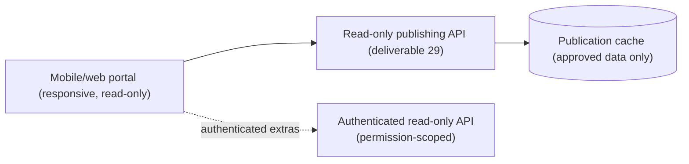

# 30. Mobile Portal Architecture

**Deliverable 30 of 38** · §29

A responsive, **read-only** records portal (iPhone, Android, tablet, desktop browsers)
with public and authenticated access, workspace branding, and strict protection of junior
and private information. It **never exposes the administrative database directly**.

## 30.1 Content (§29)

Player profiles, career statistics, records, match results, historical scorecards,
historical images, search, Ask OneStats (read-only, deterministic), workspace branding.
The **player profile** (layout, stat cards, Service & Honours, milestone badges) follows
[12a-player-profile-and-badges.md](12a-player-profile-and-badges.md), rendered responsively
and workspace-branded; the same approved profile snapshot feeds the website and the portal.

## 30.2 Architecture — reads the publication edge, not the DB

- Public portal reads the **same read-only publication cache** as the website — only
  approved, Verified, non-private data. Independent of OneStats server uptime.
- **Authenticated access** (members/admins) can see additional permitted data via a
  permission-scoped read-only API, still never the admin DB directly (§29).

## 30.3 Privacy (§29, deliverables 24/33)

- Junior and private information (DOB, contact, protected notes) is **excluded** from
  public views and shown only to authenticated users with the right permission.
- Age-based content never uses uncertain birth dates (deliverable 24).
- No write operations from the portal; no administrative actions.

## 30.4 UX

- Mobile-first responsive layout (the same design-token/branding system, deliverable 9);
  accessible (WCAG AA).
- Fast search over published people/matches/records.
- Ask OneStats available in read-only, deterministic form (deliverable 28), permission-
  and privacy-scoped.

## 30.5 Phasing

Built in **Phase 16** (Mobile Records Portal), reusing the publishing edge from Phase 15.
Likely a separate lightweight web app (`apps/portal/`, deliverable 4) deployed with the
publication cache.
