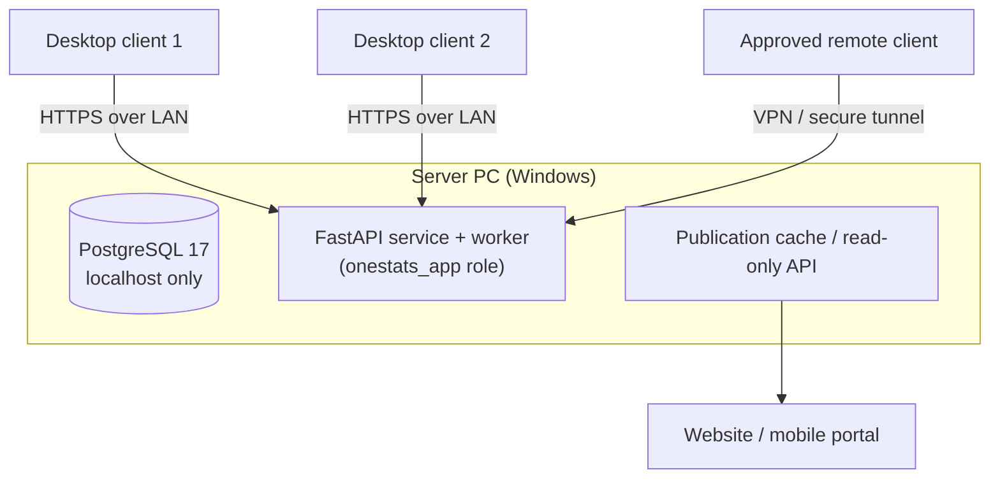

# 31. Windows Deployment Plan

**Deliverable 31 of 38** · §30

How OneStats is installed and run on Windows: a central server, multiple desktop clients,
secure connections, LAN access, approved remote access, backups, recovery, migration and
updates. The database is **never exposed to the public internet** (§3).

## 31.1 Two setup paths (§30)

1. **Set Up New OneStats System** — installs PostgreSQL (or uses the existing 17.11
   service), creates/configures the `onestats_app` role + `onestats` db, installs the
   FastAPI service + worker, and the desktop client; becomes the **server**.
2. **Connect to Existing OneStats System** — installs only the desktop client, pointed at
   an existing server over the LAN (secure connection).

## 31.2 Topology

- **Single-PC install:** server + one client on the same machine (FastAPI as a Tauri
  sidecar; PostgreSQL local). The RMCC starting point.
- **Client/server (LAN):** one server PC; additional clients connect over HTTPS on the
  LAN. PostgreSQL listens on localhost (and the LAN interface only if the API runs
  elsewhere — normally the API is co-located with PG, so PG stays localhost-only).
- **Approved remote access:** via VPN or a secure tunnel only — never by exposing
  PostgreSQL or the API to the public internet.

## 31.3 Security of connections

- Client↔API over TLS (self-signed/internal CA on LAN, documented trust setup) `[DECISION
  D18]`.
- DB credentials and tokens in the Windows Credential Manager (deliverable 33), never in
  config files.
- `onestats_app` is non-superuser; admin tasks use `postgres`/`scotney` manually, outside
  the app.

## 31.4 Updates, migration, recovery

- **Application updates:** Tauri auto-updater for clients; the server service updated via
  the installer; both signed.
- **Database migrations:** Alembic, applied by the server on upgrade with a pre-migration
  backup (deliverable 32).
- **Server migration:** documented `pg_dump`/restore + media move + credential re-setup
  to move the server to new hardware.
- **Recovery:** see deliverable 32.
- **Future dedicated server / cloud:** optional later phase; the architecture already
  separates server, clients and publication edge to make this a configuration change, not
  a rewrite.

## 31.5 Phasing

Foundation built in **Phase 2** (Windows Desktop & Server Foundation); server/client
split and remote access hardened through Phase 17 (Release).
