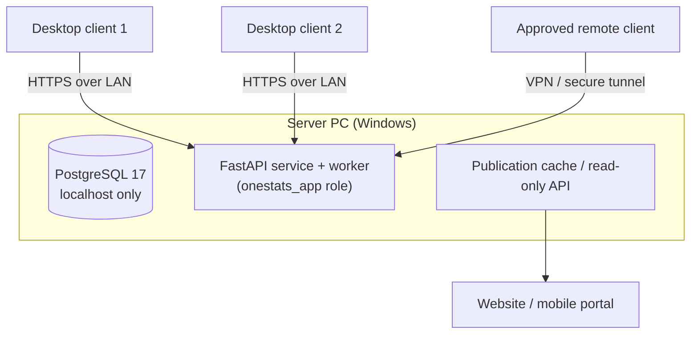

# 31. Windows Deployment Plan

**Deliverable 31 of 38** · §30

How OneStats is installed and run on Windows: a central server, multiple desktop clients,
secure connections, LAN access, approved remote access, backups, recovery, migration and
updates. The database is **never exposed to the public internet** (§3).

## 31.1 Two setup paths (§30)

1. **Set Up New OneStats System** — installs PostgreSQL (or uses the existing 17.11
   service), creates/configures the `onestats_app` role + `onestats` db, installs the
   FastAPI service + worker, and the desktop client; becomes the **server**.
2. **Connect to Existing OneStats System** — installs only the desktop client, pointed at
   an existing server over the LAN (secure connection).

## 31.2 Topology

- **Single-PC install:** server + one client on the same machine (FastAPI as a Tauri
  sidecar; PostgreSQL local). The RMCC starting point.
- **Client/server (LAN):** one server PC; additional clients connect over HTTPS on the
  LAN. PostgreSQL listens on localhost (and the LAN interface only if the API runs
  elsewhere — normally the API is co-located with PG, so PG stays localhost-only).
- **Approved remote access:** via VPN or a secure tunnel only — never by exposing
  PostgreSQL or the API to the public internet.

## 31.3 Security of connections

- Client↔API over TLS (self-signed/internal CA on LAN, documented trust setup) `[DECISION
  D18]`.
- DB credentials and tokens in the Windows Credential Manager (deliverable 33), never in
  config files.
- `onestats_app` is non-superuser; admin tasks use `postgres`/`scotney` manually, outside
  the app.

## 31.3a Packaged backend process management `[DECISION D7 — deferred; design recorded]`

Final sidecar packaging is deferred, but how the **packaged desktop app securely manages its
backend process** is specified now (per the Phase 2 review):

- **Lifecycle bound to the shell:** the Tauri shell starts the bundled FastAPI backend
  (PyInstaller sidecar) on app launch and **terminates it on exit/crash** — no orphaned
  process. A single instance per app.
- **Loopback-only by default:** the backend binds `127.0.0.1` on an **ephemeral port**; the
  shell passes the chosen port to the webview. It is **never bound to a public interface**;
  LAN binding is an explicit, session-gated opt-in (e.g. mobile upload pairing, 20a).
- **Local handshake:** the shell injects a **short-lived local token/secret** (via env/stdin
  to the sidecar, never a file) that the webview includes on requests, so only the paired
  desktop client can call the backend — defence against other local processes.
- **Secrets from the OS store:** the DB credential and any tokens come from the **Windows
  Credential Manager** at runtime, never from bundled files, and are never logged.
- **Health/supervision:** the shell polls `/api/v1/health` on startup and restarts the
  sidecar on failure, surfacing a clear error state in the UI.
- In **development** the backend and app run as two independent processes (deliverable
  DEVELOPMENT.md); the above describes the **packaged** app. The exact packaging
  (PyInstaller flags, signing) remains `[DECISION D7]`.

## 31.4 Updates, migration, recovery

- **Application updates:** Tauri auto-updater for clients; the server service updated via
  the installer; both signed.
- **Database migrations:** Alembic, applied by the server on upgrade with a pre-migration
  backup (deliverable 32).
- **Server migration:** documented `pg_dump`/restore + media move + credential re-setup
  to move the server to new hardware.
- **Recovery:** see deliverable 32.
- **Future dedicated server / cloud:** optional later phase; the architecture already
  separates server, clients and publication edge to make this a configuration change, not
  a rewrite.

## 31.6 Production installer & USB distribution (Phase 17 — MANDATORY, added 2026-10-26)

A professional Windows installation package, **distributable on a USB flash drive**, is a mandatory Phase
17 deliverable. Ordinary production installation must **never** require the user to install Python,
PostgreSQL, Node.js or developer tools by hand — the installer manages all dependencies.

**Three installation paths (one installer, a mode chosen at first run):**
- **A — Main computer / server:** installs the app + a **new standalone database** and the backend service.
- **B — Additional desktop client:** installs the app and connects to an **existing shared server/database**.
- **C — Standalone single computer:** app + local database on one machine (the common RMCC case).

**Requirements:**
- A standard Windows **installer executable** (e.g. MSI/NSIS/WiX), with app branding and Start-menu +
  desktop **shortcuts**.
- **Offline installation** where technically feasible (bundled prerequisites), suitable for USB.
- **Bundled or clearly-managed prerequisites** (the packaged FastAPI backend per §31.3a, and the database
  engine) — no manual developer-tool installs.
- **Guided first-run configuration**: choose path A/B/C; set up the admin; configure a **secure server
  connection** (TLS on LAN, §31.3) for clients.
- **Clear distinction between a new standalone database and an existing shared database**, with no
  ambiguity about which is being used.
- **Upgrade installation without loss of user data** — migrations run forward; a pre-upgrade **backup** is
  taken automatically (§32).
- **Repair** and **uninstall** options (uninstall must not silently delete the user's data without explicit
  confirmation).
- **Appropriate permissions and secure service configuration** (least-privilege service account; no
  unnecessary open ports).
- **Signed installers where feasible**, with clear handling of the code-signing **certificate requirements
  and costs** (a cost/paid decision to raise with the user before purchase).
- **Version information and release notes**; **installer checksums** published for verification.
- A **user-friendly installation guide** (non-technical, RMCC-volunteer-oriented).

**The installer must never overwrite an existing database without an explicit, verified and recoverable
migration process** (confirm target, back up first, migrate forward, allow rollback).

**Acceptance (Phase 17):** tested installation **from removable USB storage**; tested **clean install** on
a supported Windows machine; tested **additional-client** install against an existing server; tested
**upgrade** (data preserved) and **repair/uninstall**; checksums verified; release notes present. These
tests join the deferred acceptance register (deliverable 62). Several of these require real Windows
hardware/USB media and are **manual** acceptance items.

## 31.7 User management & first-login workflow (added 2026-10-26)

**Super Admin user management** (System Administration → User Management): create/edit/suspend accounts,
assign system (Super Admin) and workspace roles, assign users to one or more workspaces, issue **temporary
single-use expiring passwords** (changed on first login), send **time-limited invitation** links (and
revoke them), reset passwords, view a user's **login + admin audit history**, and promote/demote Super
Admins. All of this is **Super-Admin-gated in the backend** (not just the UI).

**New additional-client installation workflow:**
1. Install OneStats (installer or USB).
2. First run → **Connect to a server** (Settings → Server Connection, or the "backend unreachable" screen).
3. Enter the authorised **server address**; **Test connection** validates it (`/api/v1/health`) before saving.
4. On success the **login screen** appears (no new database is created when connecting to an existing server).
5. The user signs in with their issued credentials; a **temporary password forces a password change** before
   anything loads.
6. The app then loads **only the workspaces and features the user is authorised for** (backend permissions).

**New standalone / main-server installation:** the first-run **setup-token bootstrap** (deliverable 26)
creates the initial Super Admin — **no hard-coded default credentials**; the token is generated on first
run and written to a local operator-only file.

**Security guarantees (enforced in the backend):** passwords are **Argon2id** (never plaintext);
temporary/recovery credentials are **single-use and expire**; a **password-strength** floor applies; login
is **rate-limited**; **admin actions and login attempts are audited**; a **Club Admin can never grant
system-wide Super Admin** (escalation guard) and the **last active Super Admin cannot be removed/demoted**.

**Secure Super Admin account recovery:** an operator with **host access** runs a server-side command to
issue a one-time **recovery token** (hash in DB, plaintext in a local file); `POST /api/v1/setup/recover-
super-admin` then uses it to restore/reset a Super Admin (forcing a password change). Because it requires
the server-side token file, recovery **cannot be triggered remotely** and never bypasses authentication or
workspace isolation.

## 31.5 Phasing

Foundation built in **Phase 2** (Windows Desktop & Server Foundation); server/client
split and remote access hardened through Phase 17 (Release). The production installer & USB distribution
(§31.6) and the user-management/first-login workflow (§31.7) are mandatory Phase 17 deliverables.
