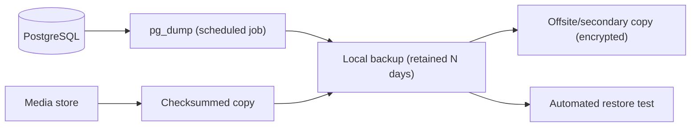

# 32. Backup and Disaster Recovery Plan

**Deliverable 32 of 38** · §30, §33

Protects the database, media and configuration, with automated backups, tested restores,
and documented recovery — honouring provenance (originals never lost) and security
(backups encrypted, no plaintext secrets).

## 32.1 What is backed up

| Asset | Method | Frequency (proposed) |
|---|---|---|
| PostgreSQL `onestats` | `pg_dump` (logical) + optional WAL archiving for PITR | Daily full; WAL continuous `[DECISION D19]` |
| Internal media store | File-level copy (checksummed) | Daily / on change |
| Configuration (non-secret) | Versioned export | On change |
| Secrets/credentials | **Not** in backups as plaintext; re-provisioned from the OS credential store | — |

## 32.2 Strategy

- **Automated scheduled backups** via the background worker (deliverable jobs); retention
  policy configurable (e.g. 7 daily, 4 weekly, 12 monthly).
- **Encryption at rest** for backup files; offsite/secondary copy encrypted.
- **Pre-migration backup** taken automatically before any Alembic migration (deliverable
  31).
- **Restore tests**: periodic automated restore to a scratch database to prove backups
  are valid (a backup never restored is not a backup).

## 32.3 Recovery objectives (proposed, confirm)

| Objective | Proposed target |
|---|---|
| RPO (max data loss) | ≤ 24 h (daily) or near-zero with WAL/PITR `[DECISION D19]` |
| RTO (time to restore) | ≤ 2 h on same hardware |

## 32.4 Disaster scenarios & response

| Scenario | Response |
|---|---|
| DB corruption | Restore latest good `pg_dump` (+ WAL replay for PITR); restore tests ensure validity |
| Media loss | Restore from checksummed media backup; verify checksums |
| Server hardware failure | Rebuild server (deliverable 31), restore DB + media, re-provision secrets |
| Bad migration | Roll back using pre-migration backup |
| Ransomware/accidental delete | Offsite encrypted copy; originals never auto-deleted (§18) |

## 32.5 Integrity & security

- Backups preserve all provenance, audit history and verification state (nothing dropped).
- No plaintext DB passwords or tokens in backups, logs or scripts (§3, deliverable 33).
- Restore procedures documented in the runbook (Phase 2+), and part of the release
  checklist (deliverable 17 release phase).
