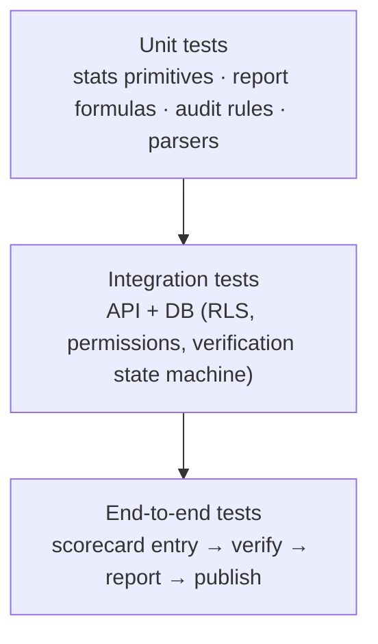

# 34. Automated Testing Strategy

**Deliverable 34 of 38** · §33 ("test all statistical calculations")

Testing that makes **statistical correctness, integrity rules and workspace isolation**
release gates. Accuracy is the product's core promise, so the statistics engine is tested
hardest.

## 34.1 Test pyramid

## 34.2 Statistics engine (highest priority)

- **Golden fixtures:** curated matches with **hand-computed expected values** for every
  report in the RMCC catalogue (deliverable 23), captaincy (24) and partnerships (25).
- **Unknown/partial fixtures:** assert unknown ≠ zero, known-minimum flagging, exclusion
  (not zero-fill) of unknown values, and "insufficient data" outcomes.
- **Classification-split fixtures:** Home & Away vs Finals vs Grand Finals produce the
  right subsets.
- **No-double-counting assertions:** pairs/combinations counted once; aggregates match
  the sum of their parts.
- **Bowling-partnership fixtures** (confirmed method, deliverable 25 §25.3) — dedicated
  golden tests asserting: only matches where **every** member participated are counted;
  a member who played with 0 wickets still qualifies (match counts, contributes 0);
  matches with any member absent are **excluded**; multi-innings matches count **once**
  with innings summed; **run-outs/non-bowler dismissals are excluded**; 2-, 3- and
  4-player combinations; total, matches-together, average-per-match, first/last qualifying
  match; classification + grade/season/competition filters; known-minimum flagging when a
  member's figures are incomplete. The worked example in §25.3 is a required fixture.
- **Dismissal-type fixtures** (confirmed CS legend, deliverable 16 §16.8) — one test per
  **confirmed** type (dnb, not_out, bowled, caught, caught_and_bowled, lbw) and per
  **inferred** type (ct_behind, run_out, stumped, retired, unknown_out) asserting correct
  **bowler credit** (none for run-out & other non-bowler dismissals), **batting-average
  treatment** (not_out/dnb excluded; out included), **fielder/keeper credit**, and that
  **caught_and_bowled yields exactly one bowler wicket + one fielding credit** (no double
  count). Plus an **unresolved-code fallback** test (CS 20/22/23/24 → out of unknown
  manner, no bowler/fielder credit, flagged — never guessed).
- **Overs-conversion fixtures:** `5.3` overs @ 6 balls/over → 33 deliveries (not 31.8);
  economy/strike-rate use converted balls.
- **Statistical-inclusion fixtures:** a Verified match with `include_in_statistics=false`
  is **excluded** from reports; a Verified-Partial match is included within its scope.
- **Retired-Not-Out fixture:** `how_out = retired_not_out` (CS code 20) is **not** a wicket
  and **not** in the batting-average denominator; an innings with 8 dismissals + 1
  retirement reconciles to 8 wickets.
- **Keeper-catch fixture:** a `caught` dismissal whose fielder is the recorded wicketkeeper
  counts as a keeper catch (fielding-catch reports exclude it); keyed on fielder role, not a
  code.
- **Player Identity Management fixtures (required, deliverable 12 §12.3a)** — the confirmed
  real examples and the merge lifecycle:
  - **A. Two "Bonner A" stay separate** — distinct `person_id`s in one innings; totals never
    combined; shared name alone raises no finding; can be marked *Definitely Different* and
    then never re-suggested.
  - **B. Two "Walker D" merge** — "Daniel Walker" + "D Walker" (RMCC) merge to one canonical
    person; both source IDs retained; career stats **recalculated from match records**.
  - **C. Same-match conflict** — two source records in one match block finalisation unless
    resolved as separate appearances; no auto-combine.
  - **D. Undo/split merge** — reversal restores original identities, performances, source
    IDs and audit history.
  - **E. Re-import after merge** — confirmed mappings reused; resolved duplicates not
    recreated; Definitely-Different pairs not re-suggested.
  - **F. Recalculation without double counting** — a merged person counts **once per match**;
    career totals match a from-records recompute, not a sum of prior totals.
- Each primitive aggregator and each derived metric has its own unit tests.

## 34.3 Integrity & workflow

- **Audit rules:** each rule (deliverable 15) tested for true/false positives, including
  unknown-aware cases (no Critical on unknowns).
- **Verification state machine** (deliverable 14): legal/illegal transitions; verified
  data not silently overwritten; Verified Partial scope respected.
- **Importers/connectors** (deliverables 16–17): parse real sample files into staging;
  mapping, validation, duplicate detection, identity-match suggestions, rollback.
- **Discovery & web scraping** (deliverable 18): adapter extraction from fixture HTML/PDF
  into candidates with **confidence + provenance** (source URL, publication details,
  retrieval date); **OCR uncertainty preserved** (unclear text flagged, not fabricated);
  **compliance** (robots/rate-limit/backoff honoured; gated sources not scraped); **no
  player merge on name alone**; approve/reject/defer with audit; resumable/scheduled jobs.
- **Historical Research Timeline** (deliverable 19 §19.6): season classification
  (comprehensive/partial/significant-gaps/**unassessed when evidence insufficient — never a
  fabricated %**); **completeness ≠ verification**; **confirmed-inactive vs missing-evidence**
  distinguished; a fully-recorded-but-no-fixture-list season is **not** Comprehensive;
  coverage **recalculated** after an approved import/correction/finding; assessment changes
  **audited**.
- **Cricket Statz JSON importer** (deliverables 16, 16a): the sample import test cases
  **T1–T21** (deliverable 16 §16.6) are required golden fixtures — DOB/`0`/`Balls=0`/
  `Howout=0` sentinels map to unknown (never zero, never a dismissal/duck/"player 0");
  classification **provisional** (Final/GF flags absent from JSON, not inferred from round
  alone); derived innings totals; **cricket-over conversion**; **incomplete fall-of-wicket**
  → partnerships known-minimum, not fabricated; **innings override** fields absent →
  derived totals; lossy-export fields (margin/sub-result/D/L/exclude-from-stats/Captain2)
  imported as unknown/flagged; idempotent re-import on `source_ref`; verified records not
  overwritten; duplicate names kept distinct. **Fixtures are synthetic reproductions — the
  real RMCC file is never committed** (deliverable 4, §33).

## 34.4 Security & isolation (release gate)

- **Workspace isolation:** cross-workspace read/write attempts denied at service and RLS
  layers (deliverable 6); "no unscoped query" CI check.
- **Permissions:** each protected action allowed/denied per role (deliverable 7).
- **Privacy:** junior/DOB fields excluded from Viewer/public/portal responses
  (deliverables 24, 30, 33).

## 34.5 Tooling

| Layer | Tooling |
|---|---|
| Backend unit/integration | **pytest** (+ factory fixtures); test DB per run |
| DB/RLS | optional **pgTAP** for policy-level tests |
| Frontend unit/component | **Vitest** + Testing Library |
| End-to-end | **Playwright** (desktop webview flows) |
| Contract | OpenAPI schema → generated TS types kept in sync (deliverable 4) |

## 34.6 CI & gates

- CI runs the full suite on every PR; builds the Windows installer artifact.
- **Release gates:** statistics golden tests, isolation tests, permission tests must pass.
- Coverage targets emphasise the engine, audit rules and isolation over raw percentage.
- Each approved `[DECISION Dn]` that changes a formula updates the corresponding golden
  fixtures (the docs + tests are the contract).

## 34.7 Test data policy

Test fixtures are **synthetic** (no real personal data in the repo, deliverable 4);
real RMCC samples used for importer development stay outside version control.
