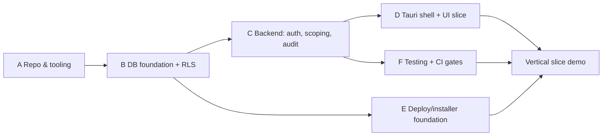

# 35. Detailed Phase 2 Implementation Plan

**Deliverable 35 of 38** · §31 Phase 2 (Windows Desktop & Server Foundation)

The concrete, buildable plan for Phase 2 — the foundation everything else sits on. Starts
**only after architecture approval**. No Phase 2 code exists yet.

## 35.1 Objective

Stand up the end-to-end skeleton: a Tauri+React desktop app talking to a bundled
FastAPI service, backed by PostgreSQL (schema v1 with workspace isolation + auth +
audit), with migrations, tests, CI and a signed Windows installer — proving the whole
architecture in miniature with a trivial vertical slice.

## 35.2 Workstreams & tasks

### A. Repository & tooling
- `git init` at `C:\OneProjects\OneStats`; create the monorepo layout (deliverable 4);
  `.gitignore` (secrets/data excluded).
- Frontend: pnpm + Vite + React + TS + Tailwind + shadcn/ui.
- Backend: Python 3.12 env (uv, `[DECISION D8]`) + FastAPI + Pydantic v2 + SQLAlchemy 2 +
  Alembic.
- CI skeleton: lint, test, build installer.

### B. Database foundation
- Connect as `onestats_app` to `onestats` (creds from Windows Credential Manager; **no
  plaintext**).
- Alembic migration **v1**: `workspace`, `app_user`, `role`, `permission`,
  `role_permission`, `app_user_workspace_role`, `audit_log`, plus a trivial domain table
  to exercise isolation.
- **Row-Level Security** policies keyed on a session workspace GUC (deliverable 6).
- Reference/enum seed (non-production).

### C. Backend service
- App factory, config, health endpoint.
- Auth (login, password hashing, session/token) + permission dependency.
- Workspace-scoping data-access layer (sets RLS GUC; injects `workspace_id`).
- Audit-log writer on sensitive actions.
- OpenAPI schema → generated TS types.

### D. Desktop shell + UI
- Tauri 2 shell: window, auto-updater config, **Python sidecar lifecycle**, Credential
  Manager access (`[DECISION D7]` PyInstaller packaging).
- React app shell: six-section nav (deliverable 10) as empty routed screens; workspace
  switcher; branding token system (deliverable 9) wired to CSS variables.
- Typed API client; login screen; one trivial end-to-end CRUD screen (vertical slice).

### E. Deployment foundation
- "Set Up New System" vs "Connect to Existing" installer flows (deliverable 31) — minimal.
- TLS for client↔API on LAN (`[DECISION D18]`).
- Pre-migration backup hook; scheduled `pg_dump` job stub (deliverable 32).

### F. Testing foundation (deliverable 34)
- pytest + test DB; isolation + permission tests on the skeleton; Vitest + Playwright
  smoke; CI gates.

## 35.3 Vertical slice (definition of a working foundation)

A Super Admin logs in → creates a workspace (onboarding stub) → a scoped user logs in →
creates/reads one trivial workspace-scoped record → the action is audited → a
cross-workspace access attempt is denied at both service and RLS layers → all via the
packaged desktop app against the bundled service and PostgreSQL. CI builds a signed
installer.

## 35.4 Sequence

## 35.5 Exit criteria (Phase 2 done)

- [ ] Monorepo + CI building a signed Windows installer.
- [ ] Desktop app launches, starts the bundled FastAPI sidecar, connects to PostgreSQL as
      `onestats_app` (creds from Credential Manager, no plaintext).
- [ ] Alembic v1 schema with workspace isolation (service + RLS) proven by tests.
- [ ] Auth + role/permission enforcement + audit log working on the slice.
- [ ] Branding token system themes the shell.
- [ ] Vertical slice (§35.3) passes end-to-end; isolation/permission tests are green gates.
- [ ] Backup job stub + pre-migration backup hook present.

## 35.6 Prerequisites from the user before/early in Phase 2

- Approval of the architecture and the key decisions (deliverable 37), especially D1, D2,
  D7.
- `onestats_app` password available via the Credential Manager setup.
- (Can trail into Phase 8) PlayHQ API access + real Cricket Statz samples for RMCC.
